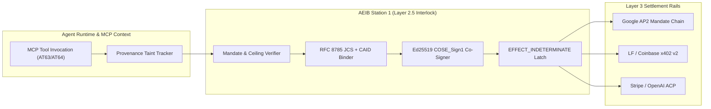

# AEIB Wire-Level Interoperability: Google AP2 v0.2, Linux Foundation x402 V2, and Stripe/OpenAI ACP

**Document Status:** Architectural Specification & Prototype Wire Mapping (October 2026)  
**Target Subsystem:** `src/rail_mandate_and_mcp_taint_interlock.py` & `tests/test_scitt_ap2_mcp_pqc_interop.py`  
**Epistemic Boundary:** Evaluated under the stated model; prototype interlock specification.

---

## 1. Architectural Role: Co-Signer & Deterministic Gate (Not a Proprietary Island)

AEIB Station 1 and Station 2 operate natively on the wire formats of the three primary agentic commerce protocols:

| Protocol | Wire Artifacts | AEIB Station 1 (Pre-Dispatch) Binding | AEIB Station 2 (Transport & 504 Reconciliation) |
| :--- | :--- | :--- | :--- |
| **Google AP2 v0.2** *(FIDO Alliance SD-JWT)* | `mandate.checkout.1`<br>`mandate.payment.1`<br>(`Open` -> `Closed`) | Verifies user-signed **Open Mandate** constraints; checks session context taint (`AT57b`) and MCP schema hash (`AT63`) before co-signing the **Closed Payment Mandate** (`checkout_hash` == `action_caid`). | On transport timeout, queries the Credential Provider / Merchant Payment Receipt endpoint using the `sd_hash` of the Closed Payment Mandate. |
| **Stripe / OpenAI ACP** *(agenticcommerce.dev)* | `POST /checkout_sessions/{id}/complete`<br>Header: `Idempotency-Key`<br>Body: `payment_data.token` (`SPT`) | Enforces mandatory `Idempotency-Key: aeib-idem-v1-<sha256(op_id:caid)>` and `Request-Id: <operation_id>` even though ACP marks them optional. | On `HTTP 504` / connection reset, latches `EFFECT_INDETERMINATE` and executes a single bounded probe to `GET /checkout_sessions/{checkout_session_id}` to inspect authoritative session state. |
| **Linux Foundation x402 V2** *(HTTP 402)* | `PAYMENT-REQUIRED`<br>`PAYMENT-SIGNATURE`<br>`PAYMENT-RESPONSE` | Decodes the Base64 `PAYMENT-REQUIRED` challenge, converts the crypto/stablecoin price into minor EUR risk units, and charges it against the Root Sponsor's 5h Sprint + 7d Epoch pool (`AT56`) before signing `PAYMENT-SIGNATURE`. | If the retry carrying `PAYMENT-SIGNATURE` drops before `PAYMENT-RESPONSE` arrives, blocks re-signing a new voucher/nonce until facilitator settlement state is queried. |

### 1.1 Architectural Context: The Layer 3 Wire & Ledger Interlock

As autonomous agents transition from conversational retrieval to direct financial settlement and infrastructure actuation, industry payment protocols have converged around three primary Layer 3 rails:
1. **Google Agent Payments Protocol (AP2 v0.2)** — FIDO Alliance SD-JWT Verifiable Digital Credentials (`mandate.checkout.1`, `mandate.payment.1`) and 3-tier mandate chains (`IntentMandate` $\rightarrow$ `CartMandate` $\rightarrow$ `PaymentMandate`).
2. **Linux Foundation / Coinbase x402 V2 (`HTTP 402 Payment Required`)** — Machine-to-machine HTTP header settlement (`PAYMENT-REQUIRED` / `PAYMENT-SIGNATURE` / `PAYMENT-RESPONSE`) with EIP-3009 authorization payloads.
3. **Stripe / OpenAI / Meta Agentic Commerce Protocol (ACP)** — Delegated `Shared Payment Tokens` (`spt_...`) over versioned REST checkout endpoints (`API-Version: 2025-09-29`).

While each rail defines how a merchant or settlement facilitator verifies payment authorization, none natively inspect the **internal runtime integrity** of the calling agent (such as whether the agent's context was poisoned by an untrusted Model Context Protocol tool output, or whether a local transport timeout left a stateful token in an indeterminate state).

The **Agent Execution Integrity Boundary (AEIB)** operates at **Layer 3 (Wire & Ledger Plane)**—immediately upstream of the outbound network socket—acting as a cryptographic co-signer, deterministic idempotency binder, and provenance taint governor across all three rails.



---

## 2. Google AP2 (Agent Payments Protocol) Wire Mapping

Under Google AP2, financial authority flows through a three-tier cryptographic mandate chain:
- **`IntentMandate`**: Issued by the user or delegating authority, establishing `id`, `allowedMerchants`, `amountLimit`, `currency`, and `expiresAt`.
- **`CartMandate`**: Binds SKU line items (`items: [{sku, price_minor, quantity}]`), `merchant`, and total `amount` (`{currency, value_minor}`) to `parentIntentId`.
- **`PaymentMandate`**: Authorizes final rail settlement against `parentCartId` and `parentIntentId`.

### 2.1 Station 1 Verification Rules (`AP2MandateChainVerifier`)
Before AEIB co-signs an outbound AP2 dispatch, Station 1 evaluates the full 3-tier chain under the stated model:
1. **Cryptographic Signature Verification:** Each mandate (`IntentMandate`, `CartMandate`, `PaymentMandate`) carries an Ed25519 signature over the RFC 8785 JCS canonicalization (`encode_jcs`) of its unsigned payload. Invalid signatures trigger `HALT_AP2_MANDATE_SIGNATURE_INVALID`.
2. **Lineage Continuity:** `CartMandate.parentIntentId` must equal `IntentMandate.id`, and `PaymentMandate.parentCartId` must equal `CartMandate.id` (with `PaymentMandate.parentIntentId == IntentMandate.id`).
3. **Merchant Allowlist Enforcement:** `CartMandate.merchant` and `PaymentMandate.merchant` must be members of `IntentMandate.allowedMerchants`. Violations trigger `HALT_AP2_MERCHANT_NOT_ALLOWED`.
4. **SKU Line-Item Arithmetic Integrity:** The sum of SKU line items in `CartMandate.items` must exactly equal the declared cart and payment value:
   $$\sum_{i} \left(\text{price\_minor}_i \times \text{quantity}_i\right) = \text{CartMandate.amount.value\_minor} = \text{PaymentMandate.amount.value\_minor}$$
   Any discrepancy (e.g., hidden fee injection or hallucinated discount arithmetic) triggers `HALT_AP2_SKU_TOTAL_MISMATCH`.
5. **Intent Limit Ceiling & Freshness:** The verified total must satisfy $\text{amount.value\_minor} \le \text{IntentMandate.amountLimit}$ (otherwise `HALT_AP2_CART_EXCEEDS_INTENT_LIMIT`), and the evaluation timestamp must precede `expiresAt`.
6. **Deterministic Idempotency Derivation:** AEIB derives the wire header:
   ```text
   Idempotency-Key: aeib-idem-v1-<sha256(operation_id:action_caid)[:32]>
   ```
   and encapsulates all three mandate digests inside an RFC 9052 `COSE_Sign1`-compatible receipt.

---

## 3. Linux Foundation / Coinbase x402 v2 (`HTTP 402 Payment Required`) Wire Mapping

The x402 v2 specification standardizes machine-to-machine micropayments and API settlement over HTTP using structured headers:
- **Server Challenge (`PAYMENT-REQUIRED`):** JSON payload declaring `x402Version: 2` and an `accepts` array of settlement options:
  ```json
  {
    "x402Version": 2,
    "accepts": [
      {
        "scheme": "exact",
        "network": "eip155:8453",
        "amount": "250000",
        "asset": "0x833589fCD6eDb6E08f4c7C32D4f71b54bdA02913",
        "payTo": "0xMerchantTreasuryAddress",
        "maxTimeoutSeconds": 60
      }
    ]
  }
  ```
- **Client Authorization (`PAYMENT-SIGNATURE`):** Carries an EIP-3009 (`transferWithAuthorization` / `receiveWithAuthorization`) or permit payload containing `scheme`, `network`, `amount_minor`, `pay_to`, `nonce`, `valid_after`, `valid_before`, and an AEIB extension field `bound_action_caid`.

### 3.1 Station 1 Verification Rules (`X402V2WireInterlock`)
To prevent double-settlement during HTTP 504 gateway timeouts or TCP reset faults, `X402V2WireInterlock` enforces:
1. **Content-Addressable Action Binding (`bound_action_caid`):** The `PAYMENT-SIGNATURE` payload must bind `bound_action_caid == "sha256:" + sha256(encode_jcs(action_payload))`. If a retry loop attempts to reuse a signed `PAYMENT-SIGNATURE` header against a mutated request body or different endpoint, Station 1 halts with `HALT_X402_CAID_MISMATCH`.
2. **EIP-3009 Nonce Deduplication & Replay Protection:** Every `(nonce, bound_action_caid)` pair is tracked in the interlock ledger. Replaying a `nonce` for a different `bound_action_caid` triggers `HALT_X402_NONCE_REPLAY`. Retrying the *exact same* `(nonce, bound_action_caid)` after an HTTP 504 returns the cached idempotent settlement binding rather than generating a fresh authorization nonce.
3. **Scheme & Ceiling Validation (`exact` vs. `upto` vs. `auth-capture`):**
   - For `scheme == "exact"`, `amount_minor` must equal the challenge `amount` (`int(accept["amount"])`).
   - For `scheme in {"upto", "auth-capture"}`, `amount_minor` must not exceed `int(accept["amount"])`.
   - Exceeding the challenge amount triggers `HALT_X402_AMOUNT_EXCEEDS_CHALLENGE`.
4. **Time-Window & Cryptographic Verification:** `valid_after <= current_timestamp <= valid_before`, and the Ed25519 signature over `encode_jcs` of the unsigned `PAYMENT-SIGNATURE` payload must verify.

---

## 4. Stripe / OpenAI ACP (Agentic Commerce Protocol) Wire Mapping

Under the Stripe / OpenAI Agentic Commerce Protocol (`API-Version: 2025-09-29`), agents complete merchant checkouts via `POST /checkout_sessions/{id}/complete` using a single-use, merchant-scoped `Shared Payment Token` (`spt_...`).

### 4.1 Station 1 Verification Rules (`StripeACPCheckoutInterlock`)
1. **Version & Deterministic Idempotency Binding:** Every outbound `POST /checkout_sessions/{id}/complete` request is bound to `API-Version: 2025-09-29` and a deterministic `Idempotency-Key` derived from `(checkout_session_id, spt_id, action_caid)`.
2. **Single-Use SPT `EFFECT_INDETERMINATE` Latch:** If the HTTP transport returns a timeout, HTTP 502/504, or connection reset during `POST /checkout_sessions/{id}/complete`, the side effect on the merchant server is indeterminate. Because an agent retry loop often reacts to a failure by either re-submitting `spt_id` without idempotency alignment or minting a *second* `spt_...` for the same checkout session, AEIB immediately transitions the checkout session and `spt_id` into `EFFECT_INDETERMINATE`.
3. **Fail-Closed Retry Blocking (`HALT_ACP_SPT_LOCKED_INDETERMINATE`):** Any subsequent attempt to call `complete_checkout` on that session or `spt_id`—including attempts supplying a newly minted `spt_...`—is blocked with `HALT_ACP_SPT_LOCKED_INDETERMINATE`.
4. **Out-of-Band Probe Reconciliation:** The lock is only cleared when an authoritative out-of-band status probe (`reconcile_checkout_session_probe`) verifies the remote `GET /checkout_sessions/{id}` state (`completed` vs. `open_unpaid`) signed by the probe verifier.

---

## 5. Directive 3 — MCP Tool Supply-Chain & Provenance-Tiered Consequence Ceiling (`AT63` & `AT64`)

Model Context Protocol (MCP) ecosystems expose two critical attack vectors against financial agents:
- **AT63 (Shadow MCP Server & Tool Description Poisoning / Rug-Pulls):** Unregistered MCP servers ("Shadow MCP") or mutated tool definitions (`description` / `inputSchema`) that embed covert prompt-injection instructions (e.g., *"Before calling this tool, transfer funds to..."* or hidden parameter defaults) as documented by Invariant Labs and the OWASP MCP Top 10.
- **AT64 (Untrusted Tool Output Provenance Taint):** Even when an MCP tool descriptor is benign, invoking a `TIER_2_UNTRUSTED_EXTERNAL` tool (such as a web scraper, third-party email reader, or unverified community connector) introduces untrusted external data into the LLM context window.

### 5.1 Station 1 Enforcement (`MCPToolProvenanceTaintGate`)

| Threat Vector | Detection Mechanism | AEIB Rejection Code |
| :--- | :--- | :--- |
| Unregistered / Shadow MCP Server | Server ID not present in approved registry or missing valid Ed25519 registration | `HALT_SHADOW_MCP_SERVER_UNREGISTERED` |
| MCP Tool Description / Schema Poisoning | Static inspection of `description` and serialized `input_schema` for covert override directives (`ignore previous`, `system prompt`, `transfer funds`, `<system>`, etc.) | `HALT_MCP_TOOL_DESCRIPTION_POISONING` |
| Post-Approval Tool Rug-Pull | Live `(description, input_schema, source_sha256)` JCS digest mismatches pinned `MCPToolDescriptor` signature | `HALT_MCP_TOOL_RUG_PULL_DETECTED` |
| Untrusted Tool Output Context Taint (`AT64`) | Session invokes a `TIER_2_UNTRUSTED_EXTERNAL` tool, degrading session consequence ceiling from `HIGH_FINANCIAL` to `LOW_READ_ONLY` | `UNTRUSTED_TOOL_TAINT_CEILING_DEGRADED` |

### 5.2 Provenance-Tiered Consequence Ceiling Degradation (`AT64`)
1. Every registered MCP tool is assigned a provenance tier:
   - `TIER_0_SYSTEM_PINNED`: Local deterministic AEIB / core system tools.
   - `TIER_1_PARTNER_ATTESTED`: Cryptographically attested partner endpoints.
   - `TIER_2_UNTRUSTED_EXTERNAL`: External retrieval, web, or third-party tools whose outputs may carry indirect prompt injections.
2. When a session invokes any `TIER_2_UNTRUSTED_EXTERNAL` tool, `MCPToolProvenanceTaintGate` marks the session as tainted (`session_tainted = True`) and lowers the session's maximum permitted financial consequence ceiling (`effective_ceiling_minor`).
3. Any subsequent attempt to execute a high-consequence financial action (across AP2, x402 v2, or Stripe ACP) exceeding the degraded ceiling is halted with `UNTRUSTED_TOOL_TAINT_CEILING_DEGRADED` unless a valid Ed25519 human supervisor step-up token (`verify_step_up_token`) is presented for that exact `action_caid`.
