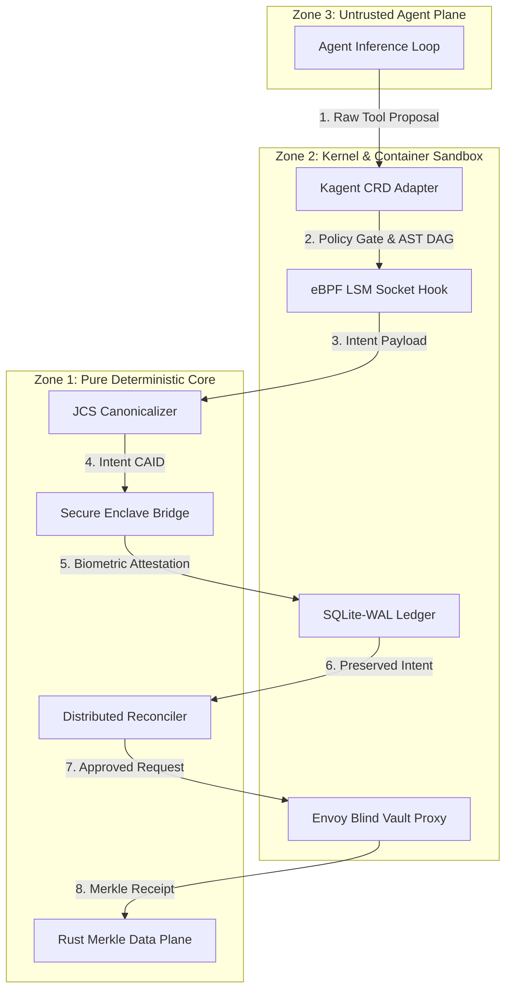

<!--
Common Criteria ISO/IEC 15408 Evaluation Package
Document: 02_TOE_DESIGN_ADV_TDS_3.md
Status: INTERNAL PREVIEW COMMISSIONED
Assurance Component: ADV_TDS.3 (Basic Modular Design)
-->

# ADV_TDS.3: TOE Design & Physical Zone Separation

**Target of Evaluation (TOE):** SovereignNexus Agent Execution Integrity Boundary (AEIB v1.1)  
**Assurance Level:** EAL4 Augmented (ALC_FLR.2 + AVA_VAN.4)  
**Status:** `INTERNAL PREVIEW COMMISSIONED`  

---

## 1. Architectural Overview & Subsystem Decomposition

The AEIB v1.1 architecture enforces modularity through three discrete physical execution zones. Modules within each zone communicate only through formalized, typed interfaces with cryptographic validation:

```
┌────────────────────────────────────────────────────────────────────────┐
│                              ZONE 3                                    │
│             UNTRUSTED INFERENCE & EXTERNAL NETWORKS                    │
│   • Generative LLMs (DeepSeek / Gemini / Claude)                       │
│   • Raw Prompt Synthesizers & Tool Speculators                         │
│   • Upstream Public Internet & External API Gateways                   │
└───────────────────────────────────┬────────────────────────────────────┘
                                    │ Unauthenticated Tool Calls
                                    ▼
┌────────────────────────────────────────────────────────────────────────┐
│                              ZONE 2                                    │
│                 SANDBOXED KERNEL & CONTAINER PLANE                     │
│   • gVisor / microVM Container Sandbox (`kagent_crd_adapter.py`)       │
│   • eBPF LSM Policy Hooks (`crates/aeib-ebpf-lsm`)                     │
│   • Local SQLite-WAL State Store (`multi_region_edge_latch_mesh.py`)   │
│   • Blind Credential Proxy (`substrate_cube_interlock.py`)             │
└───────────────────────────────────┬────────────────────────────────────┘
                                    │ Pure Serialized Payloads & Signatures
                                    ▼
┌────────────────────────────────────────────────────────────────────────┐
│                              ZONE 1                                    │
│              PURE DETERMINISTIC CORE & HARDWARE ENCLAVE                │
│   • RFC 8785 Canonicalization (`jcs_canonicalizer.py`)                │
│   • Apple Secure Enclave & TPM 2.0 (`iphone_enclave_notary_bridge.py`) │
│   • Monotonic Merkle Consensus (`crates/aeib-data-plane`)              │
│   • Distributed Reconciler (`distributed_agentgateway_reconciler.py`)  │
└────────────────────────────────────────────────────────────────────────┘
```

---

## 2. Physical Zone Invariants

### Zone 1: Pure Deterministic Core (Mathematical Root of Trust)
* **Execution Environment:** In-memory, strictly deterministic algorithms.
* **Prohibitions:** Zero network socket calls, zero filesystem mutation (read-only configuration), zero non-canonical floating point math.
* **Responsibilities:**
  1. Cryptographic canonicalization and Content-Addressed Intent ID (CAID) calculation.
  2. Monotonic attempt counter validation against hardware-backed notary chips.
  3. Merkle tree batch root generation and consistency verification.
  4. Cross-region distributed jitter calculation and idempotency deduplication.

### Zone 2: Sandboxed Kernel & Local Persistence Plane
* **Execution Environment:** Containerized sandboxes (gVisor runsc or microVMs) governed by Linux eBPF LSM hooks.
* **Prohibitions:** Raw outbound egress to unauthorized IPs; access to plain text secret vaults.
* **Responsibilities:**
  1. Write-Before-Execute intent logging to SQLite-WAL (<5ms local latency).
  2. Dynamic placeholder substitution (`{{VAULT:KEY}}`) via Envoy egress proxy.
  3. Interception of file opens (`security_file_open`) and socket connects (`security_socket_connect`).

### Zone 3: Untrusted Inference Plane
* **Execution Environment:** External model inference services and user-facing prompt generators.
* **Responsibilities:** Generating non-deterministic tool proposals and intent payloads. The TOE treats Zone 3 as completely untrusted.

---

## 3. Subsystem Modularity & Data Flow


