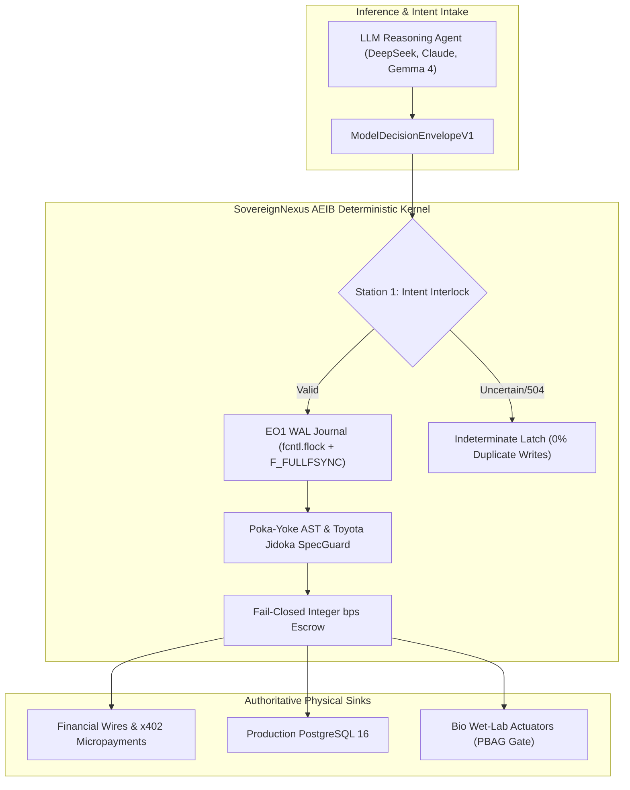
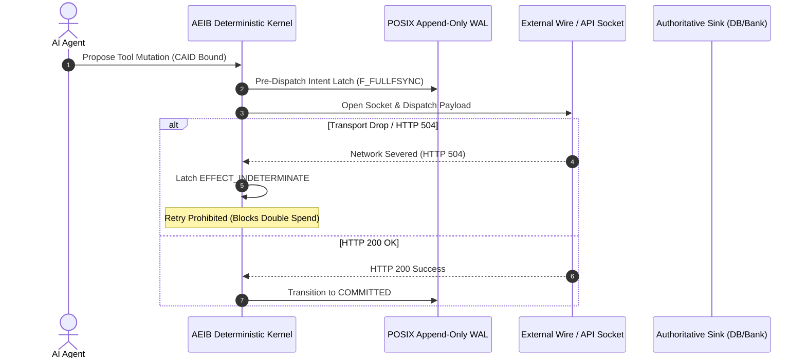
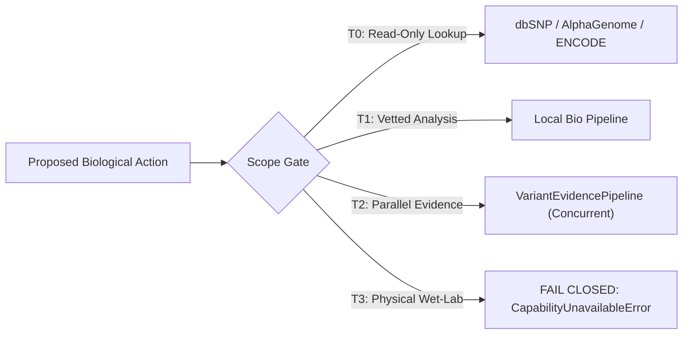

# SovereignNexus Visual Architecture, Mermaid Schematics & UI Blueprints

> **Classification:** Visual System Maps, Sequence Flows, State Machines & UI Walkthroughs

> **Target Notebook:** `https://notebook.google.com/notebook/e1b91409-02f9-4300-8bf7-5dfd4426dd16`

## 1. High-Level Macro Architecture

## 2. 6-Stage Execution Lifecycle & Post-Commit Wire Trap

## 3. Biological Action Gating & Scope Bisection (PBAG)

## 4. UI Layout Blueprints & Human-in-the-Loop Architecture

- **01-home.png**: Executive Command Center showing global fleet health, active budget escrows, and real-time fault rates.

- **02-governance-dashboard.png**: Regulatory compliance monitor mapping DORA Article 17, EU AI Act Article 12, and SCITT receipts.

- **03-security-view.png**: Forensic investigation console tracing 504 timeout recovery, CAID verification, and blocked duplicate retries.

- **04-creator-platform.png**: Agent deployment workbench configuring capability scopes, budget ceilings, and step-up warrants.