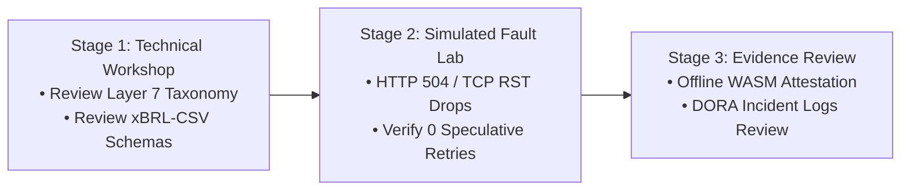

# 📦 AEIB v0.4.0: Zenodo DOI Deposit & ČAS / CzechInvest Sandbox Submission Pack
### Bounded Synthetic Benchmark and Local Runtime Reference for Agent Effect-Integrity Evidence

---

## Part I: Zenodo DOI Deposit Process & Publication Payload

### 1. Release Manifest & Distribution Assets (Recomputed & Audited)
* **Package Label**: **AEIB v0.4.0 — Bounded Synthetic Benchmark and Local Runtime Reference for Agent Effect-Integrity Evidence**
* **Release Version**: `v0.4.0`
* **Target Repository**: [Zenodo (CERN / OpenAIRE)](https://zenodo.org/)
* **Distribution Archive**: [`dist/aeib-v0.4.0-cleanroom.tar.gz`](file:///Users/andriileukhin/Documents/SovereignNexus/dist/aeib-v0.4.0-cleanroom.tar.gz)
* **Archive Size**: `371,213 bytes` (verified via `ls -l`)
* **Archive SHA-256**: `6d52b322aeee795e445db4d8692f0ce3ca71157f718128746a1e8264faf61363` (verified via `shasum -a 256`)
* **Offline WASM Verifier**: [`dist/smaos_verify.wasm`](file:///Users/andriileukhin/Documents/SovereignNexus/dist/smaos_verify.wasm) (`199,770 bytes`, SHA-256: `6ecc360af19008632c950d94910b70220e3c2cc36a5cc29fe0c33ba64d2bb041`)
  * *Note: Designed for offline verification; network isolation must be verified in the execution environment.*
* **Licensing**: Split/Dual Licensing:
  * Software, verifier, and test harness: `Apache-2.0`
  * Specifications, schemas, and benchmark reports: `Creative Commons Attribution 4.0 International (CC-BY-4.0)`
* **Author / Principal**: Andrej Leukhin (`andrejlo123@gmail.com`), ORCID: [`0009-0004-9543-8263`](https://orcid.org/0009-0004-9543-8263)
* **Affiliation**: SovereignNexus, Prague, Czech Republic
* **Repository**: [`https://github.com/sovreignnexus/smaos`](https://github.com/sovreignnexus/smaos)

---

### 2. Machine-Readable Zenodo Metadata Payload (`.zenodo.json`)

```json
{
  "title": "AEIB v0.4.0: Bounded Synthetic Benchmark and Local Runtime Reference for Agent Effect-Integrity Evidence",
  "description": "AEIB v0.4.0 is a bounded synthetic benchmark and execution-evidence proposal prepared for independent reproduction. It evaluates how a gateway handles state-changing agent actions when transport outcomes become ambiguous. The package binds a unique operation to an exact request, records typed transport and effect dispositions, removes retry authority after uncertain dispatch, and reconciles target state where a declared status source exists.\n\nTrack B uses a target-side ledger oracle rather than agent self-report or browser-page text as the grading source. The package includes schemas, reference harnesses, comparative artifacts, negative tamper tests, and an offline verifier. Results are reported by the producing environment. Real third-party API behavior, live TinyFish execution, universal exactly-once behavior, deployment readiness, and regulatory compliance are not established.\n\nThe package contains the scenario suites listed below; exact test counts are provided in the machine-readable manifest:\n- Track B (Web-Mutation Wire Faults): 11 scenarios (B01–B11)\n- Extended Edge Cases: 7 scenarios (BT12–BT18)\n- Governance Boundary Tests: 11 scenarios (AT15–AT25)\n- MCP Egress & Federation: 7 scenarios (AT30–AT36)\nTotal test cases: 36 core execution-evidence scenarios across 36 scenario IDs.\n\nKey Deliverables:\n1. aeib-bench v0.1: Synthetic benchmark evaluating agent runtime behavior against an independent target-side ledger oracle.\n2. Identity Triad Specification: Separates unique intent instance (operation_id) from exact request hash (request_digest) and target idempotency identity (business_idempotency_key).\n3. Prior-Art Adjusted Integration: Explicitly positioned against LIMBO (arXiv:2609.29095), RFC 9110 HTTP semantics, and OpenTelemetry GenAI semantic conventions (proposing gen_ai.effect_disposition event projection).\n4. AEIB Gateway Adapter and AEIB PAP Adapter Proposal: Reference control-plane adapter enforcing RFC 8785 JCS payload binding, fail-closed uncertainty latching (retry_safe: false), single-flight out-of-band target probe coalescing, real Ed25519 cryptographic receipts, and decoupled human release separation.\n5. Regulated Evidence Export Reference: Supporting telemetry generation designed to inform DORA (Regulation (EU) 2022/2554) Article 17 incident timeline logs, Article 28(3) Register of Information templates (RT.01.01–RT.02.03 xBRL-CSV), EU AI Act Article 14/50 evidence workflows, and SCITT-compatible evidence architecture (RFC 9943).\n\nLocked Milestone Claim:\nUnder the declared synthetic Track B scenarios, the harness matched gateway dispositions to an independent target-side ledger and issued no speculative retry in the tested ambiguous cases (11/11 reported synthetic scenarios matched the declared oracle).\n\nLicensing Notice:\nCode, test harnesses, and verifiers are licensed under Apache-2.0. Specifications, documentation, and benchmark reports are licensed under Creative Commons Attribution 4.0 International (CC-BY-4.0). See per-directory LICENSE files for terms.",
  "version": "v0.4.0",
  "upload_type": "software",
  "publication_date": "2026-10-08",
  "access_right": "open",
  "license": "Apache-2.0",
  "creators": [
    {
      "name": "Leukhin, Andrej",
      "affiliation": "SovereignNexus",
      "orcid": "0009-0004-9543-8263",
      "email": "andrejlo123@gmail.com"
    }
  ],
  "keywords": [
    "Agentic AI",
    "Autonomous Systems",
    "Execution Finality",
    "GIRAI 2026",
    "LIMBO Prior Art",
    "DORA Regulation (EU) 2022/2554",
    "EU AI Act Article 50",
    "RFC 8785 JCS",
    "IETF SCITT RFC 9943",
    "OpenTelemetry GenAI",
    "Retry Suppression",
    "Uncertainty Latching",
    "Target-Side Ledger Benchmark",
    "WebAssembly Verifier",
    "Personal Agent Protocol"
  ],
  "notes": "Status: AEIB v0.4.0 is a bounded synthetic benchmark and execution-evidence proposal, with reported passing tests and a prior-art-adjusted claim set, prepared for independent reproduction.\nWASM Verifier: dist/smaos_verify.wasm (199,770 bytes, SHA-256: 6ecc360af19008632c950d94910b70220e3c2cc36a5cc29fe0c33ba64d2bb041)\nDistribution Archive SHA-256: 6d52b322aeee795e445db4d8692f0ce3ca71157f718128746a1e8264faf61363 (371,213 bytes)\nLicensing: Dual-licensed / split-licensed: Apache-2.0 (Software, Test Harness, Verifier) and Creative Commons Attribution 4.0 International (CC-BY-4.0, Specifications, Schemas, Benchmark Reports).",
  "related_identifiers": [
    {
      "identifier": "arXiv:2608.09290",
      "relation": "references",
      "resource_type": "preprint"
    },
    {
      "identifier": "arXiv:2609.29095",
      "relation": "references",
      "resource_type": "preprint"
    },
    {
      "identifier": "arXiv:2609.35928",
      "relation": "references",
      "resource_type": "preprint"
    },
    {
      "identifier": "https://datatracker.ietf.org/doc/draft-schrock-canonical-action-identifier/",
      "relation": "references",
      "resource_type": "standard"
    },
    {
      "identifier": "https://github.com/sovreignnexus/smaos",
      "relation": "isSupplementTo",
      "resource_type": "software"
    }
  ]
}
```

---

### 3. Step-by-Step Deposit & Publication Workflow (Staging-First)

Zenodo publication is irreversible. To avoid publishing inaccurate metadata or unverified checksums, use this staging sequence:

```bash
# 1. Prompt for API access token securely (do not write to history or scripts)
echo -n "Enter Zenodo Personal Access Token: "
read -s ZENODO_ACCESS_TOKEN
echo ""

# 2. Verify all local archive digests before transmission
echo "[*] Auditing file checksums..."
sha256sum dist/aeib-v0.4.0-cleanroom.tar.gz
sha256sum dist/smaos_verify.wasm
sha256sum dist/verifier.html
sha256sum schemas/aeib-bench-web-v0.1.schema.json
sha256sum schemas/aeib_bench_v0.1_spec.json

# 3. Create a draft deposition record on Zenodo
DEPOSITION_ID=$(curl -s -X POST https://zenodo.org/api/deposit/depositions \
  -H "Authorization: Bearer $ZENODO_ACCESS_TOKEN" \
  -H "Content-Type: application/json" \
  -d '{}' | jq -r '.id')

echo "[+] Created Draft Deposition ID: $DEPOSITION_ID"

# 4. Upload files to draft deposition
curl -s -X POST "https://zenodo.org/api/deposit/depositions/$DEPOSITION_ID/files" \
  -H "Authorization: Bearer $ZENODO_ACCESS_TOKEN" \
  -F "file=@dist/aeib-v0.4.0-cleanroom.tar.gz" \
  -F "name=aeib-v0.4.0-cleanroom.tar.gz"

curl -s -X POST "https://zenodo.org/api/deposit/depositions/$DEPOSITION_ID/files" \
  -H "Authorization: Bearer $ZENODO_ACCESS_TOKEN" \
  -F "file=@dist/smaos_verify.wasm" \
  -F "name=smaos_verify.wasm"

# 5. Attach vetted metadata
curl -s -X PUT "https://zenodo.org/api/deposit/depositions/$DEPOSITION_ID" \
  -H "Authorization: Bearer $ZENODO_ACCESS_TOKEN" \
  -H "Content-Type: application/json" \
  -d "{\"metadata\": $(cat .zenodo.json)}"

# 6. Inspect draft record (STOP and verify before publishing)
curl -s -X GET "https://zenodo.org/api/deposit/depositions/$DEPOSITION_ID" \
  -H "Authorization: Bearer $ZENODO_ACCESS_TOKEN" | jq '{id: .id, title: .metadata.title, files: .files}'

# 7. Publish only after human review (IRREVERSIBLE)
# curl -s -X POST "https://zenodo.org/api/deposit/depositions/$DEPOSITION_ID/actions/publish" \
#   -H "Authorization: Bearer $ZENODO_ACCESS_TOKEN"
```

---

## Part II: ČAS / CzechInvest FinTech Sandbox II Formal Submission Pack

### 1. Transmission Details & Routing

**Date**: 8 October 2026  
**Sender**: Andrej Leukhin, Founder & Principal Systems Architect, SovereignNexus  
**Email**: `andrejlo123@gmail.com` | **ORCID**: `0009-0004-9543-8263`  
**Address**: Prague, Czech Republic  

**Official Recipients**:
1. **CzechInvest – FinTech Sandbox II Coordination Office**  
   Agentura pro podporu podnikání a investic CzechInvest  
   Štěpánská 15, 120 00 Praha 2, Česká republika  
   E-mail: `fintech@czechinvest.org` / Portal: `fintechsandbox.cz`  
   *Scope: Technical consultation on sandbox eligibility and fault-simulation testing charter; non-certifying inquiry.*
2. **Česká agentura pro standardizaci (ČAS) / ÚNMZ**  
   Technická normalizační komise TNK 156 (Umělá inteligence)  
   Biskupský dvůr 1148/5, 110 00 Praha 1, Česká republika  
   E-mail: `agentura@agenturacas.gov.cz` / Datová schránka: `4htvpem`  
   *Scope: Review of Layer 7 transport-fault taxonomy and evidentiary schemas for CEN/CENELEC JTC 21 input.*
3. **Separate Supervisory Submission**:  
   **Česká národní banka (ČNB)**  
   Odbor dohledu nad finančním trhem – FinTech kontaktní místo  
   *Transmitted via ČNB's official specialized FinTech web form:*  
   [`https://www.cnb.cz/en/public/contacts/form-for-submitting-specialised-fintech-related-queries/`](https://www.cnb.cz/en/public/contacts/form-for-submitting-specialised-fintech-related-queries/)  

**Subject**:  
**Technical Consultation Request: Evaluating Whether a Deterministic Effect-Integrity and Evidence Workflow Can Support DORA Incident-Management and Third-Party Oversight Records (Project AEIB v0.4.0 — Bounded Synthetic Benchmark and Local Runtime Reference)**

---

### 2. Consultation Objectives & Structured Questions

| Regulatory Objective | Technical Enforcement in AEIB v0.4.0 | Consultation Question for Sandbox / ČAS |
| :--- | :--- | :--- |
| **Incident-Management Records** (*DORA Art. 17 / RTS 2025/301*) | AEIB produces evidence that may support incident detection, timeline reconstruction, classification, investigation, and reporting workflows. Timing expectations (<=4h initial, 24h/72h intermediate, 1 month final per RTS 2025/301) derive from applicable standards; AEIB records local timestamps and wire telemetry (`bytes_sent`, `socket_state`, `fault_phase`), but does not determine when legal clocks start or whether an incident is major. | Can offline-verifiable, hash-chained receipts without live cloud telemetry satisfy supervisory expectations for logging major ICT-related incidents? |
| **ICT Third-Party Relationship Evidence** (*DORA Art. 28(3)*) | Reference evidence-mapping workflow for selected ICT third-party relationship fields; completeness and regulatory sufficiency require institution-specific legal, contractual, and supervisory review. | What specific structural validations does the supervisory authority look for when institutions log third-party AI service interfaces in the Register of Information? |
| **Reconciliation Evidence** (*Operational Resilience*) | When a transport drop occurs, the gateway binds the operation instance (`operation_id`) and exact request digest (`request_digest`), records `EFFECT_INDETERMINATE`, sets `retry_safe: false`, and invokes a declared target-side status probe using the business key (`business_idempotency_key`) where available. | Is an inline latching and single-flight probe mechanism viewed as a sound operational safeguard against duplicate processing risk in automated systems? |
| **Human Oversight Records** (*EU AI Act Art. 14*) | Decouples target mutation confirmation from business release authorization. Human oversight records require an identified reviewer, review timestamp, reviewed raw evidence, action digest, decision, authority, ability to intervene, and ability to stop or reverse. AEIB receipts provide supporting technical records but do not by themselves establish legal compliance. | Does this decoupling mechanism provide a useful technical model for documenting meaningful human oversight in automated agentic workflows? |

---

### 3. Proposed 3-Stage Testing Charter in FinTech Sandbox II



* **Stage 1 (Architecture & Scope Alignment)**: Technical walkthrough with CzechInvest and standardization experts reviewing the transport-fault taxonomy and evidentiary schemas.
* **Stage 2 (Simulated Fault Testing)**: Execution of synthetic fault-injection scenarios (HTTP 504 timeouts, connection drops) in the sandbox environment to demonstrate retry blocking and probe reconciliation.
* **Stage 3 (Evidence Review & Feedback)**: Examination of generated xBRL-CSV register samples and incident journals to identify gaps relative to supervisory expectations.

---

### 4. Complete Attachment & Verification Inventory (Exact Recomputed Digests)

| Asset Name | Repository Location | Format / Size | SHA-256 Digest | Notes & Purpose |
| :--- | :--- | :---: | :--- | :--- |
| **Clean-Room Distribution** | [`dist/aeib-v0.4.0-cleanroom.tar.gz`](file:///Users/andriileukhin/Documents/SovereignNexus/dist/aeib-v0.4.0-cleanroom.tar.gz) | `.tar.gz` (371,213 bytes) | `6d52b322aeee795e445db4d8692f0ce3ca71157f718128746a1e8264faf61363` | Clean-room runnable verification bundle |
| **Offline WASM Verifier** | [`dist/smaos_verify.wasm`](file:///Users/andriileukhin/Documents/SovereignNexus/dist/smaos_verify.wasm) | `.wasm` (199,770 bytes) | `6ecc360af19008632c950d94910b70220e3c2cc36a5cc29fe0c33ba64d2bb041` | Designed for offline verification; network isolation must be verified in execution environment |
| **WASM In-Browser UI** | [`dist/verifier.html`](file:///Users/andriileukhin/Documents/SovereignNexus/dist/verifier.html) | `.html` (7,844 bytes) | `11a3cb753a634b78ab83f1a6f0705c19d54d029424953eef8af3056e0a3dd11b` | Standalone browser-based verifier |
| **Track B Benchmark Schema** | [`schemas/aeib-bench-web-v0.1.schema.json`](file:///Users/andriileukhin/Documents/SovereignNexus/schemas/aeib-bench-web-v0.1.schema.json) | `.json` (3,816 bytes) | `512afe45c1fda1d89df341e961545f6ab09764b86d383b8ef8d56b6c2e5e254f` | JSON Schema for Track B fault matrix |
| **Master Specification** | [`schemas/aeib_bench_v0.1_spec.json`](file:///Users/andriileukhin/Documents/SovereignNexus/schemas/aeib_bench_v0.1_spec.json) | `.json` (22,825 bytes) | `6ee6abb3c7d5028023ea299354d466b6392ab1c9dce850ae7826aa4db1bf570f` | Formal specification for AT15–AT45 |
| **Comparative Baselines** | [`dist/track_b_comparative_baselines.json`](file:///Users/andriileukhin/Documents/SovereignNexus/dist/track_b_comparative_baselines.json) | `.json` (5,439 bytes) | `d10f896d8a034352764edbca883fdb49f287975458ee8915ffd74570f4f07092` | 4-arm comparative duplication benchmark data |
| **Demonstration Trace** | [`dist/decisive_demonstration_trace.json`](file:///Users/andriileukhin/Documents/SovereignNexus/dist/decisive_demonstration_trace.json) | `.json` (3,750 bytes) | `661afa77ef82bb8882907dea65494b0644729567d3ebfd1479350333a2b1e329` | Full execution trace showing Target commit=1 |
| **Technical Consultation Pack** | [`docs/CAS_PRE_SUBMISSION_PACK.md`](file:///Users/andriileukhin/Documents/SovereignNexus/docs/CAS_PRE_SUBMISSION_PACK.md) | `.md` (9,519 bytes) | `34662d7d1fdf9aa740eb0beb891dd33766de0214aba6d5473140ccf85becb066` | Canonical consultation request document |

---

### 5. Final Status & Bounded Claim Assertions

```text
Status Classification:
- Package: AEIB v0.4.0 — Bounded Synthetic Benchmark and Local Runtime Reference for Agent Effect-Integrity Evidence
- Synthetic Track B: reported complete
- Local physical socket test: reported complete
- Real third-party API: pending
- Real TinyFish cloud session: pending
- Independent reproduction: pending
- PAP interoperability: pending
- CzechInvest consultation: non-certifying inquiry only
- CNB submission: separate via official FinTech query form
- ČAS submission: official contact route (agentura@agenturacas.gov.cz / Datová schránka 4htvpem)
- Regulatory certification: not claimed
```

#### 🔒 The 5 Approved Empirical Assertions:
1. *"No duplicate retry was issued by the controlled gateway in the tested scenario."*
2. *"The gateway preserved an ambiguous outcome after the tested transport fault."*
3. *"The verifier detected tampering in the tested tamper cases."*
4. *"The benchmark grades against target-side state rather than agent self-report."*
5. *"The adapter is designed to integrate with existing identity and gateway controls."*

> **Mandatory Epistemic Disclaimer:**  
> **All claims refer to the declared synthetic or local physical harness and do not establish remote exactly-once behavior, universal security, deployment readiness, or regulatory compliance.**
