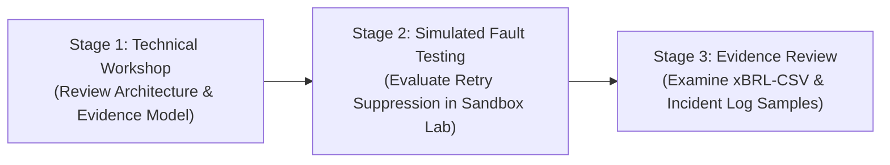

# Technical Consultation Request & Sandbox Inquiry

**To:**  
1. **CzechInvest – FinTech Sandbox II Coordination Office**  
   Agentura pro podporu podnikání a investic CzechInvest  
   Štěpánská 15, 120 00 Praha 2, Česká republika  
   E-mail: `fintech@czechinvest.org` / Portal: `fintechsandbox.cz`  

2. **Česká agentura pro standardizaci (ČAS) / ÚNMZ**  
   Technická normalizační komise TNK 156 (Umělá inteligence)  
   Biskupský dvůr 1148/5, 110 00 Praha 1, Česká republika  
   E-mail: `agentura@agenturacas.gov.cz` / Datová schránka: `4htvpem`  

**Separate Regulatory Submission:**  
**Česká národní banka (ČNB)**  
Odbor dohledu nad finančním trhem – FinTech kontaktní místo  
*Submissions to ČNB are transmitted via the official specialized query form:*  
`https://www.cnb.cz/en/public/contacts/form-for-submitting-specialised-fintech-related-queries/`  

**From:**  
Andrej Leukhin  
Founder & Principal Systems Architect, SovereignNexus  
Prague, Czech Republic  
E-mail: `andrejlo123@gmail.com`  
ORCID: `0009-0004-9543-8263`  

**Date:** 8 October 2026  

---

### SUBJECT:
**Technical Consultation Request: Evaluating Whether a Deterministic Effect-Integrity and Evidence Workflow Can Support DORA Incident-Management and Third-Party Oversight Records (Project AEIB v0.4.0 — Bounded Synthetic Benchmark and Local Runtime Reference)**

---

### 1. Executive Summary & Purpose of Consultation

As financial entities, payment service providers, and technology vendors in the Czech Republic explore the integration of autonomous agentic AI software (such as Model Context Protocol [MCP] and agentic orchestration frameworks) into operations, a key operational resilience challenge is **how to handle post-dispatch transport ambiguity**.

When an automated tool invocation or agent action encounters a mid-flight transport timeout or socket drop (`HTTP 504 Gateway Timeout`, `TCP RST`, connection drop), client software cannot determine from the transport layer alone whether the backend mutation completed. Conventional retry logic may trigger duplicate operations or corrupted state, while standard LLM outputs cannot serve as legally verifiable audit journals.

**SovereignNexus** has developed a synthetic reference implementation and benchmark—the **Agent Execution Integrity Boundary (AEIB v0.4.0)**—designed to preserve post-dispatch ambiguity, suppress speculative retries fail-closed, and produce cryptographically signed (Ed25519 / RFC 8785 JCS) audit receipts.

We submit this **technical consultation request** to **CzechInvest FinTech Sandbox II** and **ČAS (TNK 156)** to solicit informal technical feedback on:
1. Whether an offline-verifiable, deterministic evidence workflow can support regulated institutions in fulfilling record-keeping and incident-management workflows under the **Digital Operational Resilience Act (Regulation (EU) 2022/2554 – DORA)** and the **EU AI Act (Regulation (EU) 2024/1689)**.
2. Technical eligibility and testing scope within the sandbox to evaluate this approach under simulated network fault conditions.

*Note: This submission does not request or claim regulatory compliance certification or approved status; the competent authorities decide all matters of regulatory applicability and compliance.*

---

### 2. Focus Areas for Technical Consultation

We seek technical guidance on four specific evidentiary workflows:

| Regulatory Objective | Proposed Technical Workflow in AEIB | Consultation Questions for Sandbox / ČAS |
|:---|:---|:---|
| **Incident-Management Records** (cf. DORA Art. 17) | AEIB produces evidence that may support incident detection, timeline reconstruction, classification, investigation, and reporting workflows. Timing expectations (<=4h initial, 24h/72h intermediate, 1 month final per RTS 2025/301) derive from applicable standards; AEIB records local timestamps and wire telemetry (`bytes_sent`, `socket_state`, `fault_phase`), but does not determine when legal clocks start or whether an incident is major. | Can offline-verifiable, hash-chained receipts without live cloud telemetry satisfy supervisory expectations for logging major ICT-related incidents? |
| **ICT Third-Party Relationship Evidence** (cf. DORA Art. 28(3)) | Reference evidence-mapping workflow for selected ICT third-party relationship fields; completeness and regulatory sufficiency require institution-specific legal, contractual, and supervisory review. | What specific structural validations does the supervisory authority look for when institutions log third-party AI service interfaces in the Register of Information? |
| **Reconciliation Evidence** (Operational Resilience) | When a transport drop occurs, the gateway binds the operation instance (`operation_id`) and exact request digest (`request_digest`), records `EFFECT_INDETERMINATE`, sets `retry_safe: false`, and invokes a declared target-side status probe using the business key (`business_idempotency_key`) where available. | Is an inline latching and single-flight probe mechanism viewed as a sound operational safeguard against duplicate processing risk in automated systems? |
| **Human Oversight Records** (cf. EU AI Act Art. 14) | Decouples target mutation confirmation from business release authorization. Human oversight records require an identified reviewer, review timestamp, reviewed raw evidence, action digest, decision, authority, ability to intervene, and ability to stop or reverse. AEIB receipts provide supporting technical records but do not by themselves establish legal compliance. | Does this decoupling mechanism provide a useful technical model for documenting meaningful human oversight in automated agentic workflows? |

---

### 3. Overview of the Synthetic Reference Implementation

AEIB is a reference control-plane adapter positioned between client applications and downstream service ledgers:

$$\text{Identity / Intent} \longrightarrow \text{Permission Gate} \longrightarrow \mathbf{\text{AEIB Adapter (Uncertainty Latch)}} \longrightarrow \text{Target Ledger}$$

#### Key Technical Mechanics (Reported Under Stated Model):
1. **Target-Side Ground-Truth Rule**:
   Benchmark scoring evaluates state strictly against target-side ledger logs. Ephemeral browser DOM banners and agent self-reports are treated as non-authoritative.
2. **Uncertainty Latching & Retry Suppression**:
   Upon detecting a transport fault, the gateway latches state at `EFFECT_INDETERMINATE` (`retry_safe: false`), blocking blind retries.
3. **Declared Target-Side Status Probe**:
   Reconciles target state via a declared status probe strictly using the business key under the stated test model, preventing probe amplification.
4. **Standalone WebAssembly Verifier (`smaos_verify.wasm`)**:
   A 199 KB zero-dependency WebAssembly binary designed for offline verification; network isolation must be verified in the execution environment.

---

### 4. Proposed Sandbox Consultation & Testing Stages

- **Stage 1 (Architecture & Scope Alignment)**: Technical walkthrough with CzechInvest and standardization experts reviewing the transport-fault taxonomy and evidentiary schemas.
- **Stage 2 (Simulated Fault Testing)**: Execution of synthetic fault-injection scenarios (HTTP 504 timeouts, connection drops) in the sandbox environment to demonstrate retry blocking and probe reconciliation.
- **Stage 3 (Evidence Review & Feedback)**: Examination of generated xBRL-CSV register samples and incident journals to identify gaps relative to supervisory expectations.

---

### 5. Standardization Dialogue with ČAS (TNK 156)

We additionally inquire with ČAS regarding:
- Whether the benchmark scenarios (`aeib-bench` v0.1) and Layer 7 transport-fault taxonomy could be reviewed by **TNK 156 (Umělá inteligence)** as a potential technical input to European standardization discussions under **CEN/CENELEC JTC 21** regarding execution logging and reliability for AI systems.

---

### 6. Available Reference Materials for Inspection

The following reproducible materials are available for review:

| Asset Name | Repository Location | Format / Size | SHA-256 Digest | Purpose |
|:---|:---|:---:|:---|:---|
| **Clean-Room Distribution** | [`dist/aeib-v0.4.0-cleanroom.tar.gz`](file:///Users/andriileukhin/Documents/SovereignNexus/dist/aeib-v0.4.0-cleanroom.tar.gz) | `.tar.gz` (371,213 bytes) | `6d52b322aeee795e445db4d8692f0ce3ca71157f718128746a1e8264faf61363` | Clean-room runnable verification bundle |
| **Offline WASM Verifier** | [`dist/smaos_verify.wasm`](file:///Users/andriileukhin/Documents/SovereignNexus/dist/smaos_verify.wasm) | `.wasm` (199,770 bytes) | `6ecc360af19008632c950d94910b70220e3c2cc36a5cc29fe0c33ba64d2bb041` | Designed for offline verification |
| **WASM In-Browser UI** | [`dist/verifier.html`](file:///Users/andriileukhin/Documents/SovereignNexus/dist/verifier.html) | `.html` (7,844 bytes) | `11a3cb753a634b78ab83f1a6f0705c19d54d029424953eef8af3056e0a3dd11b` | Standalone browser-based verifier |
| **Track B Benchmark Schema** | [`schemas/aeib-bench-web-v0.1.schema.json`](file:///Users/andriileukhin/Documents/SovereignNexus/schemas/aeib-bench-web-v0.1.schema.json) | `.json` (3,816 bytes) | `512afe45c1fda1d89df341e961545f6ab09764b86d383b8ef8d56b6c2e5e254f` | JSON Schema for Track B fault matrix |
| **Master Specification** | [`schemas/aeib_bench_v0.1_spec.json`](file:///Users/andriileukhin/Documents/SovereignNexus/schemas/aeib_bench_v0.1_spec.json) | `.json` (22,825 bytes) | `6ee6abb3c7d5028023ea299354d466b6392ab1c9dce850ae7826aa4db1bf570f` | Formal specification for AT15–AT45 |
| **Comparative Baselines** | [`dist/track_b_comparative_baselines.json`](file:///Users/andriileukhin/Documents/SovereignNexus/dist/track_b_comparative_baselines.json) | `.json` (5,439 bytes) | `d10f896d8a034352764edbca883fdb49f287975458ee8915ffd74570f4f07092` | 4-arm comparative duplication benchmark data |
| **Demonstration Trace** | [`dist/decisive_demonstration_trace.json`](file:///Users/andriileukhin/Documents/SovereignNexus/dist/decisive_demonstration_trace.json) | `.json` (3,750 bytes) | `661afa77ef82bb8882907dea65494b0644729567d3ebfd1479350333a2b1e329` | Full execution trace showing Target commit=1 |
| **Technical Consultation Pack** | [`docs/CAS_PRE_SUBMISSION_PACK.md`](file:///Users/andriileukhin/Documents/SovereignNexus/docs/CAS_PRE_SUBMISSION_PACK.md) | `.md` (9,519 bytes) | `34662d7d1fdf9aa740eb0beb891dd33766de0214aba6d5473140ccf85becb066` | Canonical consultation request document |

---

### 7. Applicant Information & Declaration

I declare that the software described herein is an open-source reference prototype (dual-licensed: Apache License 2.0 for code/harness, CC-BY-4.0 for specifications/documentation) evaluated under declared synthetic simulation models. 

**Execution Boundaries:**
* Local physical socket demonstration: reported complete.
* Real TinyFish integration: pending.
* Real third-party external API integration: pending.
* Regulatory compliance certification: not claimed.

All claims refer to the declared synthetic or local physical harness and do not establish remote exactly-once behavior, universal security, deployment readiness, or regulatory compliance.

Respectfully submitted,

**Andrej Leukhin**  
Founder & Principal Systems Architect  
SovereignNexus  
Prague, Czech Republic  
E-mail: `andrejlo123@gmail.com`  
ORCID: `0009-0004-9543-8263`  
Repository: `https://github.com/sovreignnexus/smaos`
