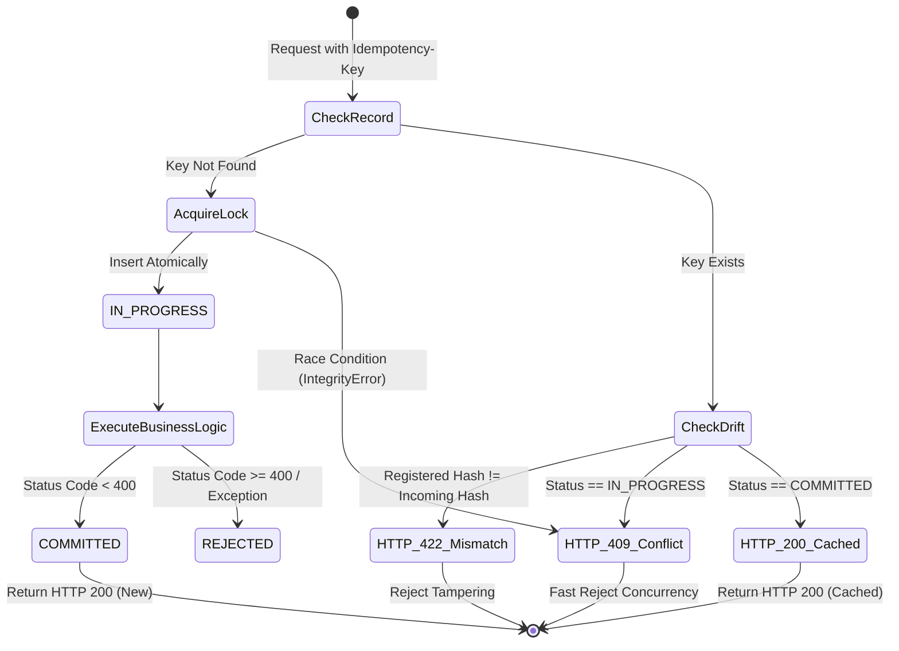

# Downstream Server-Side Idempotency Contract Specification
**Sovereign Multi-Agent OS (SMAOS) / Agent Execution Integrity (AEIB) — Pillar 2**

*Document Status: Defensible Engineering Specification*  
*Standard: RFC 4122 (UUIDv5) / RFC 8785 (JCS-compatible subset) / RFC 9052 (COSE_Sign1)*

---

## 1. Executive Summary & Problem Definition

In autonomous multi-agent environments, agents interact with microservices, legacy core banking backends, and external third parties via JSON-RPC or REST protocols.

### The Fundamental Invariant
$$\text{authorized write} \neq \text{persisted write} \neq \text{correct outcome}$$

Under physical network anomalies (such as reverse proxy `504 Gateway Timeout` or socket `TCP RST ECONNRESET`), the client loses the wire acknowledgment. However, the downstream service may have already processed and committed the mutation.

Generating a deterministic client-side identifier (such as a UUIDv5 idempotency key) is **necessary but insufficient** on its own:
- Client-side key derivation guarantees **action identity**.
- Only an enforced **downstream server-side contract** guarantees **outcome finality and physical non-duplication**.

---

## 2. Derivation of the Idempotency Key

The SMAOS MCP interceptor computes an RFC 4122 UUIDv5 idempotency key deterministically from the canonical composite action identifier and the SHA-256 payload digest:

```python
# 1. Composite Action ID (Session + Step + RPC ID + Tool Name)
action_id = f"mcp://{session_id}/{step_sequence}/{rpc_id}/{tool_name}"

# 2. Canonical Request Payload Hash (RFC 8785 / JCS deterministic serialization)
req_payload_hash = "sha256:" + hashlib.sha256(
    json.dumps(arguments, ensure_ascii=False, separators=(',', ':'), sort_keys=True).encode('utf-8')
).hexdigest()

# 3. Deterministic UUIDv5 in custom SMAOS namespace
SMAOS_NAMESPACE_UUID = uuid.UUID("a7b8c9d0-e1f2-4a5b-8c9d-0e1f2a3b4c5d")
seed_string = f"{action_id}:{req_payload_hash}"
idempotency_key = str(uuid.uuid5(SMAOS_NAMESPACE_UUID, seed_string))
```

This key is injected into outgoing transport headers:
- `Idempotency-Key: <UUIDv5>`
- `X-Action-ID: <Composite Action URI>`
- `X-Payload-Hash: sha256:<hex>`

---

## 3. The 4 Core Invariants of the Downstream Contract

Any downstream service integrating with the SMAOS Agent Execution Integrity framework must adhere to the following four state invariants:



### Invariant 1: Atomic Concurrency Lock (`IN_PROGRESS` $\rightarrow$ `HTTP 409 Conflict`)
- Upon receiving a request, the server executes an atomic `INSERT` with `status = "IN_PROGRESS"`.
- If another concurrent thread or replayed request arrives bearing the same key while `status == "IN_PROGRESS"`, the server **MUST NOT** execute the business logic.
- The server returns `HTTP 409 Conflict` with JSON error payload:
  ```json
  {
    "error": "CONCURRENT_REQUEST_IN_FLIGHT",
    "status_code": 409,
    "message": "A request with this idempotency key is already currently being processed.",
    "action_id": "mcp://sess-01/1/rpc-441/payment.settle_payment",
    "retry_after_ms": 1000
  }
  ```

### Invariant 2: Deterministic Cached Replay (`COMMITTED` $\rightarrow$ `HTTP 200 OK`)
- If a request arrives bearing an `Idempotency-Key` that has already transitioned to `COMMITTED`:
- The server returns the cached status code and cached response body directly.
- The downstream business logic is bypassed entirely, guaranteeing zero duplicate ledger writes or fund transfers.
- Response header `X-Cache-Lookup: HIT` indicates cached replay.

### Invariant 3: Payload Drift & Tamper Rejection (`HTTP 422 Unprocessable Entity`)
- If a request arrives bearing an `Idempotency-Key` that already exists in the ledger, but the incoming `payload_hash` does **not** equal `registered_payload_hash`:
- The server rejects the request immediately with `HTTP 422 Unprocessable Entity`:
  ```json
  {
    "error": "IDEMPOTENCY_PAYLOAD_MISMATCH",
    "status_code": 422,
    "message": "Request payload diverged from previously registered payload for this idempotency key.",
    "registered_payload_hash": "sha256:e3b0c44...",
    "attempted_payload_hash": "sha256:7f83b16...",
    "action_id": "mcp://sess-01/1/rpc-441/payment.settle_payment"
  }
  ```
- This prevents parameter tampering, key recycling, or replay attacks targeting different accounts under an existing key.

### Invariant 4: Authoritative Out-of-Band State Probe
- Following a transport drop (e.g. `504 Gateway Timeout` or `TCP RST`), the agent transitions into `DISPATCHED_UNCONFIRMED`.
- The agent does **NOT** retry the mutation directly.
- Instead, the agent's out-of-band `StateProber` calls the downstream server's reconciliation probe:
  ```python
  probe_result = server_adapter.probe_state(idempotency_key, expected_payload_hash)
  ```
- Return schema:
  - If record exists and `status == "COMMITTED"`: `disposition = "OUTCOME_VERIFIED"`, `outcome_verified = True`.
  - If record exists and payload hash mismatch: `disposition = "RECONCILIATION_FAILED"`, `outcome_verified = False`.
  - If record does not exist: `disposition = "RECONCILIATION_NOT_FOUND"`, `outcome_verified = False`.

---

## 4. Downstream Storage Schema

The reference persistence model requires an ACID-compliant transaction register (SQLite, PostgreSQL, or DynamoDB):

```sql
CREATE TABLE IF NOT EXISTS server_idempotency_ledger (
    idempotency_key TEXT PRIMARY KEY,
    action_id TEXT NOT NULL,
    payload_hash TEXT NOT NULL,
    status TEXT NOT NULL,              -- 'IN_PROGRESS', 'COMMITTED', 'REJECTED'
    created_at_utc TEXT NOT NULL,      -- ISO 8601 UTC
    updated_at_utc TEXT NOT NULL,      -- ISO 8601 UTC
    response_code INTEGER,
    response_body_json TEXT,
    execution_duration_ms REAL
);

CREATE INDEX IF NOT EXISTS idx_idem_action ON server_idempotency_ledger (action_id);
```

---

## 5. Reference Implementation

A complete, production-tested reference implementation is provided in `src/server_idempotency_adapter.py`.

### Minimal Server Middleware Integration:
```python
from server_idempotency_adapter import ServerIdempotencyAdapter

adapter = ServerIdempotencyAdapter(db_path="/var/data/idempotency.db")

def handle_incoming_rpc(request_headers, request_body):
    idem_key = request_headers.get("Idempotency-Key")
    action_id = request_headers.get("X-Action-ID", "unknown")
    
    def business_handler(payload):
        # Execute actual transactional logic
        result = core_ledger.settle_payment(payload["account"], payload["amount"])
        return 200, result

    status_code, body, is_cached = adapter.execute_idempotent(
        idempotency_key=idem_key,
        action_id=action_id,
        payload=request_body,
        business_handler=business_handler
    )
    return status_code, body
```

---

## 6. Audit & Regulatory Defensibility

Under **DORA RTS 2025/301 Annex II** and **EBA Guidelines on ICT and Security Risk Management**:
1. **Zero Double-Execution**: Concurrency locks guarantee that network retries during gateway dropouts cannot cause duplicate debit/credit operations.
2. **Deterministic Forensic Tracing**: The tuple `(idempotency_key, action_id, payload_hash)` permanently links the agent's signed RFC 9052 `COSE_Sign1` receipt to the backend database record.
3. **Fail-Closed Quarantining**: Wire failures never trigger speculative retries; execution resumes only after out-of-band probe verification.
