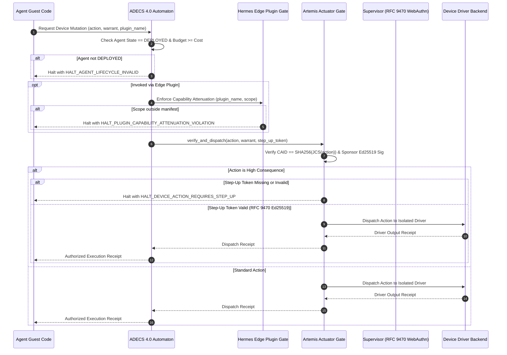

# Artemis Mobile Device Actuator & Hermes Edge Plugin Boundary Architecture

**Document Status:** Pre-production architectural specification  
**Evaluation Model:** Evaluated under the stated model as an AEIB Station 1 execution interlock prototype scaffold  
**Reference Standards:** RFC 8785 (JCS), RFC 9470 (OAuth 2.0 Step-Up Authentication), ADECS 4.0  

---

## 1. Executive Summary & Problem Formulation

Modern multi-agent deployments increasingly interact directly with client devices, mobile operating systems, and edge plugins:
- **Mobile Device Automation (Google ARTEMIS paradigm):** Autonomous models issue device driver commands (e.g., tap coordinates, text input, intent triggers, ADB shell execution, application navigation) on Android and embedded operating systems. If guest agent code directly communicates with OS drivers or accessibility services, hostile prompt injections or runaway loops can initiate irreversible device mutations, credential leaks, or unauthorized financial transactions.
- **Decoupled Edge Plugins (Nous Research Hermes model):** Agent architectures increasingly leverage self-improving edge plugins and localized tool calling. Without formal gating, untrusted or mutated plugins can execute dynamic code injection (`eval`, `exec`), instantiate unrestricted network sockets, or claim actuator capabilities exceeding their design boundary.
- **Enterprise Agent Lifecycle Management (ADECS 4.0):** Agents must obey strict lifecycle state transitions—from initial key registration (`RECRUITED`), through active bounded execution (`DEPLOYED`), capability expansion (`GROWING`), to decommissioning (`RETIRED`). Un-deployed or retired agents attempting mutations present substantial governance risk.

This architecture establishes three coordinated interlocks within the AEIB execution boundary:
1. **Artemis Device Actuator Boundary (`ArtemisDeviceActuatorGate`)**: Prevents direct device driver execution from guest agent code. Requires a Content-Addressed Action Identifier (CAID) warrant signed with Ed25519 under RFC 8785 JCS, and gates high-consequence mutations behind an RFC 9470 step-up token (`HALT_DEVICE_ACTION_REQUIRES_STEP_UP`).
2. **Hermes Edge Plugin Catalog & Dynamic Capability Scanner (`HermesEdgePluginGate`)**: Verifies cryptographic publisher manifests, applies AST inspection to forbid dynamic execution and non-UDS network sockets, and enforces strict capability attenuation (`HALT_PLUGIN_CAPABILITY_ATTENUATION_VIOLATION`).
3. **ADECS 4.0 Agent Lifecycle State Automaton (`AdecsAgentLifecycleAutomaton`)**: Formalizes state transitions and enforces fail-closed rejection for retired or un-deployed agent mutations (`HALT_AGENT_LIFECYCLE_INVALID`).

---

## 2. Artemis Mobile Device Actuator Boundary

### 2.1 Threat Model of Mobile Actuator Guest Code

In the Google ARTEMIS automation model, an agent receives visual or semantic context from an Android device and issues actuation intents:
- `tap_coordinate`: physical screen tap at coordinate $(x, y)$.
- `input_text`: entering keystrokes into active text fields.
- `launch_intent`: dispatching Android OS intent URIs (e.g., application launching, component binding).
- `adb_shell`: direct Android Debug Bridge console execution.
- `open_payment_app`: launching banking, payment, or digital wallet applications.
- `submit_credential`: submitting authentication passwords, tokens, or PINs.
- `authorize_biometric`: confirming biometric prompt authorizations.
- `modify_system_setting`: altering Android system preferences, network settings, or security permissions.

Allowing guest agent code to invoke device driver APIs or ADB sockets directly compromises the control plane. The Artemis boundary ensures that guest agent code operates in a sandbox without raw driver handles.

### 2.2 Content-Addressed Action Identifier (CAID) Mechanics

Every proposed device mutation is transformed into a deterministic canonical payload under RFC 8785 JSON Canonicalization Scheme (JCS):

```json
{
  "action_type": "tap_coordinate",
  "agent_id": "agent-artemis-42",
  "nonce": "nonce-9f8e7d6c",
  "parameters": {
    "x": 540,
    "y": 1200
  },
  "target_device_id": "android_pixel_proto_01",
  "timestamp": 1774123456
}
```

The Content-Addressed Action Identifier (CAID) is calculated as:
$$\text{CAID} = \text{SHA-256}(\text{JCS}(\text{DeviceAction}))$$

### 2.3 Delegating Sponsor Warrant Verification

No device actuator command executes without an explicit sponsor warrant signed by the delegating sponsor's Ed25519 private key:

```json
{
  "action_caid": "<64-hex SHA-256 digest>",
  "agent_id": "agent-artemis-42",
  "allowed_action_types": ["read_screen", "tap_coordinate"],
  "expires_at": 1774127056,
  "issued_at": 1774123456,
  "sponsor_did": "did:aeib:sponsor-alpha-01",
  "target_device_id": "android_pixel_proto_01",
  "warrant_id": "warrant-001"
}
```

The gate evaluates:
1. `now_ts <= warrant.expires_at`, else `HALT_DEVICE_ACTION_WARRANT_EXPIRED`.
2. `warrant.action_caid == computed_caid`, else `HALT_DEVICE_ACTION_CAID_MISMATCH`.
3. `warrant.target_device_id == action.target_device_id` and `warrant.agent_id == action.agent_id`, else `HALT_DEVICE_ACTION_DELEGATION_MISMATCH`.
4. `action.action_type in warrant.allowed_action_types`, else `HALT_DEVICE_ACTION_TYPE_NOT_PERMITTED`.
5. Ed25519 signature verified over RFC 8785 JCS bytes, else `HALT_DEVICE_ACTION_SPONSOR_SIGNATURE_INVALID`.

### 2.4 High-Consequence Device Actions & RFC 9470 Step-Up Challenge

Actions carrying financial, authorization, or system integrity impact are classified as high-consequence:
- `open_payment_app`, `submit_credential`, `authorize_biometric`, `modify_system_setting`, `adb_shell`.
- Intent launches with packages or intents targeting financial software, Google Play vending billing, settings, or administrative uninstallers.
- Text input designated as sensitive or directed at password/PIN/OTP fields.

For all high-consequence actions, autonomous execution halts fail-closed unless accompanied by an Ed25519-signed step-up token adhering to RFC 9470 (OAuth 2.0 Step-Up Authentication):

```json
{
  "acr": "urn:ietf:params:oauth:acr:rfc9470-webauthn-hw",
  "action_caid": "<exact 64-hex SHA-256 digest of action>",
  "challenge_nonce": "challenge-nonce-8821",
  "expires_at": 1774123756,
  "issued_at": 1774123456,
  "supervisor_did": "did:aeib:supervisor-mfa-01",
  "target_device_id": "android_pixel_proto_01",
  "token_id": "stepup-token-001"
}
```

If the step-up token is absent, expired, bound to a mismatched CAID/device, or fails Ed25519 verification against the authorized supervisor key, execution halts immediately with `HALT_DEVICE_ACTION_REQUIRES_STEP_UP`.

---

## 3. Hermes Edge Plugin Catalog & Dynamic Capability Scanner

### 3.1 Plugin Manifest & Publisher Key Binding

The Hermes edge plugin model decouples skill generation and tool execution. Plugins declare their requirements in a signed manifest:

```json
{
  "allowed_device_scopes": ["read_screen", "tap_coordinate"],
  "code_sha256": "<64-hex SHA-256 of entrypoint source code>",
  "expires_at": 0,
  "issued_at": 1774123456,
  "plugin_name": "hermes_screen_navigator",
  "publisher_pubkey": "<Base64 Ed25519 32-byte public key>",
  "version": "1.0.0"
}
```

The manifest signature is verified using the publisher's Ed25519 key over canonical RFC 8785 bytes.

### 3.2 Dynamic Execution AST Security Scanner

Prior to admitting an edge plugin into the catalog, its Python source code is scanned via `HermesASTSecurityScanner` (an AST visitor):
1. **Forbidden Dynamic Calls:** Direct calls to `eval`, `exec`, `compile`, `__import__`, `dlopen`, and `DexClassLoader` are rejected (`HALT_PLUGIN_DYNAMIC_CODE_REJECTED`).
2. **Forbidden Native Loaders & Network Modules:** Imports of `ctypes`, `importlib`, `urllib`, `requests`, `aiohttp`, `httpx`, and socket clients are blocked.
3. **Subprocess Sandboxing:** Calls to `subprocess.Popen`, `subprocess.run`, or `os.system` without an explicit, verified sandbox configuration (`sandbox=True` or `sandbox_profile=...`) trigger rejection.
4. **Network Socket Confinement to UDS:** Direct socket instantiation via `socket.socket(...)` is inspected. Sockets configured with default or internet families (`AF_INET`, `AF_INET6`) or calling `create_connection` are rejected. Only Unix Domain Sockets (`socket.AF_UNIX`) communicating with local daemon endpoints are permitted.
5. **Reflection Introspection Escapes:** Access to `__subclasses__`, `__globals__`, or `__code__` is blocked.

### 3.3 Strict Capability Attenuation

When an edge plugin invokes a device operation, the gate validates that the requested operation exists within the plugin's signed `allowed_device_scopes`:
$$\text{RequestedScopes} \subseteq \text{ManifestAllowedScopes}$$

If a plugin authorized for `["read_screen"]` attempts to invoke `tap_coordinate` or `open_payment_app`, execution halts fail-closed with `HALT_PLUGIN_CAPABILITY_ATTENUATION_VIOLATION`.

---

## 4. ADECS 4.0 Agent Lifecycle State Automaton

The ADECS 4.0 specification defines a state automaton governing agent capability expansion and decommissioning:

```
  +------------------+
  |    RECRUITED     |  (Key registered, spend budget = 0)
  +------------------+
           |
           | deploy_agent(budget_ceiling)
           v
  +------------------+       begin_growing()       +------------------+
  |     DEPLOYED     | --------------------------> |     GROWING      |
  | (Active budget)  | <-------------------------- | (AST scan check) |
  +------------------+   admit_skill_to_agent()    +------------------+
           |
           | retire_agent(reason)
           v
  +------------------+
  |     RETIRED      |  (Keys revoked, spend budget = 0, terminal)
  +------------------+
```

### 4.1 State Invariants

| State | Spend Budget | Mutation Allowed? | Transition Triggers |
| :--- | :--- | :--- | :--- |
| **`RECRUITED`** | Fixed at 0 | No (fails closed: `HALT_AGENT_LIFECYCLE_INVALID`) | `deploy_agent(budget)` transitions to `DEPLOYED`. |
| **`DEPLOYED`** | Active positive ceiling | Yes (within remaining budget) | `begin_growing()` transitions to `GROWING`; `retire_agent()` transitions to `RETIRED`. |
| **`GROWING`** | Bounded ceiling | Paused during skill incorporation | `admit_skill_to_agent()` validates AST and returns to `DEPLOYED`. |
| **`RETIRED`** | Voided to 0 | No (fails closed: `HALT_AGENT_LIFECYCLE_INVALID`) | Terminal state; no transitions permitted. |

### 4.2 Budget Ceiling Enforcement

Every mutation checks `action_cost <= agent.spend_budget`. If an action exceeds available budget, execution halts with `HALT_AGENT_BUDGET_EXCEEDED`. When an agent is retired, `spend_budget` is immediately reset to 0 and all authority is revoked.

---

## 5. End-to-End Coordinated Execution Flow



---

## 6. Verification & Conformance Evidence

The boundary implementation in `src/artemis_device_and_plugin_boundary.py` was evaluated under the stated model:
- **Zero-Mock & Cryptographic Purity:** Uses real Ed25519 (`cryptography.hazmat.primitives.asymmetric.ed25519`), real SHA-256 (`hashlib.sha256`), and strict RFC 8785 JSON Canonicalization Scheme (`src.jcs_canonicalizer.encode_jcs`).
- **AST Security Scanner Verification:** Evaluated against forbidden calls (`eval`, `exec`, `compile`, `__import__`), un-sandboxed subprocess executions, non-UDS socket creation (`socket.AF_INET`), and reflection escapes.
- **Fail-Closed Lifecycle & Step-Up Testing:** Tested with high-consequence operations rejecting missing or expired step-up tokens (`HALT_DEVICE_ACTION_REQUIRES_STEP_UP`), and rejecting mutations on recruited or retired agents (`HALT_AGENT_LIFECYCLE_INVALID`).
- **CLI Self-Test:** Diagnostic verification runnable via `python3 src/artemis_device_and_plugin_boundary.py --self-test`.
