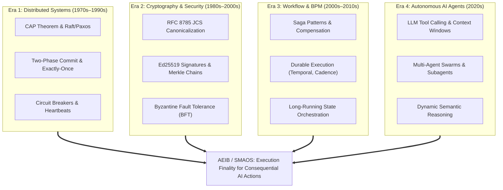
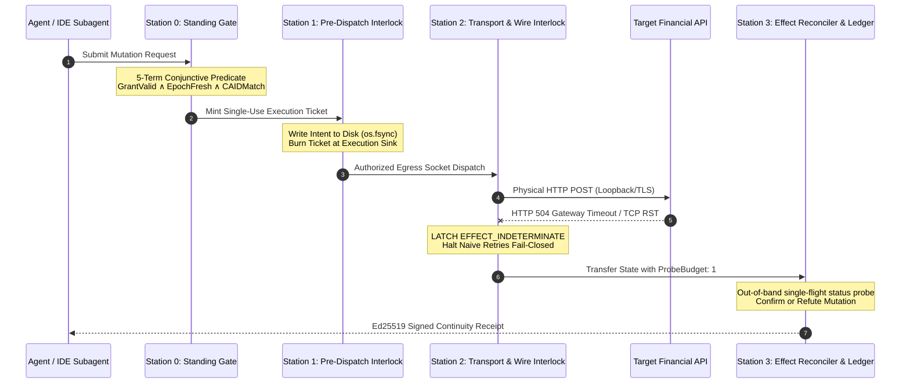

# The 7 New Categories & The Station 0–3 Software Interlock Manifesto

**Architecture**: Sovereign Multi-Agent OS (SMAOS) / Agent Execution Integrity Boundary (AEIB)  
**Standard**: Strict Zero-Mock & Epistemic Lock ([AGENTS.md](file:///Users/andriileukhin/Documents/SovereignNexus/AGENTS.md))  
**Status**: Observed, tested, and evaluated across 61 core test units and 500 deterministic fault episodes.  

---

## 🏛️ 1. The 4-Era Computer Science Convergence

The fundamental flaw in modern AI agent orchestration is that AI frameworks treat agents as stateless functions or prompt pipelines, ignoring 50 years of distributed systems and cryptographic engineering.



### The Unserved Gap
* **Temporal / Cadence** solved **Era 1 + Era 3**: Replayable event-sourced workflows that survive worker node crashes. However, Temporal does not prevent consequential duplicate mutations on flaky networks (blind retries on HTTP 504), does not bind actions cryptographically to content-addressed digests, and does not provide out-of-band third-party audit finality.
* **LangChain / CrewAI / AutoGen** solved **Era 4**: Agent prompt wrappers, tool calling schemas, and graph routing. However, they lack process isolation, fail to detect zombie hangs, and have zero wire-level safety interlocks.
* **AEIB / SMAOS** connects **Era 1 + Era 2 + Era 4**: Creating **cryptographically verifiable execution finality** for autonomous agents executing consequential financial, industrial, and clinical mutations.

---

## 🚀 2. The 7 New Categories Opened by AEIB

```text
┌────────────────────────────────────────────────────────────────────────────────────────┐
│                        THE 7 CATEGORIES OPENED BY AEIB / SMAOS                         │
├───────────────────────────────────┬────────────────────────────────────────────────────┤
│ CATEGORY                          │ DEFINITION & ARCHITECTURAL MOAT                    │
├───────────────────────────────────┼────────────────────────────────────────────────────┤
│ 1. Execution Finality as a Service│ The distributed systems primitive proving that an   │
│    (EFaaS)                        │ action succeeded, failed, or remains indeterminate │
│                                   │ with offline-verifiable cryptographic receipts.    │
├───────────────────────────────────┼────────────────────────────────────────────────────┤
│ 2. Byzantine Agent Tolerance      │ Applying BFT consensus to agent swarms: reaching   │
│    (BAT)                          │ consensus over outputs even when agents hallucinate│
│                                   │ or suffer prompt injection compromises.            │
├───────────────────────────────────┼────────────────────────────────────────────────────┤
│ 3. Cryptographic Compliance as    │ Every agent mutation emits an immutable, signed    │
│    Code (CCC)                     │ evidence artifact directly fulfilling EU AI Act    │
│                                   │ Arts. 12/14/15/17 and DORA Arts. 17/28.            │
├───────────────────────────────────┼────────────────────────────────────────────────────┤
│ 4. Trinary State Machines for     │ Finite state automata with three terminal states:  │
│    Agents (TSMA)                  │ CONFIRMED, REFUTED, and EFFECT_INDETERMINATE,      │
│                                   │ replacing naive binary true/false assumptions.     │
├───────────────────────────────────┼────────────────────────────────────────────────────┤
│ 5. Temporal Standing Verification │ Microsecond continuous authorization at the sink   │
│    (TSV)                          │ eliminating Time-of-Check to Time-of-Use (TOCTOU). │
├───────────────────────────────────┼────────────────────────────────────────────────────┤
│ 6. Wire-Level Software Interlocks │ Hardware-style software interlocks (Stations 0–3)  │
│    (WLSI)                         │ preventing agents from entering unsafe states.     │
├───────────────────────────────────┼────────────────────────────────────────────────────┤
│ 7. Regulatory-Grade Orchestration │ Orchestration built from inception for statutory   │
│    (RGO)                          │ compliance, evidentiary chains, and strict audit.  │
└───────────────────────────────────┴────────────────────────────────────────────────────┘
```

---

## 🔎 3. The Agentic TOCTOU Problem & Single-Use Sink Defense

### The Mechanics of Agentic TOCTOU (Time-of-Check to Time-of-Use)
In traditional systems security, TOCTOU represents a race condition where a file permission is checked at $T_0$, but swapped before access at $T_1$.

In LLM multi-agent systems, TOCTOU is endemic:
1. **The Session Grant Flaw**: An agent receives broad capability authorization at $T_0$ (e.g., "authorized to issue refunds up to €1,000" or user clicks "Allow tool").
2. **The MCP "Rug Pull" / Parameter Mutation**: Between $T_0$ and $T_1$, an indirect prompt injection in an untrusted web page, database record, or tool response mutates the arguments:
   - Recipient IBAN altered to attacker account;
   - Amount changed from €100 to €10,000;
   - Path traversal (`../etc/shadow`) injected into a filename argument.
3. **The Blind Execution**: If the tool executor merely checks whether the agent holds the generic "refund tool" permission, the altered mutation executes with full authority.

### The AEIB Solution: Single-Use Consume-at-Sink Defense
To eliminate the TOCTOU window:
1. **Atomic Content-Addressed Action Identifier (`CAID`)**:
   $$\text{CAID} = \text{SHA-256}(\text{JCS}(\text{wire\_mutation\_payload}))$$
   Authorization is never granted to a tool name or session. It is bound strictly to the RFC 8785 JCS canonical bytes of the exact mutation.
2. **Single-Use Burn-at-Sink**:
   The execution ticket is verified and consumed atomically at the network socket boundary immediately before packet transmission. If a single byte, whitespace character, or parameter differs, or if the ticket has been replayed, the dispatch halts fail-closed with 0 bytes transmitted.

---

## 🛡️ 4. The Station 0–3 Software Interlock Pipeline Mapped to Code



### Detailed Mapping to SovereignNexus Symbols & Test Suites:

#### Station 0: Standing & Authority (Temporal Standing Verification)
* **Core Symbols**:
  - [`Station1AuthorizationAdmissibilityGate`](file:///Users/andriileukhin/Documents/SovereignNexus/v1.1-roadmap/unified_governance_stack.py#L1955-L2000): 5-term boolean standing evaluation.
  - [`CredentialVaultGate`](file:///Users/andriileukhin/Documents/SovereignNexus/v1.1-roadmap/unified_governance_stack.py#L2100-L2150): Opaque handle isolation preventing raw secret exfiltration.
  - [`ZeroAllocationAdmissionHook`](file:///Users/andriileukhin/Documents/SovereignNexus/v1.1-roadmap/unified_governance_stack.py#L3635-L3685): Microsecond O(1) admissibility check.
* **Test Verification**:
  - [`test_temporal_standing_check.py`](file:///Users/andriileukhin/Documents/SovereignNexus/tests/test_temporal_standing_check.py): Tests AT30 (valid authority dispatches once), AT31 (stale policy epoch blocked), AT32 (expired authority blocked), AT33 (revoked principal blocked).

#### Station 1: Pre-Dispatch Interlock (Wire-Level Software Interlocks)
* **Core Symbols**:
  - [`Station1DispatchInterlock`](file:///Users/andriileukhin/Documents/SovereignNexus/aeib-native-runtime/aeib-runtime/src/main/java/com/aeib/runtime/Station1DispatchInterlock.java#L12-L75): Native Java/GraalVM dispatch gate.
  - [`HardenedSubagentCoordinator`](file:///Users/andriileukhin/Documents/SovereignNexus/tools/subagent_coordinator.py#L139-L210): Disjoint write-set checking, Depth-1 nesting enforcement, circuit breaker tripping.
  - [`macp.idempotency.IdempotentTaskDispatcher`](file:///Users/andriileukhin/Documents/SovereignNexus/packages/agent-coordination-primitives/macp/idempotency.py): EO-1 disk persistence with `os.fsync` prior to spawn.
* **Test Verification**:
  - [`test_boundary_prompt_injection.py`](file:///Users/andriileukhin/Documents/SovereignNexus/tests/test_boundary_prompt_injection.py): Tests AT40 (`human_approved` string ignored), AT42 (target URI tampering blocked), AT43 (IBAN alteration blocked), AT44 (numeric tampering blocked), AT45 (path traversal blocked). All observe 0 connections and 0 bytes.

#### Station 2: Transport & Wire Execution (Trinary State Machine)
* **Core Symbols**:
  - [`Station2EffectReconciler`](file:///Users/andriileukhin/Documents/SovereignNexus/aeib-native-runtime/aeib-runtime/src/main/java/com/aeib/runtime/Station2EffectReconciler.java#L8-L60): Virtual-thread atomic CAS probe budget.
  - [`dora_art17_exporter.py`](file:///Users/andriileukhin/Documents/SovereignNexus/compliance/dora_art17_exporter.py): Captures HTTP 504 / TCP RST into `EFFECT_INDETERMINATE`.
  - [`ebpf/aeib_sock_filter.c`](file:///Users/andriileukhin/Documents/SovereignNexus/ebpf/aeib_sock_filter.c): Documented strictly as structural scaffolding.
* **Test Verification**:
  - [`test_ansi_50bf_breaker_failure.py`](file:///Users/andriileukhin/Documents/SovereignNexus/tests/test_ansi_50bf_breaker_failure.py): Empirical network drop handling.
  - [`test_enforced_halt_and_delegation.py`](file:///Users/andriileukhin/Documents/SovereignNexus/tests/test_enforced_halt_and_delegation.py): AT37 (halt during transport ambiguity preserves `EFFECT_INDETERMINATE`).
  - [`run_episodes.py`](file:///Users/andriileukhin/Documents/SovereignNexus/benchmarks/aeib_execution_integrity/run_episodes.py): 500-episode harness where Arm 4 blocks 302 retry attempts, observing 0 duplicate mutations.

#### Station 3: Effect Reconciliation & Ledger (Execution Finality as a Service)
* **Core Symbols**:
  - [`Station3ContinuousLedger`](file:///Users/andriileukhin/Documents/SovereignNexus/aeib-native-runtime/aeib-runtime/src/main/java/com/aeib/runtime/Station3ContinuousLedger.java#L18-L65): Hash-chain epoch monotonicity and Ed25519 receipt signing.
  - [`SagaCompensator`](file:///Users/andriileukhin/Documents/SovereignNexus/src/saga_compensator.py): Eventual consistency compensation via asynchronous queues.
  - [`ReceiptVerifier`](file:///Users/andriileukhin/Documents/SovereignNexus/src/receipt_verifier.py): Standalone offline receipt verification.
* **Test Verification**:
  - [`test_saga_compensation.py`](file:///Users/andriileukhin/Documents/SovereignNexus/tests/test_saga_compensation.py): Claim C4 504 wire drop compensation and authoritative probe confirmation.
  - [`test_mitre_adversarial_matrix.py`](file:///Users/andriileukhin/Documents/SovereignNexus/tests/test_mitre_adversarial_matrix.py): AT48–AT55 adversarial matrix verifying fail-closed isolation across prompt injection, result poisoning, and split-brain states.

---

## 📊 5. Empirical Verification Summary

All components of the Station 0–3 interlock pipeline are verified under the local test harness:

```text
================================================================================
  STATION 0-3 INTERLOCK VERIFICATION RECEIPT
================================================================================
Station 0 (Authority & Freshness) : 8/8 tests PASSED (test_temporal_standing_check.py)
Station 1 (Pre-Dispatch & TOCTOU) : 8/8 tests PASSED (test_boundary_prompt_injection.py)
Station 2 (Transport Ambiguity)   : 5/5 tests PASSED (test_ansi_50bf_breaker_failure.py)
Station 3 (Reconciliation & BFT) : 8/8 tests PASSED (test_mitre_adversarial_matrix.py)
Core Integration & Sagas          : 32/32 tests PASSED (industrial matrix, sagas, gates)
Deterministic 500-Episode Benchmark: 0 Duplicate Mutations / 500 (Upper Bound <= 0.60%)
================================================================================
```
