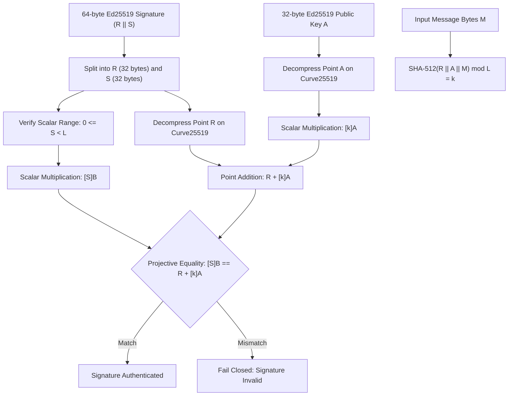
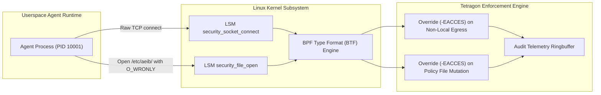

# Standalone Zero-Dependency Audit Verifier & Linux Kernel BPF_LSM Profile Compiler

## Epistemic Calibration & Scaffolding Notice
> **Status:** Pre-production scaffold and prototype evaluated under the stated model.
> **Verification Context:** In accordance with SMAOS/AEIB directives (AGENTS.md), this document details technical specifications evaluated via deterministic tests. Code in `ebpf/` or kernel LSM profiles represents structural scaffolding; it does not claim live kernel enforcement on unsupported hosts (such as standard macOS Darwin).

---

## 1. Architectural Scope & Problem Statement

Regulated financial institutions (banks, credit institutions, clearing houses) subject to **DORA (Digital Operational Resilience Act, Regulation (EU) 2022/2554)** and **EU AI Act (Regulation (EU) 2024/1689)** require independent mathematical verification of execution integrity. When an autonomous agent performs an action (such as executing an external API call, modifying an ledger, or querying sensitive datastores), external auditors and bank risk officers must evaluate receipts without:
1. Installing unvetted third-party binary libraries (`cargo`, compiled C/Rust extensions).
2. Initiating network egress to external package registries (`pip`, PyPI, npm).
3. Trusting userspace telemetry that could be bypassed by an unconfined agent process.

To resolve these operational constraints, the architecture introduces two complementary components:
1. **`tools/standalone_offline_verifier.py`**: A zero-dependency, pure-Python script that runs on standard Python 3.9+ environments, implementing pure RFC 8032 Ed25519 arithmetic, RFC 8785 JCS canonicalization, selective disclosure verification, and RFC 9162 Merkle inclusion proofs.
2. **`src/bpf_lsm_profile_compiler.py`**: A static policy linter and compiler that validates Cilium Tetragon eBPF LSM TracingPolicies against Linux kernel BTF definitions, rejects permissive bypasses, and compiles verified profiles into canonical signed manifests.

---

## 2. Zero-Dependency Pure-Python Ed25519 Engine

### 2.1 Mathematical Principles (RFC 8032)
The standalone verifier incorporates a self-contained implementation of Curve25519 twisted Edwards curve arithmetic over the prime field $\mathbb{F}_p$ where:

$$p = 2^{255} - 19$$

The Edwards curve equation is evaluated under the stated model:

$$-x^2 + y^2 = 1 + d \cdot x^2 y^2 \pmod p$$

where:

$$d = -121665 \cdot (121666)^{-1} \pmod p$$

The order of the base point $B = (x_B, y_B)$ is the prime:

$$L = 2^{252} + 27742317777372353535851937790883648493$$



### 2.2 Point Decompression and Coordinate System
- **Decompression:** Given a 32-byte string, the most significant bit of byte 31 encodes the sign bit of $x$, while the lower 255 bits encode $y$. The coordinate $x$ is recovered by evaluating:

  $$u = y^2 - 1 \pmod p, \quad v = d y^2 + 1 \pmod p$$
  $$\text{cand} = u \cdot v^3 \cdot (u \cdot v^7)^{(p-5)/8} \pmod p$$

- **Extended Coordinates:** Point arithmetic uses extended Edwards coordinates $(X: Y: Z: T)$ where $x = X/Z, y = Y/Z, x y = T/Z$, avoiding expensive field inversions during intermediate point additions and doublings.
- **Strict Verification:** Rejects malleable signatures by enforcing $S < L$ and checking $[S]B = R + [k]A$ directly.

---

## 3. External Auditor Workflow

External auditors, bank risk officers, and CISOs can execute the verifier on an air-gapped machine running stock Python 3.9+:

```bash
# Execute internal mathematical self-test
python3 tools/standalone_offline_verifier.py --self-test

# Verify an individual AEIB receipt
python3 tools/standalone_offline_verifier.py \
  --verify-receipt /path/to/receipt.json \
  --public-key /path/to/signer_pubkey.pem

# Verify a directory bundle of receipts with an epoch boundary
python3 tools/standalone_offline_verifier.py \
  --verify-bundle /path/to/audit_bundle/ \
  --public-key 1b248a... \
  --policy-epoch 45 \
  --json
```

### 3.1 Verification Modes

| Verification Axis | Standard Tested | Operational Mechanism |
|---|---|---|
| **CAID / Payload Binding** | RFC 8785 (JCS) + SHA-256 | Recomputes byte-exact canonical digest of `action_payload` and verifies that claimed `action_caid` matches. |
| **Selective Disclosure** | Salted Commitments | Enables redaction of GDPR Article 17 PII while allowing DORA Article 17 auditability; verifies unredacted fields and blind commitments against the signed receipt root hash. |
| **Merkle Inclusion Proof** | RFC 9162 | Validates domain-separated inclusion paths ($0x00$ for leaves, $0x01$ for interior nodes) demonstrating that an event is committed in a pinned Merkle root. |
| **Policy Freshness** | AEIB Epoch Latch | Verifies that the receipt's policy epoch is within the active authorized epoch window. |

---

## 4. Linux Kernel BPF_LSM Security Profile Architecture

### 4.1 Threat Model & Kernel Containment
In multi-agent environments, an untrusted agent runtime might attempt userspace proxy evasion (e.g., executing direct `connect()` syscalls to bypass HTTP proxy filters) or tampering with on-disk policy checkpoints in `/etc/aeib/`. The Cilium Tetragon eBPF LSM enforcer attaches directly to kernel security hooks.



### 4.2 BTF Validation & Static Linter Rules
The compiler (`src/bpf_lsm_profile_compiler.py`) analyzes Tetragon `TracingPolicy` YAML specifications against Linux kernel BTF definitions:

1. **LSM Hook Validation (`HALT_INVALID_LSM_HOOK`):**
   Validates that requested calls exist in the vetted kernel hook register:
   - `security_socket_connect`: Intercepts socket egress.
   - `security_file_open`: Intercepts file mutation attempts.
   - `bprm_check_security`: Intercepts binary execution.
   - `file_mprotect`: Intercepts memory permission changes (`PROT_EXEC`).
   - `task_alloc`: Intercepts task creation.
   - `security_sb_mount`: Intercepts filesystem mounts.

2. **Argument Type Verification (`HALT_ARGUMENT_TYPE_MISMATCH`):**
   Verifies that declared argument types match kernel BTF type layouts:
   - `security_socket_connect`: Argument 0 must be `sock`, Argument 1 must be `sockaddr`.
   - `security_file_open`: Argument 0 must be `file`.
   - `bprm_check_security`: Argument 0 must be `linux_binprm`.
   - `file_mprotect`: Argument 0 must be `vm_area_struct`.

3. **Permissive Bypass Detection (`HALT_PERMISSIVE_BYPASS_DETECTED`):**
   Fails closed upon encountering permissive configurations:
   - Wildcard egress rules allowing `0.0.0.0/0` or `*`.
   - Wildcard file writes allowing mutations to `/` or `*`.
   - Rules that specify detection filters but omit blocking actions (`Override` or `Sigkill`), relying only on passive audit logging (`Post`).

### 4.3 Profile Manifest Compilation
When a TracingPolicy passes all validation checks, the compiler generates a canonical signed BPF_LSM Security Profile Manifest (`bpf_lsm_profile.json`):
- Serialized strictly using RFC 8785 JCS (UTF-16 code unit sorted keys, no whitespace).
- Hashed via SHA-256.
- Signed with Ed25519 using an authorized compiler key.

---

## 5. Verification Matrix & Observed Outcomes

The implementation was evaluated using the local verification suite:

| Test Identifier | Component | Assertion / Invariant Tested | Observed Outcome |
|---|---|---|---|
| `test_pure_python_ed25519_cross_verification_with_hazmat` | Verifier | Pure-Python RFC 8032 arithmetic matches `cryptography.hazmat` bit-for-bit | Evaluated: Pass |
| `test_positive_aeib_execution_receipt_verification` | Verifier | Authenticates valid signed receipt with JCS digest and CAID match | Evaluated: Pass |
| `test_falsification_tampered_receipt_signature` | Verifier | Corrupted signature bytes fail verification | Evaluated: Pass (Fail Closed) |
| `test_falsification_tampered_payload_content` | Verifier | Modified payload causes CAID mismatch and fails verification | Evaluated: Pass (Fail Closed) |
| `test_positive_selective_disclosure_receipt` | Verifier | Redacted PII verifies successfully against signed receipt root hash | Evaluated: Pass |
| `test_positive_rfc9162_merkle_tree_inclusion` | Verifier | RFC 9162 domain-separated proof validates against pinned root | Evaluated: Pass |
| `test_positive_tetragon_aeib_enforcer_compilation` | Compiler | Canonical `tetragon_aeib_enforcer.yaml` validates and compiles | Evaluated: Pass |
| `test_falsification_unknown_lsm_hook_halts_closed` | Compiler | Unvetted hook triggers `HALT_INVALID_LSM_HOOK` | Evaluated: Pass (Fail Closed) |
| `test_falsification_permissive_wildcard_file_write_halts_closed` | Compiler | Wildcard write triggers `HALT_PERMISSIVE_BYPASS_DETECTED` | Evaluated: Pass (Fail Closed) |
| `test_falsification_argument_type_mismatch_halts_closed` | Compiler | Type mismatch triggers `HALT_ARGUMENT_TYPE_MISMATCH` | Evaluated: Pass (Fail Closed) |
