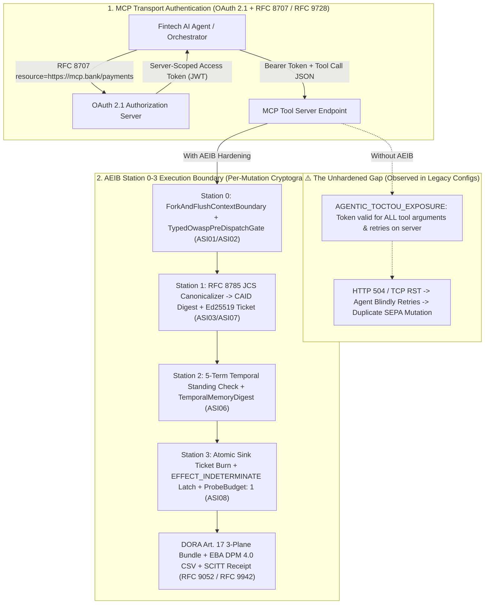

# AEIB €1,500 / 48-Hour Fintech Agent Execution Audit Diagnostic Wedge Pack

> [!IMPORTANT]
> **Mandatory Epistemic Boundary Notice:** All diagnostic evaluations, control gap classifications, and fault-injection metrics described in this document and emitted by `tools/fintech_diagnostic_wedge.py` are **observed, tested, and evaluated under the stated model** using a deterministic verification **prototype** and **scaffold**. Results reflect the **configured** architecture parameters and simulated transport fault schedules.

---

## 1. Executive Summary

European Payment Institutions (EPIs), Electronic Money Institutions (EMIs), and regulated credit or investment firms deploying autonomous tool-using agents via the **Model Context Protocol (MCP)** face an acute architectural blind spot between **server-level authentication** and **sink-level financial execution**.

The **AEIB €1,500 / 48-Hour Fintech Agent Execution Audit Diagnostic Wedge** (`SKU: AEIB-FINTECH-48H-1500EUR-WEDGE`) is a fixed-fee, zero-egress engineering assessment executed directly against a client's staging MCP/agent configuration. Within 48 hours of receiving a sanitized configuration descriptor, the diagnostic engine (`FintechDiagnosticWedgeEngine` in `tools/fintech_diagnostic_wedge.py`) produces an **RFC 8785 JCS-canonicalized, Ed25519-signed Diagnostic Assessment Report** covering four empirical Q4 2026 risk matrices:

1. **Matrix 1 — MCP OAuth 2.1 Resource Indicators (RFC 8707 / RFC 9728) vs. Tool-Call Scope Gap:** Identifies `AGENTIC_TOCTOU_EXPOSURE` where OAuth 2.1 tokens authenticate the MCP server endpoint without binding the canonical JSON payload (`CAID`) at the downstream execution sink.
2. **Matrix 2 — OWASP Agentic AI Top 10 (2026) (`ASI01`–`ASI10`) Control Posture:** Evaluates concrete execution-boundary mitigations for `ASI01` (Goal Hijack), `ASI02` (Tool Misuse), `ASI03` (Identity & Privilege Abuse), `ASI06` (Memory & Context Poisoning), `ASI07` (Insecure Inter-Agent Communication), and `ASI08` (Cascading Agent Failures).
3. **Matrix 3 — Transport Ambiguity & Duplicate Financial Mutation Simulation:** Executes a deterministic 100-episode (`seed=42`) HTTP 504 / TCP RST fault simulation comparing the client's configured retry policy against the AEIB `EFFECT_INDETERMINATE` wire latch and `ProbeBudget: 1`.
4. **Matrix 4 — EU Regulatory Evidence Readiness:** Evaluates architectural readiness for **DORA Art. 17** major ICT-related incident reporting (4-hour initial notification clock anchored to `major_classification_time`), **DORA Art. 28(3)** Register of Information (**EBA DPM 4.0 xBRL-CSV** lowercase `b_xx.xx.csv` tables), and **EU AI Act Arts. 12, 14, 15, and 17** (**CEN-CENELEC `prEN 18286`** AI Quality Management System mapping) backed by offline-verifiable **RFC 9052 / RFC 9942 SCITT** receipts.

---

## 2. The Q4 2026 Market & Regulatory Trigger

Four converging regulatory and protocol developments in Q4 2026 make execution-boundary verification mandatory for European fintech engineering and compliance teams:

### 2.1 DORA Enforcement (Regulation (EU) 2022/2554)
- **Article 17 & RTS on Major ICT-Related Incidents:** Financial entities must classify ICT-related incidents and submit an initial notification to their Competent Authority within **4 hours** of the `major_classification_time` anchor (and no later than 24 hours from detection), followed by a **72-hour** intermediate report and a **1-month** final root-cause report. When an AI agent triggers duplicate SEPA/SWIFT payouts during an HTTP 504 gateway timeout storm, compliance teams cannot reconstruct whether the duplicate side effect resulted from model hallucination, prompt injection, or blind client retry unless three-plane evidence (`intent_plane`, `governance_plane`, `execution_plane`) is cryptographically linked.
- **Article 28(3) Register of Information (EBA DPM 4.0 xBRL-CSV):** Annual and on-demand ICT third-party register submissions must conform to EBA Data Point Model (DPM) 4.0 xBRL-CSV formatting rules, including strict lowercase `b_01.01.csv` through `b_99.01.csv` table naming and explicit supply-chain rank (`RT.02.01.0040`) tracking for MCP tool servers.

### 2.2 EU AI Act High-Risk QMS & Logging (Arts. 12, 14, 15, 17 & `prEN 18286`)
- High-risk AI systems used in creditworthiness assessment, risk pricing, or automated financial workflows must satisfy **Article 12** (automatic tamper-evident record-keeping), **Article 14** (human oversight and verifiable stop/intervene gates), **Article 15** (accuracy, robustness, and cybersecurity resilience against fault injection), and **Article 17** (Quality Management System aligned with **CEN-CENELEC `prEN 18286`**).

### 2.3 OWASP Agentic AI Top 10 (2026) (`ASI01`–`ASI10`)
- Standard LLM text guardrails operate at the prompt layer and do not inspect structured tool arguments at the moment of side-effect commitment. The OWASP Agentic Security Initiative (ASI) 2026 taxonomy highlights structural execution vulnerabilities (`ASI01` Goal Hijack, `ASI02` Tool Misuse, `ASI03` Privilege Abuse, `ASI06` Memory Poisoning, `ASI07` Inter-Agent Spoofing, `ASI08` Cascading Retry Storms) that require deterministic pre-dispatch and sink-level enforcement.

### 2.4 The MCP OAuth 2.1 Tool-Call Scope Gap (RFC 8707 / RFC 9728)
- The Model Context Protocol (MCP) authorization specification adopts **OAuth 2.1**, **RFC 8707 (Resource Indicators)**, and **RFC 9728 (OAuth 2.0 Protected Resource Metadata)** to bind bearer tokens to a specific MCP server URI.
- **The Architectural Gap:** An RFC 8707 `resource` parameter scopes a token to the *MCP server process* (e.g., `https://mcp.internal.bank/payments`), **not** to the exact RFC 8785 canonical JSON parameters (`amount`, `creditor_iban`, `currency`, `idempotency_key`) of a single `initiate_sepa_credit_transfer` invocation. Between policy approval and sink execution, context mutation or retry loops create an **Agentic Time-of-Check to Time-of-Use (`AGENTIC_TOCTOU_EXPOSURE`)** window.

---

## 3. Architecture Diagram: Closing the MCP OAuth 2.1 Tool-Call Scope Gap

The diagram below illustrates how OAuth 2.1 RFC 8707 secures the client-to-server transport channel while AEIB Stations 0–3 secure the individual financial mutation against Agentic TOCTOU and HTTP 504 retry storms under the stated model:



---

## 4. 48-Hour Diagnostic Deliverables & Statement of Work (SOW) Checklist

### 4.1 Fixed-Scope Commercial Terms
- **Engagement Fee:** **€1,500** (fixed price, invoiced upon delivery of the signed assessment bundle; 100% creditable toward a subsequent 30-Day Observe-Only Pilot).
- **Turnaround SLA:** **48 hours** from receipt of the client's sanitized MCP/agent deployment configuration JSON.
- **Data & Network Posture:** **Zero Egress.** The diagnostic CLI (`tools/fintech_diagnostic_wedge.py`) runs entirely offline using Python standard library and pinned `cryptography.hazmat` Ed25519 primitives. No production customer PII, PANs, or live credentials are required or ingested.

### 4.2 48-Hour Execution Timeline & SOW Checklist

| Hour Window | Milestone | Deliverable / Verification Artifact |
| :--- | :--- | :--- |
| **Hours 0–6** | **Intake & Configuration Sanitization** | Client provides sanitized MCP server topology, retry policy parameters, and current DORA/AI Act logging schema (`config.json`). |
| **Hours 6–18** | **Matrix 1 & Matrix 2 Automated Evaluation** | Execution of `evaluate_matrix_1_mcp_oauth21_scope_gap` and `evaluate_matrix_2_owasp_asi_2026`. Identification of `AGENTIC_TOCTOU_EXPOSURE` and `ASI01`–`ASI08` control gaps. |
| **Hours 18–30** | **Matrix 3 Transport Fault Micro-Simulation** | Deterministic 100-episode (`seed=42`) HTTP 504 / TCP RST simulation quantifying `baseline_observed_duplicates` under the client's retry policy vs. `aeib_observed_duplicates: 0` with `EFFECT_INDETERMINATE` + `ProbeBudget: 1`. |
| **Hours 30–40** | **Matrix 4 Regulatory Readiness & SCITT Signing** | Assessment of DORA Art. 17 (`major_classification_time` 4h anchor), Art. 28(3) EBA DPM 4.0 lowercase `b_xx.xx.csv` export readiness, and EU AI Act `prEN 18286` QMS mapping. |
| **Hours 40–48** | **Executive Readout & Signed Bundle Handover** | Delivery of the JCS-canonicalized, Ed25519-signed JSON assessment report (`report_digest`, `signature_b64`, `public_key_pem`) and a 45-minute technical walkthrough with the CISO / Head of AI Engineering. |

### 4.3 CLI Verification Command (Self-Contained Reproducibility)
Clients and auditors can independently reproduce the diagnostic comparison in under 2 seconds:

```bash
python3 tools/fintech_diagnostic_wedge.py \
  --self-test \
  --episodes 100 \
  --seed 42 \
  --output-json /tmp/fintech_wedge_self_test.json
```

---

## 5. 30-Day Observe-Only Pilot Conversion Path (€15,000–€25,000)

The €1,500 Diagnostic Wedge is structured as the technical entry gate to a **30-Day Shadow / Observe-Only Production Pilot**:

| Commercial Tier | Scope & Deployment Mode | Duration | Commercial Investment |
| :--- | :--- | :--- | :--- |
| **Tier 1: Diagnostic Wedge** (`AEIB-FINTECH-48H-1500EUR-WEDGE`) | Offline configuration evaluation across Matrices 1–4 + 100-episode HTTP 504 simulation + JCS/Ed25519 signed audit report. | **48 Hours** | **€1,500** *(credited toward Tier 2)* |
| **Tier 2: Observe-Only Shadow Pilot** (`AEIB-FINTECH-30D-PILOT`) | Sidecar deployment of the AEIB MCP Proxy in **Observe-Only (Shadow) mode** on 1–3 staging or pre-production payment/treasury agent workflows. Emits live RFC 8785 `CAID` digests, `EFFECT_INDETERMINATE` telemetry, and draft DORA Art. 17 / EBA DPM 4.0 xBRL-CSV evidence bundles without blocking traffic. | **30 Days** | **€15,000 – €25,000** *(scoped by tool sink count)* |
| **Tier 3: Inline Fail-Closed Rollout** (`AEIB-FINTECH-INLINE-SUB`) | Promotion from Observe-Only to inline Station 0–3 fail-closed enforcement with PostgreSQL/Redis atomic ticket burn, live `ProbeBudget: 1` circuit breaking, and automated SCITT (RFC 9052 / RFC 9942) receipt archival. | **Annual Subscription** | **Custom Scoped per Regulated Entity** |

### Pilot Conversion Gate Criteria
Upon completion of the 48-hour diagnostic readout, organizations observing any of the following empirical indicators qualify for immediate onboarding into the 30-Day Observe-Only Shadow Pilot:
1. `agentic_toctou_exposure: true` in **Matrix 1** (OAuth 2.1 server-scoped tokens deployed without sink-level `CAID` payload binding).
2. Two or more unmitigated OWASP Agentic AI Top 10 (2026) categories in **Matrix 2** (`ASI01`, `ASI02`, `ASI03`, `ASI06`, `ASI07`, or `ASI08`).
3. `configured_observed_duplicates > 0` in **Matrix 3** under simulated HTTP 504 / TCP RST post-commit drops.
4. One or more `missing_readiness_items` in **Matrix 4** for DORA Art. 17 three-plane incident bundles or Art. 28(3) EBA DPM 4.0 xBRL-CSV exports.
