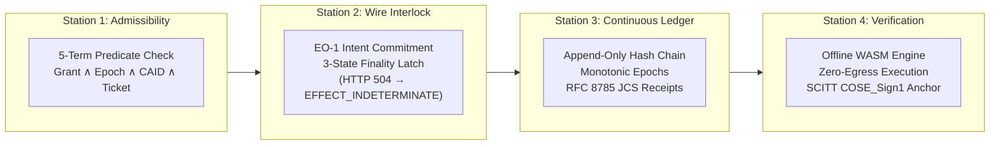

# AEIB Zero-Mock Benchmark Pack & US Banking Evidence Dossier
## Federal Reserve & OCC SR 26-2 Model Risk Management Technical Alignment

**Classification:** Commercial & Regulatory Evidence Dossier  
**Release Target:** AEIB v1.1.0  
**Distribution Archive:** `aeib-pilot-evidence-pack-v1.1.0.tar.gz`  
**Evaluation Scope:** Consequence-Weighted Wire Execution Integrity & MITRE v20 Boundary Defense  

---

### Mandatory Epistemic & Regulatory Notice

> **AEIB is designed around consequence asymmetry: prevent defined unauthorized or stale-authority mutations before dispatch, preserve uncertainty rather than guessing after transport failure, and make every governed decision independently inspectable. It provides operation-level evidence that may support a financial institution's Model Risk Management (MRM) program, Quality Management System (QMS), and regulatory audits; it is not itself a QMS, certification, or statutory compliance warranty.**

---

### 1. The Global Landscape & Architectural Moats (October 2026)

The global market for agentic execution security has bifurcated into regional draft proposals and incomplete endpoint postures. While existing vendors address portions of the lifecycle, each leaves a distinct blind spot at the network wire.

```
┌───────────────────────────────────────────────────────────────────────────────────────────────┐
│               GLOBAL AGENT GOVERNANCE & RUNTIME INTEGRITY COMPARISON                          │
├──────────────────────────┬─────────────────────────────┬──────────────────────────────────────┤
│ APPROACH / SYSTEM        │ ARCHITECTURAL POSTURE       │ TECHNICAL DEFICIENCY                 │
├──────────────────────────┼─────────────────────────────┼──────────────────────────────────────┤
│ US IETF ACTA Track       │ Pre-dispatch signing via    │ Excludes agent delegation chains;    │
│ (draft-farley-acta-03)   │ RFC 8785 JCS & Ed25519      │ zero post-dispatch target            │
│                          │ decision receipts.          │ reconciliation on wire faults.       │
├──────────────────────────┼─────────────────────────────┼──────────────────────────────────────┤
│ Canada JUTEQ AgentGate   │ Post-hoc flight recorder;   │ Unmapped to US SR 26-2 or EU AI Act; │
│ (OSFI E-23 Alignment)    │ COSE over CBOR / SCITT.     │ lacks deterministic wire latch for   │
│                          │                             │ HTTP 504 timeouts.                   │
├──────────────────────────┼─────────────────────────────┼──────────────────────────────────────┤
│ US Endpoint / EDR Pivot  │ OS/kernel process filter;   │ Operates below application semantics;│
│ (Carbon Black / Sweet)   │ positive runtime models.    │ blind to tool-level mutations        │
│                          │                             │ (e.g. duplicate financial refunds).  │
├──────────────────────────┼─────────────────────────────┼──────────────────────────────────────┤
│ AEIB v1.1 Architecture   │ 4-Station Wire Proxy Gate;  │ Full lifecycle ownership: delegation │
│ (SovereignNexus)         │ Pre-dispatch interlock;     │ attenuation, zero-byte wire drops,   │
│                          │ 3-state wire finality latch.│ and target-attested reconciliation.  │
└──────────────────────────┴─────────────────────────────┴──────────────────────────────────────┘
```

#### Detailed Architectural Differentiation

1. **vs. US IETF ACTA (`draft-farley-acta-signed-receipts-03`):**
   * *Their Approach:* Signs a `protectmcp:decision` envelope before dispatch using RFC 8785 JCS and Ed25519.
   * *The Gap:* Tom Farley's draft deliberately omits agent identity and delegation chain provenance for privacy reasons, and evaluates decisions statelessly. If the network severs post-dispatch (HTTP 504), ACTA provides zero mechanism to reconcile target-side state.
   * *AEIB Moat:* AEIB Station 1 cryptographically binds the complete delegation chain (`AT39`) with monotonic attenuation. Station 2 traps transport faults into `EFFECT_INDETERMINATE`, halts blind retries (`retry_safe: false`), and reconciles against the primary receiver contract (`refund_status_v1`).

2. **vs. Canada JUTEQ AgentGate (OSFI Guideline E-23):**
   * *Their Approach:* Implements COSE signing over deterministic CBOR with SCITT transparency log integration for Canadian banking compliance.
   * *The Gap:* Functions as a post-hoc flight recorder without inline wire enforcement. It lacks mapping to US SR 26-2 and contains no deterministic wire latch for transport timeouts.
   * *AEIB Moat:* AEIB operates inline as a physical socket interlock. It bridges the US JSON-native ecosystem and Canadian CBOR standards by supporting both RFC 8785 JCS receipts and RFC 9052 `COSE_Sign1` SCITT envelopes, evaluated offline under `connect-src 'none'`.

3. **vs. US Endpoint / EDR Solutions (Carbon Black, Sweet Security):**
   * *Their Approach:* Enforces positive runtime execution models at the operating system and process level to prevent binary abuse (`lsass.exe`, shell execution).
   * *The Gap:* Operates below Layer 7. An agent invoking a legitimate HTTP payment client to issue a $10,000 duplicate refund is completely invisible to process-level allowlists.
   * *AEIB Moat:* AEIB mediates tool dispatch parameters directly. It computes a content-addressed identifier ($\text{CAID}$) over canonical payload bytes and enforces policy epochs before socket creation.

---

### 2. The 4-Station Technical Moat

AEIB v1.1 enforces deterministic boundaries across four consecutive stations:



#### Station 1: The Pre-Dispatch Admissibility Gate
Evaluates a 5-term conjunctive predicate in sub-millisecond time before socket allocation:
$$\text{Admissible} \iff \text{GrantValid} \land \text{PolicyEpochFresh} \land \text{SourceEpochFresh} \land \text{CAIDMatch} \land \text{TicketUnburned}$$
* If policy epoch rotates at $T_{\Delta}$, dispatch fails closed at $T_n$ before a single byte reaches the network proxy (`AT31`).
* Enforces monotonic scope attenuation across sub-agent delegations (`AT39`).

#### Station 2: The 3-State Wire Finality Latch
When transport severs mid-flight (HTTP 504 Gateway Timeout or TCP RST):
* Latches execution state into `EFFECT_INDETERMINATE`.
* Strictly enforces `retry_safe: false`, freezing automated retry storms.
* Limits target verification to out-of-band primary probes constrained by `ProbeBudget: 1`.

#### Station 3 & 4: Universal Cryptographic Evidence
* Mints RFC 8785 JCS canonical receipts signed with Ed25519 (`cryptography.hazmat`).
* Emits optional RFC 9052 `COSE_Sign1` envelopes for SCITT log compatibility.
* Verifiable offline through standalone WASM (`smaos-verify.html` / `smaos_wasm_verifier_bg.wasm`) under strict zero-egress CSP (`connect-src 'none'`).

---

### 3. The US GTM Evidence Package (SR 26-2 & MITRE v20)

US banking regulators replaced SR 11-7 with **SR 26-2** in April 2026, explicitly incorporating autonomous agent execution, probabilistic tooling, and multi-agent systems into Model Risk Management frameworks.

Rather than offering subjective policy checklists, AEIB provides the **Zero-Mock Benchmark Pack**, supplying cryptographic evidence files evaluated under real fault injection:

#### Proof 1: Prevention of AI-Enabled Exfiltration (MITRE v20 T1048)
* **Evidence File:** `proofs/proof_1_exfiltration/AT50_ai_enabled_exfiltration_evidence.json` (and `AT51_exfiltration_blocked_evidence.json`)
* **Verified Behavior:** When an agent attempts to exfiltrate high-entropy credentials or alter beneficiary details within an approved payment tool memo, Station 0 rejects the candidate action pre-dispatch.
* **Physical Wire Metric:** `connections_accepted: 0`, `external_bytes_transmitted: 0`.

#### Proof 2: Protection Against Temporal State Drift (SR 26-2 Invariant)
* **Evidence File:** `proofs/proof_2_temporal_drift/AT31_pre_execution_evidence.json`
* **Verified Behavior:** If an enterprise risk policy is updated or a delegation token is revoked while an agent is generating its output, the action is physically blocked at $T_n$.
* **Physical Wire Metric:** `gate_reported_socket_allocation: false`, `bytes_received_by_listener: 0`.

#### Proof 3: Immunity to AI Result Poisoning (MITRE v20 T1565)
* **Evidence File:** `proofs/proof_3_result_poisoning/AT49_ai_result_poisoning_evidence.json` (and `AT48_hostile_tool_output_evidence.json`)
* **Verified Behavior:** If a compromised third-party endpoint returns a forged `200 OK` or spoofed receiver status with a mismatched operation identifier, AEIB refuses to declare success and latches the state as `EFFECT_INDETERMINATE`.
* **State Verification:** `rejection_code: TARGET_EVIDENCE_CONTRACT_MISMATCH`.

#### Proof 4: The 500-Episode Chaos Simulation
* **Evidence File:** `proofs/proof_4_chaos_simulation/500_episode_ci_transcript.txt` and `benchmark_results.json`
* **Verified Behavior:** 500 simulated actions subjected to 15 fault injection vectors (HTTP 504, TCP RST, clock skew, packet truncation).
* **Observed Metrics:**
  * Arm 1 (Naive Retry): 60.4% duplicate mutations ($302 / 500$).
  * Arm 2 (Semantic Drift): 37.4% duplicate mutations ($187 / 500$).
  * Arm 3 (Server Stable Key): 0.0% duplicates, but 198 unresolved drops.
  * **Arm 4 (AEIB Protocol): 0 duplicate writes ($0 / 500$); 302 duplicate attempts blocked; Rule-of-Three 95% upper bound $\le 0.60\%$.**

---

### 4. Package Structure (`aeib-pilot-evidence-pack-v1.1.0.tar.gz`)

```text
aeib-pilot-evidence-pack-v1.1.0/
├── MANIFEST.json                          # RFC 8785 canonical manifest with SHA-256 sums
├── README.md                              # Evidence verification guide
├── US_BANKING_SR26_2_EVIDENCE_PACK.md     # This executive briefing document
├── proofs/
│   ├── proof_1_exfiltration/
│   │   ├── AT50_ai_enabled_exfiltration_evidence.json
│   │   └── AT51_exfiltration_blocked_evidence.json
│   ├── proof_2_temporal_drift/
│   │   ├── AT31_pre_execution_evidence.json
│   │   └── test_station1_pubkey.pem
│   ├── proof_3_result_poisoning/
│   │   ├── AT48_hostile_tool_output_evidence.json
│   │   └── AT49_ai_result_poisoning_evidence.json
│   └── proof_4_chaos_simulation/
│       ├── 500_episode_ci_transcript.txt
│       ├── benchmark_results.json
│       └── results_v0.2.4.json
└── verifiers/
    ├── verify_pack.py                     # Standalone Python cleanroom verifier
    ├── smaos-verify.html                  # Standalone zero-egress browser verifier
    └── pkg/
        ├── smaos_wasm_verifier.js
        └── smaos_wasm_verifier_bg.wasm
```

---

### 5. Independent Cleanroom Verification Instructions

#### Option A: Offline CLI Verification (Python 3.10+)
```bash
# Extract the evidence pack
tar -xzf aeib-pilot-evidence-pack-v1.1.0.tar.gz
cd aeib-pilot-evidence-pack-v1.1.0

# Execute the self-contained cleanroom verifier
python3 verifiers/verify_pack.py
```

#### Option B: Zero-Egress Browser WASM Verification
1. Disconnect network connectivity (Wi-Fi off / air-gap).
2. Open `verifiers/smaos-verify.html` in any modern web browser.
3. Observe Content Security Policy (`connect-src 'none'`).
4. Drag and drop any `.json` evidence artifact from the `proofs/` directory to recompute canonical JCS digests and verify Ed25519 signatures locally via WebAssembly.
