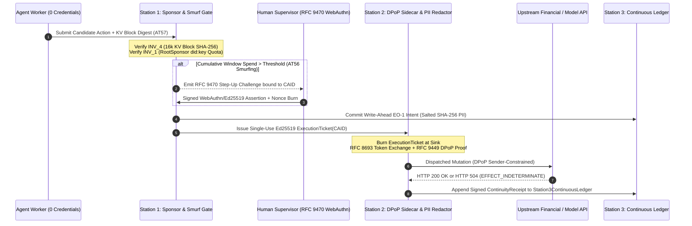

# Bilateral USA & China Red-Team Quota-Bypass, Context Poisoning & Financial Gate Compliance Dossier

**Document Reference:** `AEIB-CROSSWALK-US-CN-2026-10`  
**Implementation Module:** [`compliance/us_china_redteam_crosswalk.py`](file:///Users/andriileukhin/Documents/SovereignNexus/compliance/us_china_redteam_crosswalk.py)  
**Verification Suite:** [`tests/test_us_china_redteam_crosswalk.py`](file:///Users/andriileukhin/Documents/SovereignNexus/tests/test_us_china_redteam_crosswalk.py)  
**Epistemic Boundary Notice:**  
*Evaluated under the stated model. Permitted vocabulary: observed, tested, evaluated, configured, under the stated model, prototype, scaffold. Code in `ebpf/` and `hardware_attestation/` is documented strictly as structural scaffolding per `AGENTS.md` §5; runtime invariants in this dossier are evaluated through the Python/Rust/Java Station 0–3 execution gates. The saga compensator provides eventual consistency via asynchronous queues rather than atomic distributed 2PC.*

---

## 1. Bilateral Threat & Regulatory Context (USA & China)

Autonomous AI agents capable of invoking external tools, rotating API credentials, and initiating financial transfers face converging regulatory requirements in both the **United States** and the **People's Republic of China**. While legal terminology differs across jurisdictions, both regulatory ecosystems target the same underlying systems-engineering failure modes: **unbounded agency**, **Sybil quota multiplication**, **context-window/memory poisoning**, **silent duplicate financial mutations on transport failure**, and **unredacted PII persistence**.

### 1.1 United States Regulatory & Threat Frameworks

| Framework ID | Standard / Mandate | Subclauses & Technical Vectors | AEIB Architectural Alignment |
| :--- | :--- | :--- | :--- |
| **`NIST_AI_RMF_1_0_GENAI_2024`** | **NIST AI RMF 1.0 & NIST AI 600-1 Generative AI Profile (2024)** | `GOVERN 1.2`, `MAP 3.5`, `MEASURE 2.7`, `MANAGE 2.4` | Enforces excessive-agency containment and autonomous financial boundary controls via [`Station1AuthorizationAdmissibilityGate`](file:///Users/andriileukhin/Documents/SovereignNexus/v1.1-roadmap/unified_governance_stack.py#L1955-L2000), [`CrossAppStepUpEscalationGate`](file:///Users/andriileukhin/Documents/SovereignNexus/v1.1-roadmap/unified_governance_stack.py#L3239-L3361), and [`AigpSigmaCryptographicKillSwitch`](file:///Users/andriileukhin/Documents/SovereignNexus/v1.1-roadmap/unified_governance_stack.py#L4142-L4250). |
| **`OWASP_LLM_2025_AND_AGENTIC_ASI_2026`** | **OWASP Top 10 for LLM (2025) & OWASP Agentic AI Top 10 (ASI 2026)** | `LLM01`/`ASI01` (Prompt Injection / Goal Hijack), `LLM06`/`ASI03` (Excessive Agency / Privilege Abuse), `LLM08`/`ASI02` (Tool Misuse), `ASI06` (Memory & Context Poisoning `AT57`), `ASI08` (Cascading Agent Failures) | Binds every tool dispatch to an RFC 8785 JCS Content-Addressed Action Identifier (`CAID`), burns single-use [`ExecutionTicket`](file:///Users/andriileukhin/Documents/SovereignNexus/v1.1-roadmap/unified_governance_stack.py#L139-L185) tokens at the socket sink, validates $\le 16\text{k}$-token KV blocks, and halts cascading retry storms via `EFFECT_INDETERMINATE`. |
| **`SEC_8K_CYBERSECURITY_DISCLOSURE_2023`** | **U.S. SEC Form 8-K Item 1.05 & Reg S-K Item 106 (2023)** | 4-Business-Day Material Incident Disclosure & Forensic Determination | Produces Ed25519-signed, SHA-256 hash-chained records in `Station3ContinuousLedger` ([`LicitraMmrLedger`](file:///Users/andriileukhin/Documents/SovereignNexus/v1.1-roadmap/unified_governance_stack.py#L221-L415)) and [`FinancialAmbiguityContractGate`](file:///Users/andriileukhin/Documents/SovereignNexus/v1.1-roadmap/unified_governance_stack.py#L3452-L3550), enabling rapid verification of zero duplicate mutations and zero bytes transmitted on blocked attacks. |
| **`US_EO_14110_SEC_4_1`** | **U.S. Executive Order 14110 §4.1** | AI Red-Teaming & Adversarial Verification (`AT30`–`AT57`) | Executes deterministic adversarial verification across `AT30`–`AT57` and the 500-episode fault injection harness ([`run_episodes.py`](file:///Users/andriileukhin/Documents/SovereignNexus/benchmarks/aeib_execution_integrity/run_episodes.py)). |

### 1.2 China Regulatory & National Standard Frameworks

| Framework ID | Standard / Mandate | Subclauses & Technical Vectors | AEIB Architectural Alignment |
| :--- | :--- | :--- | :--- |
| **`CAC_GENAI_INTERIM_MEASURES_2023`** | **CAC Interim Measures for Generative AI Services (2023)** | Art. 9 (Real-Name Sponsor Binding), Art. 14 (Lifecycle Monitoring), Art. 17 (Security Assessment Logs) | Anchors every autonomous agent and subagent delegation chain to a cryptographic `RootSponsor` (`did:key` Ed25519 via [`W3cDidKeyResolver`](file:///Users/andriileukhin/Documents/SovereignNexus/v1.1-roadmap/unified_governance_stack.py#L4732-L4781)) with tamper-evident pre-dispatch and post-dispatch security assessment receipts. |
| **`TC260_GBT_45654_2025_AND_FRAMEWORK_V3`** | **National Standard `GB/T 45654-2025` (*Basic Safety Requirements for Generative AI Services*) & TC260 AI Safety Governance Framework v3.0** | Clause 5 (Corpus/Context Integrity), Clause 6 (Runtime Boundary Control), Clause 7 / Annex A (Adversarial Evaluation & Anti-Sybil Resource Abuse), TC260 v3.0 §4.2 | Prevents multi-account Sybil quota multiplication via the Sponsor Conservation Law (`INV_1`), enforces $\le 16\text{k}$-token KV-block provenance (`INV_4`), and isolates outbound sockets via the Station 2 DPoP sidecar (`INV_3`). |
| **`PIPL_ART_55_AND_DSL`** | **Personal Information Protection Law (PIPL) Art. 55 & Data Security Law (DSL)** | PIPL Art. 24 (Automated Decision Transparency), Art. 55 (PIPIA Impact Logging), DSL Art. 21 (Graded Data Protection) | Applies salted SHA-256 PII field redaction at Station 2 before ledger commitment and supports zero-knowledge selective disclosure via [`Ed25519BbsSelectiveRedactor`](file:///Users/andriileukhin/Documents/SovereignNexus/v1.1-roadmap/unified_governance_stack.py#L1265-L1380). |
| **`PBOC_FINANCIAL_AI_HITL`** | **PBOC Financial AI Safety & High-Value HITL Mandate** | High-Value Mutation Step-Up, Anti-Smurfing Cumulative Gate, Supervisor Re-Initialization | Enforces the Dual-Window Smurf Interlock (`INV_2`): crossing either the per-call limit or sliding-window cumulative ceiling halts autonomous execution and requires an `RFC 9470` Step-Up Token + hardware-backed human assertion and supervisor re-init token. |

---

## 2. Analysis of the 6 Adversarial Attack Vectors (`AT56` & `AT57`)

Red-team evaluations of commercial coding assistants, autonomous financial agents, and multi-agent orchestrators expose six recurring bypass vectors:

1. **`AV1_CLIENT_RESET_CACHE_WIPE` (`Client Reset / Cache Wipe`)**  
   - *Mechanic:* An agent or local wrapper deletes its local state directory, resets SQLite/JSON usage counters, or restarts its container to erase accumulated rate/spend counters.  
   - *AEIB Defense:* Spend and quota accounting never reside in client-writable memory or container-local storage. Station 1 debits the host-managed `RootSponsor` ledger atomically during pre-dispatch intent commitment (`EO-1`) before minting an [`ExecutionTicket`](file:///Users/andriileukhin/Documents/SovereignNexus/v1.1-roadmap/unified_governance_stack.py#L139-L185).

2. **`AV2_MULTI_ACCOUNT_SYBIL_ROTATOR` (`Multi-Account Sybil Rotator`)**  
   - *Mechanic:* An orchestrator spawns $N$ ephemeral subagents or rotates across pool accounts to multiply per-agent quotas by $N\times$.  
   - *AEIB Defense:* [`CrossAgentDelegationVerifier`](file:///Users/andriileukhin/Documents/SovereignNexus/v1.1-roadmap/unified_governance_stack.py#L3707-L3835) enforces transitive delegation lineage back to a single `RootSponsor` (`did:key`). Under the **Sponsor Conservation Law**, child allocations partition the parent sponsor pool rather than creating fresh quota.

3. **`AV3_FINGERPRINT_SPOOFING` (`Fingerprint Spoofing`)**  
   - *Mechanic:* Adversaries randomize `User-Agent` strings, TLS JA3/JA4 client hello profiles, MAC addresses, or host UUIDs to bypass heuristic device rate limiters.  
   - *AEIB Defense:* AEIB assigns zero trust to mutable HTTP headers or device telemetry. Standing is keyed strictly to canonical Ed25519 public keys verified under [`Ed25519WycheproofZip215Validator`](file:///Users/andriileukhin/Documents/SovereignNexus/v1.1-roadmap/unified_governance_stack.py#L2281-L2337) ($0 \le S < L$, torsion-free point validation).

4. **`AV4_POOL_HOPPING_AND_SMURFING` (`Pool Hopping & Smurfing`)**  
   - *Mechanic:* An agent decomposes a \$10,000 unauthorized wire transfer into fifty \$200 micro-transfers (each below a \$250 single-call guardrail) or hops across distinct regional endpoint pools.  
   - *AEIB Defense:* Station 1–2 maintains a monotonic sliding-window cumulative spend counter per `RootSponsor` across all endpoint pools. When $\text{WindowSpend} + \text{ActionSpend} > \text{CumulativeWindowLimit}$, autonomous dispatch halts immediately (`HALTED_RFC9470_STEP_UP_REQUIRED`) and requires an `RFC 9470` Step-Up assertion via [`CrossAppStepUpEscalationGate`](file:///Users/andriileukhin/Documents/SovereignNexus/v1.1-roadmap/unified_governance_stack.py#L3239-L3361).

5. **`AV5_DIRECT_SOCKET_EGRESS` (`Direct Socket Egress`)**  
   - *Mechanic:* A compromised tool or script opens a raw `socket.connect()` directly to an external financial API or LLM provider, attempting to bypass the governance middleware.  
   - *AEIB Defense:* Under the **Zero-Credential Sidecar Architecture**, the agent worker environment contains zero raw API keys or bearer tokens ([`CredentialVaultGate`](file:///Users/andriileukhin/Documents/SovereignNexus/v1.1-roadmap/unified_governance_stack.py#L654-L718)). Only the isolated Station 2 proxy sidecar possesses the cryptographic material to execute `RFC 8693` Token Exchange and attach `RFC 9449` DPoP proofs. Direct egress from the worker lacks credentials and is blocked by network namespace policy.

6. **`AV6_AT57_MEMORY_POISONING_CONTEXT_MANIPULATION` (`AT57 Memory Poisoning + Context Window Manipulation`)**  
   - *Mechanic:* An adversary plants indirect prompt injections inside retrieved RAG documents, long-term agent memory, or context-window compaction summaries (e.g. injecting `"human_approved": true` or swapping a settlement IBAN during context summarization).  
   - *AEIB Defense:* [`TripartiteKvBlockAdmissibilityGate`](file:///Users/andriileukhin/Documents/SovereignNexus/v1.1-roadmap/unified_governance_stack.py#L2002-L2065) validates every $\le 16\text{k}$-token KV block against its SHA-256 digest, pinned provenance `CAID`, active policy/source epoch, and tool grant scope. Furthermore, [`IntentContextFusionGate`](file:///Users/andriileukhin/Documents/SovereignNexus/v1.1-roadmap/unified_governance_stack.py#L4421-L4463) and RFC 8785 `CAID` ticket binding ensure that post-approval parameter mutations or compacted text claims cannot alter wire execution parameters.

---

## 3. The 6×6 Red-Team Bypass vs. AEIB Countermeasure Matrix

| Attack Vector (`Row`) | Col 1: Adversarial Technique & Quota-Bypass Mechanic | Col 2: Station 0–1 Identity & Sponsor Gate | Col 3: Station 1–2 Cumulative Budget & Step-Up Interlock | Col 4: Station 2 Zero-Credential Sidecar & Egress Isolation | Col 5: Station 3 Forensic Ledger & PII Redaction | Col 6: Verification Harness & `AT` Vector ID |
| :--- | :--- | :--- | :--- | :--- | :--- | :--- |
| **1. `Client Reset / Cache Wipe`** (`AV1`) | Wipes local agent state, deletes client token counters, or restarts container to reset spend tallies. | Rejects client-reported tallies; binds admission to host-side `RootSponsor` (`did:key` Ed25519). | Write-ahead host ledger maintains monotonic cumulative spend per `RootSponsor` across restarts. | Station 2 sidecar requires a fresh single-use `ExecutionTicket` signed by the host gate. | `Station3ContinuousLedger` chains every pre-dispatch `EO-1` intent with SHA-256 `prevChainTip`. | `AT56-V1` & `AT30`/`AT19` ledger continuity checks. |
| **2. `Multi-Account Sybil Rotator`** (`AV2`) | Spawns ephemeral subagents or rotates across synthetic accounts to multiply per-agent quotas. | Enforces transitive delegation lineage back to a single verified `RootSponsor` (`AT15`/`AT16`). | Sponsor Conservation Law aggregates all child spend into the parent `RootSponsor` pool. | Strips agent bearer tokens (`McpOAuth21ResourceAudienceGate`) and binds `RFC 9449` DPoP to sidecar key. | Receipts log full `delegation_chain` and `RootSponsor` DID (`GB/T 45654-2025` & NIST `GOVERN 1.2`). | `AT56-V2` & `AT15`/`AT16`/`AT22` lineage verification. |
| **3. `Fingerprint Spoofing`** (`AV3`) | Mutates `User-Agent`, TLS JA3/JA4 fingerprints, MAC, or machine-id to evade heuristic limiters. | Zero reliance on mutable headers; standing requires canonical Ed25519 signatures (ZIP-215). | Quota and risk budgets keyed by cryptographic `RootSponsor` public key digest and `policy_epoch`. | Normalizes outbound wire headers and attaches sender-constrained `RFC 9449` DPoP + `RFC 8693` tokens. | Binds RFC 8785 JCS `CAID` to Ed25519 signer key; spoofed headers have zero effect on standing. | `AT56-V3` & `Ed25519WycheproofZip215Validator`. |
| **4. `Pool Hopping & Smurfing`** (`AV4`) | Splits high-value transfers into micro-batches below per-call limits or hops across endpoint pools. | Evaluates `RiskProfileWithinGrantLimits` against unified cross-pool `RootSponsor` standing. | Dual-Window Smurf Interlock tracks sliding-window cumulative spend; breach halts for `RFC 9470` Step-Up. | `CrossAppStepUpEscalationGate` blocks wire dispatch until human WebAuthn/CIBA assertion + re-init token verify. | Emits signed `STEP_UP_AUDIT_RECEIPT` linking window spend, nonce, approver ID, and UUID v4 key digest. | `AT56-V4` & `CrossAppStepUpEscalationGate` (`RFC 9470`). |
| **5. `Direct Socket Egress`** (`AV5`) | Compromised worker opens raw TCP/HTTP socket directly to external APIs to bypass Station 1–2 gates. | `CredentialVaultGate` withholds raw secrets from worker memory; agent holds only opaque handles. | Unmediated socket calls lack an Ed25519 `ExecutionTicket` and cannot access vaulted credentials. | Network namespace routes egress via Station 2 sidecar (`ebpf/` noted strictly as structural scaffold). | Rejected egress and unnegotiated MCP (`MCP01`) logged in `Station3ContinuousLedger` with 0 bytes sent. | `AT56-V5` & `AT42`/`AT50` zero-connection tests. |
| **6. `AT57 Memory Poisoning + Context Window Manipulation`** (`AV6`) | Injects poisoned RAG/KV blocks or exploits context compaction to forge approvals or swap IBANs. | `TripartiteKvBlockAdmissibilityGate` verifies $\le 16\text{k}$-token KV block SHA-256, provenance `CAID`, and epoch. | `IntentContextFusionGate` and `CAID` binding reject post-approval drift or injected `human_approved` text. | `ForkAndFlushContextBoundary` isolates untrusted retrieval parsing in an ephemeral zero-capability sandbox. | Station 2 applies salted SHA-256 PII redaction and logs `MEMORY_POISONING_DETECTED` in `Station3ContinuousLedger`. | `AT57` & `AT21`/`AT24`/`AT40`/`AT43`/`AT48`/`AT49`. |

---

## 4. The 5 Formal Station 1–2 Engineering Invariants

### Invariant 1 (`INV_1_SPONSOR_CONSERVATION_LAW`): Cryptographic `RootSponsor` Quota Conservation
$$\forall \text{ epoch } e,\quad \sum_{i=1}^{N} \text{Spend}(\text{ChildAgent}_i, e) \le \text{Quota}(\text{RootSponsor}_{\text{did:key}}, e)$$
- **Enforcement:** Every subagent delegation link (`DelegationLink`) is cryptographically chained to a root `did:key` sponsor. Spawning subagents or wiping local caches cannot increase the denominator or reset the numerator held in the Station 1 host register.

### Invariant 2 (`INV_2_DUAL_WINDOW_SMURF_STEP_UP_GATE`): Dual-Window Cumulative Spend & `RFC 9470` Step-Up Interlock
$$\left(\text{Spend}(a) > L_{\text{single}}\right) \lor \left(\sum_{t \in W} \text{Spend}(t) + \text{Spend}(a) > L_{\text{window}}\right) \implies \text{Disposition}(a) = \text{HALT\_FOR\_RFC9470\_STEP\_UP}(\text{CAID}(a))$$
- **Enforcement:** Prevents micro-transaction smurfing and cross-pool hopping. Resuming execution requires a hardware-backed human `RFC 9470` step-up assertion (`CrossAppStepUpEscalationGate`) bound to the exact RFC 8785 `CAID`, a single-use challenge nonce, and a supervisor re-initialization token.

### Invariant 3 (`INV_3_ZERO_CREDENTIAL_DPOP_SIDECAR_ISOLATION`): Zero-Credential Worker & `RFC 8693` / `RFC 9449` DPoP Sidecar Binding
$$\text{Secrets}(\text{AgentWorkerProcess}) = \emptyset \quad \land \quad \text{WireAuth}(a) = \text{DPoP}_{\text{RFC9449}}\!\left(\text{TokenExchange}_{\text{RFC8693}}(\text{Ticket}_{\text{CAID}(a)})\right)$$
- **Enforcement:** The agent process never sees upstream API keys or bearer tokens. Outbound requests must pass through the Station 2 sidecar, which consumes the single-use `ExecutionTicket`, exchanges the capability handle via `RFC 8693`, and signs an `RFC 9449` DPoP proof bound to the sidecar's private key and target URI (`RFC 8707`).

### Invariant 4 (`INV_4_TRIPARTITE_CONTEXT_MEMORY_ADMISSIBILITY`): Tripartite 16k-KV Memory Admissibility & Compaction Integrity (`AT57`)
$$\text{MemoryAdmissible}(B) \iff \left(|B| \le 16384\right) \land \left(\text{SHA256}(B) = H_{\text{pinned}}\right) \land \left(\text{CAID}_{\text{prov}}(B) \in \mathcal{P}_{\text{trusted}}\right) \land \text{EpochFresh}(B) \land \text{GrantScopeValid}(B)$$
- **Enforcement:** Protects against OWASP `ASI06:2026` and TC260 `GB/T 45654-2025` context manipulation (`AT57`). If a context-window compaction pass or RAG block alters a single byte without matching a pinned provenance `CAID`, Station 1 aborts tool admission before socket allocation.

### Invariant 5 (`INV_5_WRITE_AHEAD_TRINARY_FINALITY_AND_PII_REDACTION`): Write-Ahead `EO-1` Intent, `EFFECT_INDETERMINATE` Latch & Salted SHA-256 PII Redaction
$$\text{WriteAheadCommitted}(\text{EO1}) \land \left(\text{TransportFault} \implies \text{EFFECT\_INDETERMINATE} \land \neg\text{RetrySafe} \land \text{ProbeBudget}=1\right) \land \left(\text{LedgerPII} = \text{SHA256}(\text{salt} \parallel \text{field})\right)$$
- **Enforcement:** Satisfies SEC Form 8-K Item 1.05, PBOC financial finality, and PIPL Art. 55 data minimization. Post-dispatch transport severance (`HTTP 504` / `TCP RST`) latches `EFFECT_INDETERMINATE`, suppresses blind retries, reconciles via a single authenticated probe (`ProbeBudget: 1`), and persists only salted SHA-256 digests of PII fields in `Station3ContinuousLedger`.

---

## 5. RFC 8693 / RFC 9449 DPoP Zero-Credential Sidecar & `RFC 9470` Step-Up Architecture



---

## 6. Verification Commands

Execute the bilateral crosswalk self-test and unit test suite:

```bash
python3 compliance/us_china_redteam_crosswalk.py --self-test
pytest tests/test_us_china_redteam_crosswalk.py -v
```
