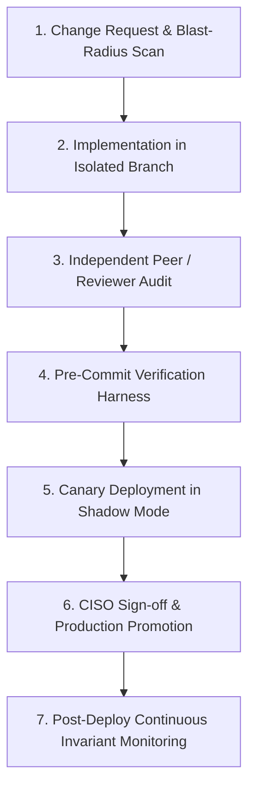

# DORA Article 17 Change Management & Operating Model
## Standard Change Control, RACI Governance, Component Rollback & Emergency Fast-Track

> **Regulatory Reference:** Regulation (EU) 2022/2554 (DORA) Article 17(1)–(2); Commission Delegated Regulation (EU) 2025/301; EU AI Act Article 17 (Quality Management System)  
> **Classification:** Pre-Production Operating Model & Change Governance Framework  
> **Epistemic Notice:** This procedure defines the operational change controls and rollback workflows evaluated under the stated model of our execution boundary architecture.

---

### 1. Governance Roles & RACI Matrix

To satisfy DORA Article 17 requirements for strict segregation of duties between authors, reviewers, approvers, and deployers, all changes to the AEIB codebase, policy manifests, cryptographic keys, or runtime configurations adhere to the RACI matrix below.

```
Roles:
• SEC-ENG:  Security Software Engineer (Author / Writer)
• REV-ENG:  Independent Reviewing Staff Engineer (Reviewer)
• CISO-DEL: CISO Delegate / Risk Officer (Approver)
• SRE-OPS:  Platform Operations / Site Reliability Engineer (Deployer)
• INC-CMD:  Incident Commander / Risk Lead (Overseer)
```

| Lifecycle Activity | SEC-ENG | REV-ENG | CISO-DEL | SRE-OPS | INC-CMD |
| :--- | :---: | :---: | :---: | :---: | :---: |
| **Change Request & Impact Assessment** | **R** | C | I | C | I |
| **Code / Policy Implementation** | **R** | I | I | I | I |
| **Independent Code & Diff Review** | I | **R / A** | I | I | I |
| **Local Verification Suite Execution** | **R** | **A** | I | I | I |
| **Pre-Deployment Security Authorization**| I | C | **A** | I | I |
| **Staging & Production Deployment** | I | I | I | **R / A** | I |
| **Rollback / Abort Execution** | C | C | C | **R** | **A** |
| **Emergency Fast-Track Approval** | C | C | **A (Quorum)**| **R** | **A (Quorum)**|

*(Legend: **R** = Responsible, **A** = Accountable, **C** = Consulted, **I** = Informed)*

---

### 2. Standard Change Workflow (7 Steps)



1. **Change Request (CR) & Impact Assessment:**  
   Every modification begins with a formal CR documenting the rationale, affected components, and blast-radius analysis (using AST symbol impact tools and execution flow mapping).
2. **Isolated Implementation:**  
   Implementation occurs in an isolated git branch/worktree (Writer session). Authors must preserve documentation integrity and adhere to the strict epistemic boundaries in [`AGENTS.md`](file:///Users/andriileukhin/Documents/SovereignNexus/AGENTS.md).
3. **Independent Dual-Session Review:**  
   A fresh context reviewer (Reviewer session) audits the diff and specification without access to the author's prior reasoning. The reviewer inspects edge cases, negative tests, and potential abstraction leaks.
4. **Mandatory Verification Harness:**  
   Before merge, the pipeline must pass with exit code `0`:
   * AST purity scanner (`compliance/ast_purity.py`) and zero-mock enforcer (`compliance/no_mock_enforcer.py`).
   * Zone boundary checker (`compliance/check_zone_boundary.py`).
   * Core industrial logic test matrix (32/32 tests).
   * 500-episode deterministic simulation benchmark (0 duplicate writes).
   * Standalone WebAssembly offline verifier (`tests/test_smaos_verify_wasm.js`).
5. **Canary Staging:**  
   Deployment to a shadow canary environment where live or replayed traffic runs through the execution boundary with zero mutations to upstream accounting ledgers.
6. **Formal Authorization:**  
   Sign-off from CISO Delegate confirming SBOM/CBOM freshness and policy epoch synchronization.
7. **Production Promotion & Monitoring:**  
   Canary promoted to active cluster; OpenTelemetry telemetry spans monitored for rate-of-change anomalies or `HALT_*` events.

---

### 3. Component Rollback & Abort Procedures

If a newly deployed component causes anomalous latches, performance degradation, or integrity warnings, operators execute component-specific rollback procedures:

#### 3.1 Kernel eBPF LSM Module Rollback
* **Trigger:** eBPF program verifier failure, unexpected latency $>5\text{ms}$ in syscall interception, or kernel error logs (`dmesg`).
* **Procedure:**
  1. Detach BPF link using `bpftool link detach id <link_id>`.
  2. Unpin policy maps from `/sys/fs/bpf/aeib/`.
  3. Revert traffic routing to the userspace host proxy fallback.
  4. Verify process execution continues unimpeded under standard userspace boundary controls.
  * *Target RTO:* $< 60\text{ seconds}$.

#### 3.2 Station 1 & 2 Gateway Controller Rollback
* **Trigger:** Increased rejection rate of valid dispatches, corrupted in-memory deques, or unhandled exceptions.
* **Procedure:**
  1. Signal gateway with `SIGTERM` to allow in-flight operations to complete their current write phase (`write_all_sync`).
  2. Switch systemd/system service symlink to the previous immutable release binary (`/opt/aeib/bin/previous`).
  3. Restart gateway service.
  4. Gateway automatically triggers `_verify_continuity_on_boot()`: scans existing `ledger.jsonl`, re-verifies Ed25519 signatures and CAID chain tips, and reconciles state from the last valid Merkle root.
  * *Target RTO:* $< 120\text{ seconds}$.

#### 3.3 WebAssembly Verifier (`smaos_verify.wasm`) Rollback
* **Trigger:** Verification false-positives or client-side parsing incompatibilities.
* **Procedure:**
  1. Invalidate client asset cache on edge CDN / web gateway.
  2. Restore previous pinned WASM release from immutable artifact repository.
  3. Verify restored WASM binary SHA-256 matches the release manifest.
  * *Target RTO:* $< 30\text{ seconds}$.

#### 3.4 Cryptographic Keys & Policy Epoch Rollback
* **Trigger:** Suspected key compromise or erroneous policy epoch deployment.
* **Procedure:**
  1. Increment `policy_epoch` in Station 1 gateway configuration.
  2. Broadcast signed `RevocationList` containing invalidated key thumbprints (`jkt`).
  3. Discard uncommitted cached delegation tokens; require root sponsor to re-issue warrants under the new epoch.
  * *Target RTO:* $< 180\text{ seconds}$.

---

### 4. Emergency Change Protocol (Fast-Track / Break-Glass)

An emergency change is permitted **strictly** to mitigate an active security incident (e.g., zero-day exploit) or resolve a critical service outage affecting ICT operational resilience.

1. **Quorum Authorization:**  
   Requires dual digital sign-off (2-of-3 quorum): CISO Delegate + Lead Security Engineer + Incident Commander.
2. **Scoped Hotfix:**  
   Hotfix commits must contain only the minimal corrective diff. No unrelated refactoring is permitted.
3. **Targeted Verification:**  
   At minimum, the AST purity scanner and specific regression tests for the affected component must pass before hotfix deployment.
4. **Post-Incident Retrospective:**  
   Within 24 hours of emergency deployment, the author and reviewer must complete a full standard change package (including threat model update, comprehensive tests, and formal audit review).
