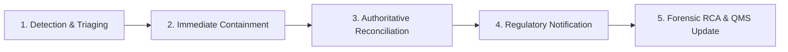

# DORA Article 17 & 19 Incident Management Runbook
## ICT Incident Classification, Emergency Containment, Regulatory Notification & Forensic Resolution

> **Regulatory Applicability:** Regulation (EU) 2022/2554 (DORA) Articles 17(2) and 19; Commission Delegated Regulation (EU) 2025/301 (RTS on Incident Classification); EU AI Act Article 12  
> **Classification:** Pre-Production Operational Security Runbook  
> **Epistemic Notice:** This runbook documents the detection criteria, incident escalation paths, and containment workflows evaluated under the stated model of our execution boundary architecture.

---

### 1. Incident Classification Criteria (DORA RTS 2025/301 Alignment)

Under DORA Commission Delegated Regulation (EU) 2025/301, ICT-related incidents must be systematically triaged based on affected clients, data integrity impact, economic consequence, and service availability.

```
┌─────────────────────────────────────────────────────────────────────────────────────────────────┐
│                                   INCIDENT SEVERITY MATRIX                                      │
├──────────┬─────────────────────────────┬────────────────────────────────┬───────────────────────┤
│ Severity │ Description                 │ AEIB Indicator / Trigger       │ Regulatory Notification│
├──────────┼─────────────────────────────┼────────────────────────────────┼───────────────────────┤
│ **SEV-1**│ **Major ICT Incident**      │ • HALT_CORRUPTED_LEDGER_CHAIN  │ • DORA Competent      │
│          │ Critical integrity breach,  │ • Divergence in SCITT root     │   Authority:          │
│          │ cryptographic key compromise│ • Double-mutation attempt      │   Initial: < 4 hours  │
│          │ or unmitigated financial    │ • Root sponsor key leak        │   Intermediate: < 72h │
│          │ impact > €10,000.           │ • Hypervisor / socket escape   │   Final: < 1 month    │
├──────────┼─────────────────────────────┼────────────────────────────────┼───────────────────────┤
│ **SEV-2**│ **Significant Incident**    │ • HALT_TOOL_RUG_PULL_HASH      │ • Internal Risk       │
│          │ Isolated tool poisoning,    │ • Ambiguity latch surge (>5%)  │   Committee: < 4 hours│
│          │ localized fail-closed halt, │ • Cross-model taint downgrade  │ • DORA notification   │
│          │ or single-node partition.   │ • Replayed DPoP token rejected │   if recurring.       │
├──────────┼─────────────────────────────┼────────────────────────────────┼───────────────────────┤
│ **SEV-3**│ **Minor Incident**          │ • Isolated HTTP 504 timeout    │ • Recorded in internal│
│          │ Normal operational friction,│ • Routine rate-limit rejection │   operational audit   │
│          │ transient socket drops.     │ • Subagent budget ceiling hit  │   log; weekly review. │
└──────────┴─────────────────────────────┴────────────────────────────────┴───────────────────────┘
```

---

### 2. Five-Phase Incident Response Lifecycle



#### Phase 1: Detection & Automated Triaging
* **Automated Signals:**
  * OpenTelemetry GenAI span event with `aeib.boundary.verdict == "REJECTED"` and status code `HALT_*`.
  * SCITT Transparency Service leaf mismatch or broken Merkle inclusion proof.
  * Systemd/Process watchdog alert triggered by unhandled panic or unexpected process termination.
* **Triage Protocol:**
  1. Incident Commander (INC-CMD) on duty assesses scope and affected ledger partitions.
  2. INC-CMD assigns initial severity rating (`SEV-1`, `SEV-2`, or `SEV-3`) based on economic exposure and cryptographic integrity indicators.

#### Phase 2: Immediate Containment & Isolation
* **Automated Circuit Breaker:**
  * If `HALT_*` is engaged, Station 1 enters fail-closed state automatically: all subsequent dispatches from the affected agent or workflow are denied.
* **Manual Emergency Containment Steps:**
  1. **Isolate Guest Agent MicroVM:**
     ```bash
     # Block guest socket immediately
     fuser -k /tmp/aeib-mcp.sock
     ```
  2. **Revoke Active Delegation Certificates:**
     * Issue an epoch increment or publish an Ed25519-signed revocation record for the affected `did:key`.
  3. **Freeze Host Proxy Outbound Egress:**
     * Engage host proxy circuit breaker to suppress any new outbound HTTP/API calls while preserving in-flight reconciliation probes.

#### Phase 3: Authoritative State Reconciliation
* For operations caught in `EFFECT_INDETERMINATE` during the incident:
  1. **Execute Out-of-Band Status Probe:**  
     Query downstream rail/acquirer status endpoints using the deterministic `rail_idempotency_key` (`aeib-idem-v1-...`).
  2. **Cryptographic State Transition:**  
     * If the downstream target confirms the transaction was processed: record `CONFIRMED` in ledger with target attestation.
     * If the downstream target confirms no mutation occurred: record `REFUTED` to release escrowed budget.
  3. **Asynchronous Compensation:**  
     If an inconsistent mutation occurred, dispatch compensating saga transactions to restore net-zero balance (`tests/test_saga_compensation.py`).

#### Phase 4: Regulatory Notification & External Disclosure
* **DORA Article 19 Major Incident Notification Flow:**
  * **Initial Notification (Within 4 hours of SEV-1 classification):** Inform the National Competent Authority (NCA) of the incident type, affected financial services, and initial containment actions taken.
  * **Intermediate Report (Within 72 hours):** Provide updated impact analysis, estimated financial and client exposure, root cause hypotheses, and remediation progress.
  * **Final Report (Within 1 month):** Submit comprehensive post-incident analysis including forensic evidence, cryptographic logs, and structural preventative measures.
* **Forensic Evidence Export:**
  * Export the verified auditor trajectory containing all signed receipts:
    ```bash
    python3 -c "from tests.test_tool_provenance_and_otel_interop import ToolProvenanceAndInteropGate; ..."
    ```

#### Phase 5: Root Cause Analysis (RCA) & QMS Remediation
* Within 5 business days, the engineering and security team must complete an RCA report addressing:
  1. Exact timeline of events with nanosecond-resolution SCITT log references.
  2. Direct cause, technical trigger, and systemic contributing factors.
  3. Effectiveness of automated fail-closed latches (`HALT_*`).
  4. Preventive regression test added to the test suite (e.g. new test vector in `tests/test_falsifiability_matrix.py`).
  5. Update to the Annex IV Technical Dossier and ISO 42001 / EN 18286 Quality Management System.
