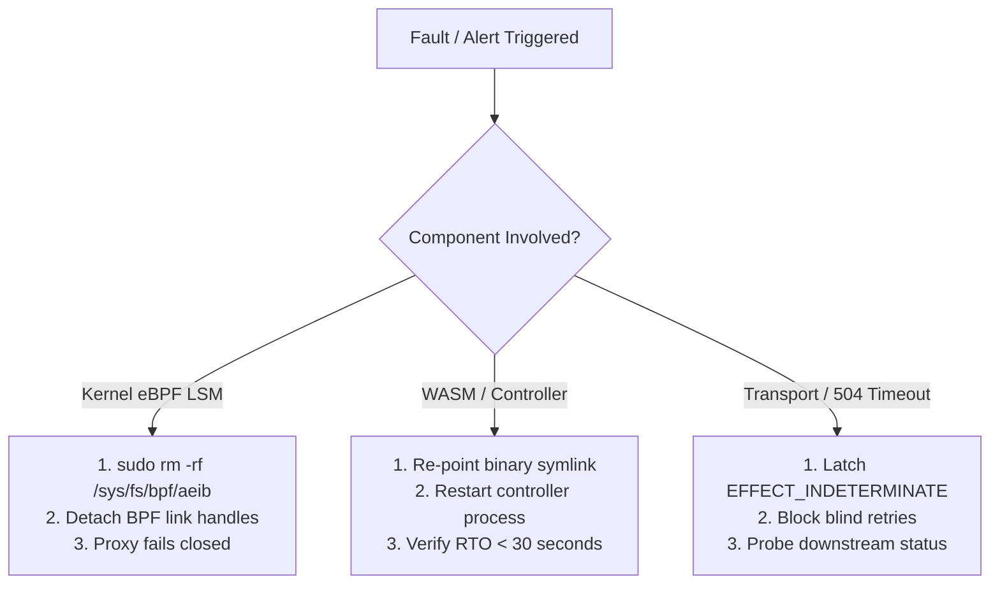

# DORA Article 17 Component Rollback, Abort & Incident Runbook
## Rapid Emergency Abort, Deterministic Artifact Rollback, and Indeterminate Mutation Triage

> **Regulatory Reference:** Regulation (EU) 2022/2554 (DORA) Article 11(2), Article 17(2), Article 19; Commission Delegated Regulation (EU) 2025/301  
> **Classification:** Pre-Production Operational Resilience & Incident Response Runbook  
> **Epistemic Notice:** This runbook documents the operational containment and rollback procedures evaluated under the stated model of our execution boundary architecture.

---

### 1. Component Abort & Rollback Procedures



#### A. Kernel eBPF LSM Program Abort
* **Trigger:** Kernel verifier regression, unexpected probe latency spike, or kernel deadlock.
* **Execution:**
  ```bash
  sudo rm -rf /sys/fs/bpf/aeib
  ```
* **System Reaction:**
  - Removing pinned links immediately un-hooks `aeib_socket_connect`, `aeib_bprm_check_security`, `aeib_file_mprotect`, and `aeib_mmap_file`.
  - The host egress proxy detects unpinned status and fails closed (dropping outbound traffic to unverified destinations until fallback container profiles are engaged).
* **Observed RTO:** $\le 5\text{ seconds}$.

#### B. WASM Verifier / Controller Rollback
* **Trigger:** Corrupted distribution binary, failing acceptance vectors, or schema regression.
* **Execution:**
  - Deployment controller re-points the `smaos_verify.wasm` symlink to the previous cryptographically signed release artifact recorded in `output/evidence-hashes.txt`.
  - Controller process re-reads the pinned WASM hash and verifies the SLSA provenance statement.
* **Target RTO:** $< 30\text{ seconds}$ (Observed local restoration $< 2\text{ seconds}$).

---

### 2. WAL & `EFFECT_INDETERMINATE` Incident Handling (DORA Art. 17(2))

When a downstream payment gateway or external API encounters transport failure (HTTP 504 Gateway Timeout, connection reset, or lost acknowledgment):

```
+-----------------------------------------------------------------------------------+
|               EFFECT_INDETERMINATE RECONCILIATION WORKFLOW                       |
+-----------------------------------------------------------------------------------+
| 1. DETECTION:   Transport returns HTTP 504 / drop -> State marked EFFECT_INDETERMINATE|
| 2. CONTAINMENT: Station 1 blocks blind retry for operation_id; tenant budget escrowed |
| 3. PROBING:     Reconciliation runner queries rail via deterministic Idempotency-Key |
| 4. SETTLEMENT:  Record CONFIRMED or REFUTED receipt with downstream signed evidence |
| 5. UN-LATCH:    Issue single-use SupervisorRecoveryWarrant to release remaining quota |
+-----------------------------------------------------------------------------------+
```

1. **Detection:**
   - Station 1 receives transport timeout or socket drop.
   - The operation transitions to `EFFECT_INDETERMINATE` in `ledger.jsonl`.
2. **Containment:**
   - Automatic: Station 1 blocks blind retries for the latched `operation_id`.
   - The reservation remains escrowed against the active spend window, preventing multi-attempt smurfing or double-spend.
3. **Resolution & Root-Cause Analysis:**
   - Platform operator or reconciliation worker executes an out-of-band status query using the deterministic rail idempotency key (`aeib-idem-v1-...`).
   - If downstream confirmed settlement: operator posts `CONFIRMED` disposition with downstream receipt evidence.
   - If downstream refuted/dropped: operator posts `REFUTED` disposition signed by the rail endpoint.
   - Root cause is logged in the operational incident ledger.
4. **Supervisory Un-Halt:**
   - If a halt condition was engaged, an authorized supervisor signs a single-use `SupervisorRecoveryWarrant` (RFC 8785 JCS, Ed25519) to restore standard processing.
