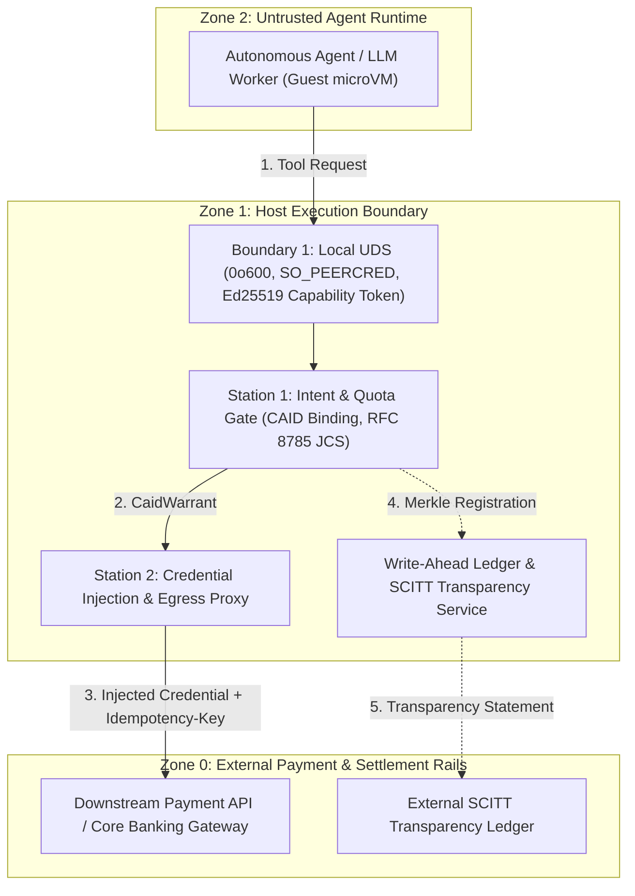

# AEIB Formal Threat Model & Explicit Non-Goals
## Pre-Production Operational Threat Specification under DORA Article 17 & EU AI Act

> **Regulatory Reference:** Regulation (EU) 2022/2554 (DORA) Article 9(4)(c) & Article 17; EU AI Act Article 15; NIST AI RMF 1.0 (Govern 1.2, Map 3.5, Measure 2.7)  
> **Classification:** Pre-Production Security Architecture & Boundary Threat Model  
> **Epistemic Notice:** Evaluated under the stated model of our execution boundary architecture. Controls are fail-closed mechanisms designed to reduce declared execution risks, subject to documented residual risks and non-goals.

---

### 1. Protected Assets

The AEIB architecture governs consequential actions initiated by autonomous reasoning agents. The system protects four primary assets:

| Asset ID | Protected Asset | Description | Primary Risk |
| :--- | :--- | :--- | :--- |
| **A-1** | **Root-Sponsor Financial Quota** | Monotonically attenuated financial spend ceilings authorized by human treasury sponsors. | Unauthorized spend escalation, smurfing, and multi-agent quota exhaustion. |
| **A-2** | **Downstream API Bearer Credentials** | Upstream payment gateway tokens, cloud IAM bearer keys, and bank API certificates. | Credential scraping from guest VM memory or LLM context exfiltration. |
| **A-3** | **Append-Only WAL & Checkpoint Continuity** | `ledger.jsonl`, Merkle roots, and SCITT transparency receipts recording every dispatched or latched mutation. | Historical state tampering, silent ledger truncate/rewind, or anchor divergence. |
| **A-4** | **Pinned TIER_1 Recipient Registry** | Canonical registry of verified IBANs, merchant DIDs, and payment destinations. | Homoglyph substitution, unauthorized payee injection, or destination spoofing. |

---

### 2. Trust Boundaries & Enforcement Mechanisms

* **Boundary 1 (Guest MicroVM $\leftrightarrow$ Host UDS):**
  - **Mechanism:** Unix Domain Socket with file mode `0o600`, peer credentials verification (`SO_PEERCRED` on Linux, `LOCAL_PEERCRED` on Darwin), PID reuse prevention, and RFC 8785 JCS Ed25519-signed capability token.
  - **Threats Mitigated:** TCP localhost interception, cross-user socket tampering, unauthenticated process injection, and confused deputy tool-scope escalation.

* **Boundary 2 (Station 1/2 $\leftrightarrow$ Host Egress Proxy):**
  - **Mechanism:** Short-lived cryptographic `CaidWarrant` signed by Station 1 over canonical action payload. Host proxy injects SigV4 / DPoP tokens only after Station 1 validation.
  - **Threats Mitigated:** Direct bearer token exposure to guest runtime; agent exfiltration of payment secrets.

* **Boundary 3 (Host Local State $\leftrightarrow$ External SCITT Anchor):**
  - **Mechanism:** RFC 9942 / RFC 9943 signed transparent statements anchoring the local Merkle tip to an external transparency ledger.
  - **Threats Mitigated:** Local administrator or host malware truncating `ledger.jsonl` to reset spend windows.

---

### 3. Explicit Non-Goals & Residual Risks

To maintain epistemic integrity across institutional procurement and compliance reviews, the following conditions are formally declared as **out-of-scope non-goals**:

1. **Compromised Host Kernel / Root Ring 0:**
   AEIB does not defend against a malicious root administrator or kernel-level rootkit on the host machine with direct physical memory (`/dev/mem`) access. Host platform integrity must be maintained by underlying OS hardening, secure boot, and hardware measured boot.

2. **Compromised Downstream Payment Rails:**
   AEIB does not prevent an allowlisted external banking rail from returning fraudulent settlement status if the external financial institution's internal systems are compromised. The boundary enforces that downstream status transitions are logically valid and monotonically reconciled; it detects contradictory external transitions (`CONFIRMED` followed by `REFUTED`) and halts.

3. **Sub-Symbolic Model Internals:**
   AEIB treats LLM neural network weights and reasoning scratchpads (Chain-of-Thought) as untrusted, non-authoritative inputs. AEIB does not attempt to sanitize internal model activations; authorization depends strictly on external, structured, and verifiable cryptographic assertions.
