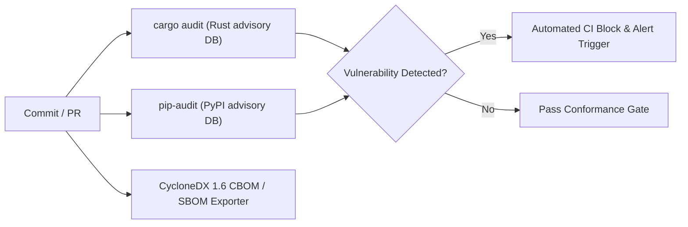

# Vulnerability & Dependency Management Policy
## Software Supply Chain Security, Vulnerability Triage SLAs, and Cryptographic Provenance

> **Regulatory Reference:** Regulation (EU) 2022/2554 (DORA) Article 9(4)(c) & Article 17; EU AI Act Article 17 (Quality Management System); NIST SP 800-218 (Secure Software Development Framework - SSDF)  
> **Classification:** Pre-Production Security Governance & Supply Chain Policy  
> **Epistemic Notice:** This policy defines the dependency vetting criteria, automated vulnerability scanning procedures, and remediation SLAs evaluated under the stated model of our execution boundary architecture.

---

### 1. Purpose & Scope

The AEIB architecture governs consequential actions initiated by autonomous AI agents. Compromise of an underlying dependency, compiler toolchain, or system crate directly undermines the boundary's ability to enforce exact action binding and credential isolation. 

This policy establishes strict supply chain controls across all code repositories, container images, Rust crates, Python packages, and WebAssembly artifacts.

---

### 2. Dependency Ingestion & Vetting Rules

In adherence to the supply chain directives defined in the project engineering standard, the addition of third-party dependencies is strictly governed:

1. **Standard Library Preference:** Python standard library (`sys`, `os`, `hashlib`, `struct`, `socket`, `pathlib`, `fcntl`) and standard Rust core/alloc primitives must be preferred over external packages.
2. **Pre-Ingestion Approval:** No new `pip` package or `cargo` crate may be introduced without written architectural justification and review.
3. **Lockfile Pinning:** All dependencies must be strictly pinned in `Cargo.lock` and dependency lock manifests with exact cryptographic digests. Unpinned or floating version ranges (`*`, `^`, `>=`) are rejected by pre-commit AST policy.
4. **Permissible Open Source Licensing:** Dependencies must possess permissive open source licenses (Apache-2.0, MIT, BSD-2/3-Clause). Viral copyleft (GPL-3.0, AGPL) or unvetted proprietary licenses are blocked from inclusion in core boundary crates.
5. **Zero Egress Mandate:** Third-party packages must not execute outbound telemetry, remote metrics beaconing, or unvetted network calls.

---

### 3. Automated Vulnerability Scanning Pipeline

The continuous integration pipeline incorporates automated scanning across each build and pull request:

* **Rust Crates:** Evaluated using `cargo audit` against the RustSec Advisory Database. Any advisory with a CVSS score $\ge 7.0$ (High/Critical) causes immediate build failure.
* **Python Environment:** Evaluated using `pip-audit` querying the Open Source Vulnerabilities (OSV) database and NIST National Vulnerability Database (NVD).
* **Static AST Purity:** Scanned via `compliance/ast_purity.py` and `compliance/no_mock_enforcer.py` to prevent dynamic code loading (`eval`, `exec`, `importlib`) or untracked binary dependencies.

---

### 4. Vulnerability Severity Classification & Triage SLAs

Vulnerabilities detected in code, dependencies, or infrastructure are classified using CVSS v3.1 / v4.0 scoring and prioritized according to the following Service Level Agreements (SLAs):

| Severity Level | CVSS Score Range | Contextual Impact on AEIB Boundary | Triage SLA | Remediation / Patch SLA |
| :--- | :---: | :--- | :---: | :---: |
| **CRITICAL** | **9.0 – 10.0** | Potential boundary bypass, credential exposure, remote code execution, or unauthenticated state forgery. | $\le \mathbf{4\text{ hours}}$ | $\le \mathbf{24\text{ hours}}$ |
| **HIGH** | **7.0 – 8.9** | Memory safety flaw in parsing logic, denial of service on intent latch, or hash collision risk. | $\le \mathbf{12\text{ hours}}$ | $\le \mathbf{72\text{ hours}}$ |
| **MEDIUM** | **4.0 – 6.9** | Theoretical timing side-channel, non-fatal resource leak, or localized logic inconsistency. | $\le \mathbf{48\text{ hours}}$ | $\le \mathbf{14\text{ days}}$ |
| **LOW** | **0.1 – 3.9** | Informational warning, cosmetic log sanitization, or low-impact code hygiene finding. | $\le \mathbf{5\text{ days}}$ | $\le \mathbf{30\text{ days}}$ |

#### Critical Vulnerability Fast-Track Workflow

When a CRITICAL vulnerability is identified:
1. **Immediate Circuit Breaker:** The Incident Commander activates the supervisory circuit breaker, setting active gates to fail-closed (`HALT_SUPERVISOR_CIRCUIT_BREAKER_TRIPPED`).
2. **Emergency Patch Isolation:** Fixes are authored in an isolated git worktree branch following the Emergency Fast-Track Protocol defined in `DORA_ART17_CHANGE_MANAGEMENT_AND_RACI.md`.
3. **Dual Review & Verification:** Requires unanimous authorization from two designated roles (CISO Delegate and Reviewing Staff Engineer).
4. **Post-Deployment Verification:** Regression tests, property fuzzers, and the 500-episode deterministic simulation suite must run clean before un-latching.

---

### 5. Bill of Materials (SBOM) & Cryptographic Bill of Materials (CBOM)

To satisfy DORA Article 17 and NIST SSDF standards for transparency, every release artifact publishes a verifiable machine-readable bill of materials:

* **Format:** CycloneDX Version 1.6 JSON (`evidence/cbom.json`).
* **Cryptographic Assets:** Catalogs all cryptographic primitives, algorithm identifiers, parameter lengths, and implementation levels:
  - Ed25519 (`alg: -8` / EdDSA)
  - SHA-256 (`alg: -16` / hash)
  - RFC 8785 Canonical JCS
  - RFC 9162 / RFC 9942 SCITT Merkle Inclusion Trees
  - Standards-tracking post-quantum candidate profiles (ML-DSA-65 / `alg: -49`)
* **Signature Binding:** The CBOM manifest is canonicalized via RFC 8785 and signed by the build system release Ed25519 key pair, enabling automated offline validation.

---

### 6. Coordinated Vulnerability Disclosure (CVD)

External security researchers and institutions observing potential defects or boundary flaws are requested to report findings through responsible disclosure channels:

1. **Reporting Channel:** Dedicated security inbox (`security@sovereignnexus.io`) with public PGP / Ed25519 verification keys.
2. **Initial Acknowledgment:** Receipt confirmed within 24 hours of submission.
3. **Remediation Window:** 90-day standard coordinated disclosure timeline, with accelerated timelines for actively exploited vulnerabilities.
4. **Public Advisory:** Release of remediation patches accompanied by a formal Security Advisory (`GHSA` / `CVE`) detailing affected versions, technical root cause, and mitigation guidance.
