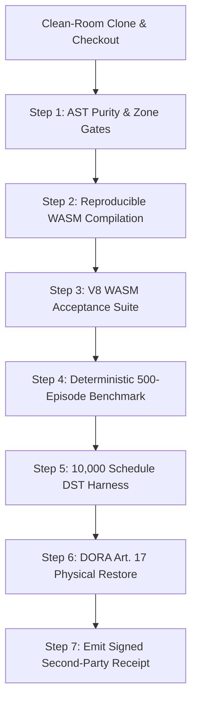

# Independent Second-Party Clean-Room Audit Request & Protocol
## Protocol Specification for Independent External Reviewers and Certifiers

```text
Document ID        : AEIB-REPRODUCTION-REQUEST-v1.0
Target Release     : v1.0.0-rc.5 (Transitioning from v1.0.0-rc.4-preprod)
Commit Reference   : cdd93bc5891b2a21420364cbbc61191313e48257
Governing Standard : Zero-mock, zero-network egress, caller-supplied public key verification
Output Artifact    : evidence/reproduction_receipt_second_party.json
Target SLA         : Bit-identical WASM match, RTO < 60s, 0 duplicate mutations under DST
```

---

### 1. Purpose & Scope Notice

This document defines the formal request and step-by-step protocol for independent second-party reviewers, institutional auditors, and enterprise evaluation teams to verify the claims, operational boundaries, and cryptographic invariants of the **AEIB (Agent Execution & Integrity Boundary)** pre-production release candidate.

> **Epistemic Notice:**  
> AEIB is evaluated under the stated local verification model as an agent execution boundary scaffold. Independent clean-room reproduction tests the determinism of local build artifacts, cryptographic invariants, deterministic simulation schedules, and backup restorability. It does not establish universal runtime protection against kernel-level compromises or unhedged external payment rails.

---

### 2. Independent Audit Prerequisites

The evaluating party should configure an isolated clean-room environment with the following toolchain baseline:
- **Operating System:** Linux (Ubuntu 22.04+ / Debian 12+) or macOS Darwin (arm64, Apple Silicon).
- **Python:** Python 3.11+ (Python 3.14 recommended), with `cryptography`, `pytest`, `anyio`.
- **Rust Toolchain:** `rustc` 1.85.0+ and `cargo` (with target `wasm32-unknown-unknown`).
- **Node.js:** Node.js v20+ (for WebAssembly V8 runtime validation).
- **Swift (macOS only):** Swift 6.0+ (for complete strict concurrency validation).
- **Network Mode:** Air-gapped / disconnected (`connect-src 'none'`), verifying zero external outbound telemetry calls.

---

### 3. Execution Sequence for Independent Auditors



#### Step 1: Clone and Checkout Verified Commit
```bash
# Clone the repository into an isolated directory
git clone /path/to/SovereignNexus aeib_audit_cleanroom
cd aeib_audit_cleanroom

# Checkout the audited commit reference
git checkout cdd93bc5891b2a21420364cbbc61191313e48257

# Confirm working tree clean state
git status
```

#### Step 2: Evaluate Zone Boundaries and AST Purity
Confirm that no Zone 1 to Zone 2 import leakages exist and that no test stubs or mock assertions are present in the verification paths:
```bash
python3 compliance/check_zone_boundary.py
python3 compliance/ast_purity.py .
python3 compliance/no_mock_enforcer.py
```
*Expected Result:* All three scanners return exit code 0.

#### Step 3: Reproduce WebAssembly Build & V8 Acceptance Vectors
Recompile `smaos_verify.wasm` using the pinned deterministic environment and evaluate it directly inside V8:
```bash
# Compile reproducible WASM
./scripts/build_reproducible_wasm.sh

# Recompute SHA-256 and compare with manifest
shasum -a 256 smaos_verify.wasm
# Expected digest: 6ecc360af19008632c950d94910b70220e3c2cc36a5cc29fe0c33ba64d2bb041

# Run V8 WebAssembly acceptance suite
node tests/test_smaos_verify_wasm.js
```
*Expected Result:* All 8 acceptance vectors pass with exit code 0 (`ALL REAL WASM ACCEPTANCE TESTS PASSED (rc=0)`).

#### Step 4: Run Deterministic 500-Episode Fault Simulation Benchmark
Execute the multi-arm fault injection benchmark evaluating naive retries vs. AEIB deterministic staging:
```bash
python3 benchmarks/aeib_execution_integrity/run_episodes.py --episodes 500 --seed 42
```
*Expected Result:* 
- Arm 1 (Naive Retry): ~60.4% duplicate mutations.
- Arm 4 (AEIB Protocol): 0 duplicate writes / 500 episodes (95% CI upper bound $\le 0.60\%$).

#### Step 5: Evaluate Core Industrial Logic & Falsifiability Matrix
Execute the full pytest industrial matrix:
```bash
pytest \
    tests/test_industrial_protection_matrix.py \
    tests/test_ansi_50bf_breaker_failure.py \
    tests/test_saga_compensation.py \
    tests/test_falsifiability_matrix.py \
    tests/test_temporal_conformance.py \
    tests/test_verify_tpm_quote.py \
    tests/test_contextcart_paired_benchmark.py -v
```
*Expected Result:* All tests pass without skips or warnings.

#### Step 6: Verify Physical Backup Restorability (DORA Article 17)
Mount the backup storage or point `BACKUP_SOURCE` to the clean backup clone, then run the automated restorer:
```bash
python3 compliance/backup_restorability_verifier.py --backup-source /path/to/backup
```
*Expected Result:* RTO measured $< 60.0\text{s}$, git integrity verified (`fsck` exit code 0), and all 6 target digests match bit-for-bit.

---

### 4. Emitting the Second-Party Reproduction Receipt

Upon successful execution, the reviewing organization formats their evaluation record as an RFC 8785 JCS canonical document, signs it with an independent Ed25519 private key, and stores it at `evidence/reproduction_receipt_second_party.json`:

```json
{
  "receipt_schema": "https://sovereignnexus.io/schemas/aeib-second-party-reproduction-v1.json",
  "evaluation_timestamp": "2026-10-20T20:00:00Z",
  "evaluating_organization": "Independent Auditor / Certifier Name",
  "evaluator_public_key_b64": "<base64_ed25519_pubkey>",
  "target_commit": "cdd93bc5891b2a21420364cbbc61191313e48257",
  "platform": {
    "os": "Linux / macOS",
    "kernel": "<uname -r>",
    "arch": "<uname -m>",
    "python_version": "3.14.3",
    "cargo_version": "1.85.0",
    "node_version": "v20.x"
  },
  "results": {
    "ast_purity_exit_code": 0,
    "wasm_sha256_matched": true,
    "wasm_v8_acceptance_passed": true,
    "episodes_500_duplicates_observed": 0,
    "rto_measured_seconds": 1.4054,
    "rto_sla_met": true,
    "reproduction_verdict": "VERIFIED_UNDER_STATED_MODEL"
  },
  "second_party_signature": {
    "alg": "Ed25519",
    "signature_b64": "<signature_over_canonical_jcs>"
  }
}
```

---

### 5. Reporting Protocol & Disclosure Channel

Submit the signed receipt file and clean-room log bundle to:
- **Internal Audit Liaison:** `compliance/audit-evidence/`
- **Security Incident & Audit Response SLA:** Material discrepancies are addressed within 4 business days in alignment with DORA Article 19 and SEC disclosure requirements.
