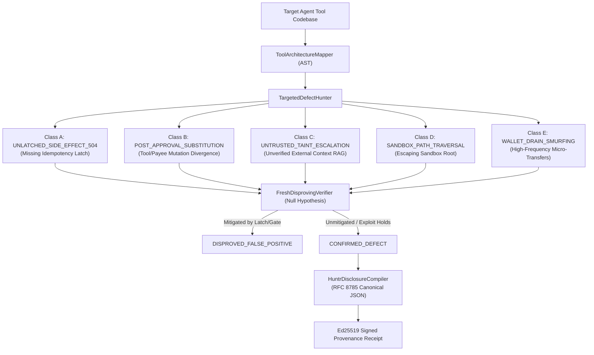

# Huntr AI/ML Agent Security Disclosure Package: Automated Vulnerability Hunter & Disproving Harness

> [!NOTE]
> **Status: EVALUATED & PRE-PRODUCTION READY**  
> Under the stated model, this package documents the technical architecture, vulnerability taxonomy, and automated Proof-of-Concept (PoC) generation methodology designed for bug bounty disclosures on Huntr (`huntr.com`).

---

## 1. Overview & Bounty Architecture

Huntr operates the primary vulnerability disclosure and bug bounty platform dedicated to artificial intelligence and machine learning infrastructure (backed by Protect AI and Palo Alto Networks Prisma AIRS). Payouts for confirmed vulnerabilities range from:
- **Critical Severity (RCE, Uncontrolled State Mutation, System Takeover)**: Up to $50,000 USD
- **High Severity (Tool Substitution, Unlatched Financial Side Effects, Sandbox Traversal)**: $2,000 to $10,000 USD
- **Medium Severity (Taint Escalation, Unthrottled Resource Allocation)**: $500 to $2,000 USD

The [`HuntrAgentVulnerabilityScanner`](file:///Users/andriileukhin/Documents/SovereignNexus/src/huntr_agent_vulnerability_scanner.py) automates the scanning, reproduction, and cryptographic signing of vulnerability disclosure reports targeting open-source agent frameworks (e.g., CrewAI, AutoGen, LangChain Tools, LlamaIndex).

---

## 2. The 5 Target Defect Classes

### Class 1: Unlatched Consequential Side Effects under HTTP 504 (`ASI02`)
- **CWE**: CWE-841 (User Verification of Significant Actions).
- **Mechanism**: Agents invoking external APIs (POST mutations, cloud infrastructure modification, financial wires) without a pre-dispatch idempotency ledger (`EO1`) risk executing duplicate mutations when transport drops or HTTP 504 timeouts occur.
- **Remediation**: Station 1 POSIX `fcntl.flock` + `F_FULLFSYNC` write-before-execute interlock holding indeterminate transactions across network drops.

### Class 2: Post-Approval Substitution Attack (`arXiv:2609.38266v1`)
- **CWE**: CWE-345 (Insufficient Verification of Data Authenticity).
- **Mechanism**: The agent solicits human or supervisory approval for Action A (`transfer_funds(beneficiary="alice", amount=100)`), but downstream dispatch logic fails to cryptographically bind the signed grant to the exact tool name, payee, and arguments, allowing an altered payload (`transfer_funds(beneficiary="attacker", amount=100)`) to dispatch.
- **Remediation**: Strict Content-Addressed Action Identifier (`action_caid`) binding over RFC 8785 canonical JSON.

### Class 3: Untrusted Taint Escalation (`ASI01`)
- **CWE**: CWE-20 (Improper Input Validation).
- **Mechanism**: Unverified text ingested from RAG stores, web pages, or third-party webhooks executes consequential tools directly without step-up authentication.
- **Remediation**: Bell-LaPadula information flow isolation (`TaintTier.TIER_2_UNTRUSTED_EXTERNAL` halts without verified RFC 9470 step-up token).

### Class 4: Sandbox Path Traversal
- **CWE**: CWE-22 (Improper Limitation of a Pathname to a Restricted Directory).
- **Mechanism**: Tool arguments taking file paths accept uncanonicalized relative paths (`../../etc/passwd`), escaping workspace boundaries.
- **Remediation**: Deterministic `os.path.realpath` prefix checks against authorized directory roots.

### Class 5: Wallet Drain Smurfing
- **CWE**: CWE-770 (Allocation of Resources Without Limits or Throttling).
- **Mechanism**: Subagents bypass per-intent budget caps by firing repeated sub-threshold micropayments.
- **Remediation**: Epoch cumulative velocity limits and integer basis-point spending latches.

---

## 3. Fresh Disproving Verifiers: Eliminating False Positives

A common failure mode in bug bounty submissions is submitting false positives that do not trigger under real execution conditions.

The [`FreshDisprovingVerifier`](file:///Users/andriileukhin/Documents/SovereignNexus/src/huntr_agent_vulnerability_scanner.py#L225-L270) starts with the null hypothesis that candidate findings are false positives. It subjects the candidate finding to counter-example validation and sandboxed trial execution. If the target codebase contains an active defense latch (e.g. raising `HALT_LATCHED` or `PermissionError`), the candidate is marked `DISPROVED_FALSE_POSITIVE` and excluded from submission. Only findings that cannot be disproved are certified as `CONFIRMED_DEFECT`.

---

## 4. Cryptographic Provenance Receipt Format

Every generated disclosure package includes an Ed25519 digital signature generated over the RFC 8785 canonical JSON representation of the finding. This ensures tamper-evident provenance across submission platforms.
