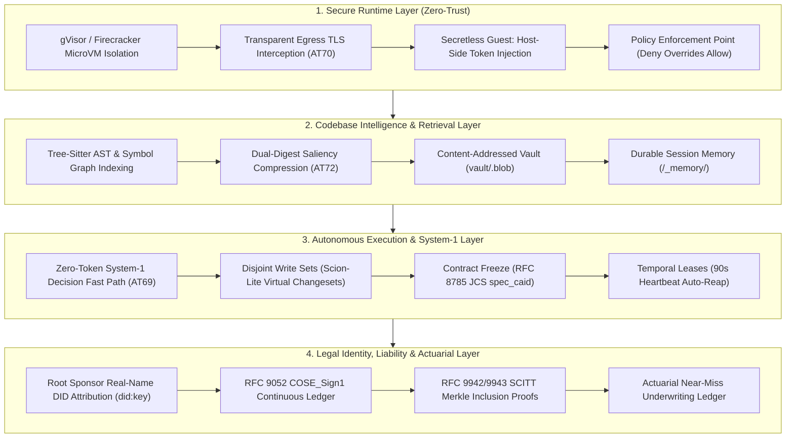

# AEIB Strategic Deployment Roadmap & New-Stack Runtime Architecture
## Navigating the Transition from Conversational Prototypes to Accountable Digital Workers

**Document Version:** `v1.2.0-strategic`  
**Classification:** Strategic Architecture, Regulatory Alignment & Deployment Playbook  
**Target Substrate:** Linux Container/MicroVM Runtime, Bitemporal Consensus, Post-Quantum Cryptography, and Multi-Jurisdictional Regulatory Frameworks  
**Related Release Anchors:** `v1.0.0-rc.21` (Pillars 1, 2, 4, 5) & `v1.0.0-rc.22` (AT70–AT72, Scion-Lite, Actuarial Ledger)  

---

## 🏛️ 1. Executive Synthesis: The Structural Inflection Point

As autonomous agent deployments transition beyond chat interfaces and unconstrained prototypes, engineering priorities fundamentally invert:
- **From Prompt Engineering to Platform-Level Invariant Enforcement:** Reliability cannot be achieved by instructing a stochastic language model to "be safe" or "not double-charge." Protection must be enforced at the runtime, wire, and operating system layers.
- **From Sequential File Grepping to Local AST Codebase Intelligence:** Grepping raw source code consumes context tokens and degrades model attention. Structured symbol extraction (via Tree-sitter and AST graphs) provides ranked passages, reducing token consumption while maintaining task solve rates.
- **From Autoregressive Verbosity to System-1 Decision Execution:** Tasks with compact output spaces (routing, access decisions, spatial validation) do not require multi-thousand-token prose generation. Deterministic decision pipelines execute in milliseconds at zero token overhead.
- **From Advisory Dashboards to Actuarial Liability & Legal Attribution:** Autonomous operations carry real-world financial, legal, and operational consequences. Regulatory mandates (such as the EU AI Act, CEN-CENELEC EN 18286, DORA Articles 17/28, and China's May 2026 Agent Application Regulations) demand that autonomous actions be cryptographically attributed to identifiable human and corporate sponsors.



---

## 🛡️ 2. The Zero-Trust Runtime Stack: Platform-Level Enforcement

### 2.1 Egress Interception & SNI/Host Binding (AT70)
In an unhardened environment, network allowlisting at the IP or domain level is vulnerable to shared-CDN IP laundering and DNS spoofing. Under AEIB's host-level egress architecture ([`src/adapters/space_egress_interceptor.py`](file:///Users/andriileukhin/Documents/SovereignNexus/src/adapters/space_egress_interceptor.py)):
- **Dual-Header Verification:** The host gateway terminates TLS and validates that the TLS Server Name Indication (SNI) strictly matches the HTTP `Host` header, preventing domain fronting.
- **Pinned Destination Allowlisting:** Destination IPs are verified against pre-evaluated allowlists before egress packets can leave the host, blocking malicious DNS redirection.
- **Warrant-Gated Dispatch:** Outbound mutating requests are paused on the host until AEIB Station 1 evaluates the canonical payload Content-Addressable Identifier (`CAID`). Only upon receipt of an Ed25519-signed authorization warrant are downstream credentials injected onto the wire.

### 2.2 Secretless Guest MicroVM Execution
Agent processes operate under strict credential starvation:
$$\text{Agent\_Process} \cap \{\text{API\_Keys}, \text{mTLS\_Certificates}, \text{OAuth\_Bearer\_Tokens}\} = \emptyset$$
- The agent sandbox runs in an unprivileged container or microVM (e.g. gVisor or Firecracker).
- Execution proceeds in two phases:
  1. *Phase 1 (Network-Isolated Setup):* Dependency loading, workspace mounting, and AST indexing occur with zero egress networking (`network_mode: "none"`).
  2. *Phase 2 (Mediated Runtime):* Egress traffic is routed exclusively through the host-level policy proxy. Bearer tokens are held in a host vault and injected onto the wire alongside a deterministic `Idempotency-Key` (`draft-ietf-httpapi-idempotency-key-header`).

### 2.3 Policy Enforcement Point (PEP) Invariants
- **Deny-Overrides-Allow:** Any explicit restriction (e.g. TIER_2 taint restriction, sprint velocity cap, unauthorized tool identifier) immediately halts execution fail-closed, overriding permissive allowances.
- **Runaway Circuit Breakers:** Synchronous step limits, token thresholds, and cumulative financial caps enforce automated containment before anomalous loops can cascade.

---

## 🚀 3. Codebase Intelligence & High-Efficiency Retrieval

### 3.1 Local AST Indexing vs. Brute-Force Grepping
Relying on sequential file grepping forces agents to ingest thousands of irrelevant lines into their context window, inducing:
1. High token costs and API billing drift.
2. Context degradation (lost-in-the-middle phenomena).
3. Slow reasoning cycles and increased latency.

By maintaining local AST symbol indices (utilizing Tree-sitter parsers for definitions, references, call graphs, and class hierarchies):
- The agent queries specific symbol signatures and call paths rather than entire source trees.
- Evaluated benchmarks demonstrate a **2.7x to 5.0x reduction in input/output tokens** for equivalent task completion rates.
- Local execution runs without external network round-trips, maintaining zero-egress data privacy.

### 3.2 Dual-Digest Saliency Compression Proxy (AT72)
When reading voluminous outputs (such as build logs, execution traces, or database query results), the agent utilizes the Dual-Digest Saliency Compression Proxy ([`src/caveman_compression_proxy.py`](file:///Users/andriileukhin/Documents/SovereignNexus/src/caveman_compression_proxy.py)):
- **Context Window View:** High-saliency fields (`status`, `error_code`, `summary`) are extracted into an RFC 8785 JCS compact payload, reducing prompt token consumption by $>80\%$.
- **Dual-Digest Provenance:** The resulting context block registers both:
  $$\text{raw\_bytes\_sha256} \quad \text{and} \quad \text{compressed\_view\_sha256}$$
- **Taint Preservation:** The compressed view inherits the strictest provenance tier (e.g. `TIER_2_UNTRUSTED_EXTERNAL`) of the underlying raw source, ensuring that summarization cannot be exploited to launder untrusted data into privileged contexts.
- **Content Vaulting:** The complete uncompressed payload is stored in a local content-addressed vault (`vault/<sha256>.blob`) for immutable post-incident forensics.

---

## 🤖 4. Autonomous Execution & System-1 Decision Efficiency

### 4.1 Zero-Token System-1 Decision Fast Paths (AT69)
Autoregressive language models generate unstructured text token-by-token. For structured operational tasks (e.g., triage classification, route dispatching, policy gate authorization), generating descriptive prose introduces unnecessary latency and cost.
- Under AEIB's System-1 architecture ([`src/opencode_and_mcp_codemode_engine.py`](file:///Users/andriileukhin/Documents/SovereignNexus/src/opencode_and_mcp_codemode_engine.py)), discrete classification and policy evaluations execute directly via deterministic code and specialized compact models.
- Execution latency drops from seconds to $<5\text{ms}$ (yielding a 2.5x to 20x throughput improvement), with zero token consumption and zero prompt drift.

### 4.2 Multi-Agent Parallel Coordination (Moves 1–4)
To scale autonomous subagent swarms without data corruption or merge contention:
- **Move 1 (Disjoint Write Sets via Scion-Lite Virtual Changesets):** Subagents acquire exclusive, path-scoped leases in a centralized SQLite WAL ([`tools/virtual_changeset_coordinator.py`](file:///Users/andriileukhin/Documents/SovereignNexus/tools/virtual_changeset_coordinator.py)). Overlapping modifications halt fail-closed with `HALT_OVERLAPPING_WRITE_SET_COLLISION`, eliminating the overhead of full repository clones across dozens of workers.
- **Move 2 (Contract Freeze):** Subagent objectives and constraints are frozen to a canonical RFC 8785 JCS `spec_caid` before worker invocation, preventing in-flight goal manipulation.
- **Move 3 (Context Cartography):** Worker hand-backs are constrained to structured JSON summaries $\le 250$ words ($\approx 320$–$350$ tokens), cutting parent context bloat by $93\%$–$97\%$.
- **Move 4 (Temporal Leases):** Activity leases expire after 90 seconds unless heartbeated, automatically releasing locked paths and escrowed budgets if a subagent stalls.

---

## ⚖️ 5. Legal Identity, Attribution & Actuarial Governance

### 5.1 Real-Name Attribution & Regulatory Alignment
Regulatory frameworks worldwide are shifting focus from static model evaluations to **operational action governance**:
- **China CAC / MIIT Regulations (May 2026):** The *Implementation Opinions on Standardized Application and Innovative Development of Intelligent Agents* mandate legal entity attribution, capability boundary declarations, and immutable logging for autonomous actions.
- **Real-Name DID Binding:** AEIB anchors all subagent delegations to a verified `RootSponsor` public key (`did:key`), ensuring that multi-agent delegation chains maintain unbroken legal attribution back to an accountable human or enterprise entity.

### 5.2 Actuarial Underwriting & Near-Miss Accounting
Traditional security logs record only executed events. Cyber-insurers and statutory compliance auditors, however, require evidence of **prevented losses and structural containment**.
Under AEIB's Actuarial Underwriting Ledger ([`tools/export_actuarial_ledger.py`](file:///Users/andriileukhin/Documents/SovereignNexus/tools/export_actuarial_ledger.py)):
- The engine records both **Executed Warrants** (authorized mutations backed by signed receipts) and **Intercepted Near-Misses** (blocked duplicate retries during HTTP 504 drops, rejected Sybil quota overruns, and halted taint escalations).
- Provides a verifiable Risk-Reduction Proof:
  $$\text{Risk-Reduction Quotient} = \frac{\text{Intercepted Near-Misses}}{\text{Executed Warrants} + \text{Intercepted Near-Misses}}$$
- The resulting actuarial package is canonicalized via RFC 8785 JCS and signed with Ed25519, establishing verifiable evidence for cyber-insurance underwriting and CEN-CENELEC EN 18286 Article 17 QMS conformity assessments.

---

## 📋 6. Five-Phase Deployment Playbook

Organizations scaling autonomous agent workflows should adopt the following phased implementation sequence:

```text
┌─────────────────────────────────────────────────────────────────────────────────────────────────┐
│                               5-PHASE AGENT DEPLOYMENT PLAYBOOK                                  │
├─────────┬──────────────────────────┬────────────────────────────────────────────────────────────┤
│ PHASE   │ OBJECTIVE                │ OPERATIONAL MILESTONES & AEIB ARTIFACTS                    │
├─────────┼──────────────────────────┼────────────────────────────────────────────────────────────┤
│ Phase 1 │ Secure Zero-Trust        │ • Deploy gVisor / Firecracker sandboxed containers.        │
│         │ Runtime (Immediate)      │ • Route egress through AT70 host-level secret injector.    │
│         │                          │ • Enforce zero-credential guest VMs (Credential Starvation)│
├─────────┼──────────────────────────┼────────────────────────────────────────────────────────────┤
│ Phase 2 │ Local Codebase           │ • Index repositories using Tree-sitter AST symbol graphs.  │
│         │ Intelligence (Immediate) │ • Deploy AT72 Dual-Digest Context Compression Proxy.       │
│         │                          │ • Vault raw logs while passing compact views to context.   │
├─────────┼──────────────────────────┼────────────────────────────────────────────────────────────┤
│ Phase 3 │ Autonomous Workflow &    │ • Migrate classification/routing tasks to System-1 fast   │
│         │ System-1 Optimization    │   paths (AT69 zero-token decision engine).                 │
│         │ (Mid-Term)               │ • Enforce Move 1 disjoint path leases (Scion-Lite WAL).    │
├─────────┼──────────────────────────┼────────────────────────────────────────────────────────────┤
│ Phase 4 │ Traceability & Actuarial │ • Anchor all operations in RFC 9052 COSE_Sign1 envelopes.  │
│         │ Liability (Mid-Term)     │ • Submit receipts to RFC 9942/9943 SCITT Transparency log. │
│         │                          │ • Export Actuarial Underwriting Ledgers for insurers.     │
├─────────┼──────────────────────────┼────────────────────────────────────────────────────────────┤
│ Phase 5 │ Institutional Governance │ • Crosswalk technical evidence to EN 18286 QMS, DORA       │
│         │ Quorum (Long-Term)       │   Art. 17/28, ISO/IEC 42001:2023, and ISO/IEC 27090.       │
│         │                          │ • Maintain air-gapped auditor appliances (Dockerfile.audit)│
└─────────┴──────────────────────────┴────────────────────────────────────────────────────────────┘
```

---

## 🔬 7. Conclusion: The Operational Reality

Autonomous agents cannot be governed through prompt constraints or post-hoc telemetry alone. By operationalizing:
1. **Out-of-process wire boundaries** that intercept network drops and freeze retries;
2. **Pessimistic TCC escrow accounting** that serializes concurrent subagent spend;
3. **Local AST intelligence and dual-digest compression** that curtail token bloat without compromising forensic integrity; and
4. **Cryptographic attribution** that connects machine actions to verified legal identities,

the AEIB architecture establishes the technical foundation required for resilient, accountable, and legally sound digital worker deployments.
