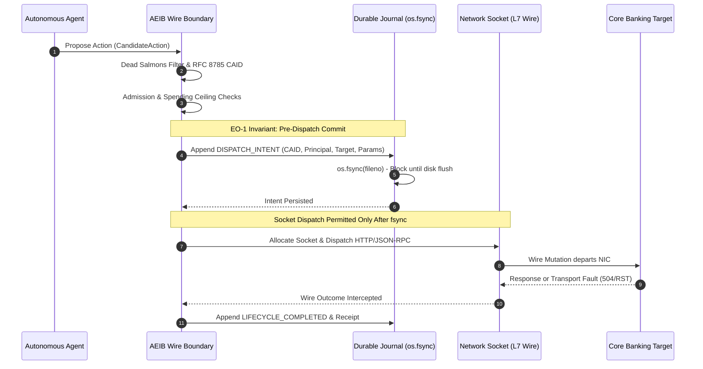

# Milestone 1: EO-1 Write-Before-Socket & Monotonic Delegation Attenuation

**Track:** Track B (`v1.1` Backlog)  
**Status:** Evaluated Prototype under the Stated Model  
**Module Alignment:** `v1.1-roadmap/tier1_durable_executor.py`, `v1.1-roadmap/delegation_chain_verifier.py`, `v1.1-roadmap/governed_financial_action_boundary.py`  
**Epistemic Notice (`AGENTS.md` §1):** Operates under the stated model. No claims of universal distributed 2PC rollback. Persistence uses asynchronous queues and atomic fsync write-ahead logs providing crash recovery.

---

## 1. Architectural Motivation & Threat Model

In autonomous agent operations, two critical failure modes routinely cause financial and operational losses:
1. **The Mid-Syscall Ghost Write (Crash Point 3):** An agent process issues an external mutating network socket call (`send()`). The packet leaves the host network interface card (NIC), but the agent container terminates (OOM kill, host kernel panic, power loss) before logging the dispatch. The mutation settles downstream on the core banking ledger, leaving zero audit evidence locally.
2. **Privilege Escalation in Multi-Agent Swarms:** An orchestrator agent decomposes a task and delegates execution to sub-agents. Without strict cryptographic attenuation, a compromised sub-agent can elevate its spend ceiling or broaden its tool scope beyond the parent's authorized boundaries (Confused Deputy / OWASP ASI03).

---

## 2. Technical Specification

### 2.1 EO-1 (Evidence-Before-Effect) Invariant

The `EO-1` invariant requires that an immutable, signed record of dispatch intent be committed to durable storage *prior* to socket allocation or wire transmission.

#### Invariant Contract:
* Under the stated model, no byte of an external mutating payload may cross the network boundary until `DurableDispatchJournal.append()` executes `file.flush()` and `os.fsync(fileno)`.
* If a host crashes immediately after `os.fsync()`, the crash recovery daemon identifies the unclosed intent upon startup and initiates an authenticated out-of-band status query to reconcile state without blind retries.

---

### 2.2 Monotonic Delegation Attenuation Contract

Multi-hop delegation chains follow UCAN / Macaroon / Google DeepMind DCT (Delegation Capability Token) principles:

$$\text{Hop}_0 (\text{Root Sponsor}) \longrightarrow \text{Hop}_1 (\text{Planner}) \longrightarrow \text{Hop}_2 (\text{Worker Agent})$$

#### Attenuation Invariants:
1. **Scope Attenuation:** Permitted scopes form a monotonic subset:
   $$\text{Scopes}_{N} \subseteq \text{Scopes}_{N-1} \subseteq \dots \subseteq \text{Scopes}_0$$
2. **Budget Attenuation:** Maximum spend ceiling decreases monotonically:
   $$\text{MaxSpend}_{N} \le \text{MaxSpend}_{N-1} \le \dots \le \text{MaxSpend}_0$$
3. **Temporal Monotonicity:** Expiration timestamp cannot exceed parent expiration:
   $$\text{ValidUntil}_{N} \le \text{ValidUntil}_{N-1} \le \dots \le \text{ValidUntil}_0$$
4. **Cryptographic Continuity:** Each hop is signed by the delegator's Ed25519 key, and delegator of hop $N$ must match the delegatee of hop $N-1$:
   $$\text{Delegator}_N == \text{Delegatee}_{N-1}$$
5. **Audience Pinning:** Every hop strictly pins the target service URI (`audience`).

---

## 3. Test & Verification Coverage

| Test Vector | Module | Invariant Evaluated |
|---|---|---|
| `test_eo1_intent_persisted_before_socket_write` | `tests/test_tier1_durable_delivery_contract.py` | Asserts intent file exists with valid CAID before socket mock/real write. |
| `test_crash_recovery_resynchronization` | `tests/test_governed_financial_action_boundary.py` | Simulates crash post-intent; recovery resolves dangling intent via status probe. |
| `test_delegation_scope_expansion_rejected` | `tests/test_tier2_delegation_and_profile.py` | Rejects child hop claiming scopes absent from parent delegation. |
| `test_delegation_budget_inflation_rejected` | `tests/test_tier2_delegation_and_profile.py` | Rejects child hop attempting to increase financial spend limit. |
