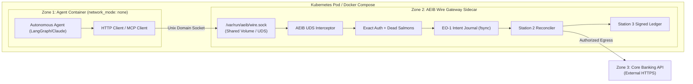

# Milestone 3: Sandbox Integration Topologies (Option 2 & Option 3)

**Track:** Track B (`v1.1` Backlog)  
**Status:** Architecture Specification & Deployment Manifests  
**Deployment Artefacts:** `deploy/sandbox/docker-compose.sidecar.yml`, `deploy/sandbox/firecracker_tap_setup.sh`, `deploy/sandbox/gvisor_runsc_spec.json`  
**Epistemic Notice (`AGENTS.md` §1):** Sandboxing provides process containment and host interface reduction; it does not replace cryptographic authorization or post-dispatch settlement.

---

## 1. Topological Allocation: Containment vs. Wire Governance

A sandboxing technology (Docker, gVisor, Firecracker, LiteBox) and an execution boundary (AEIB) have distinct operational responsibilities:
* **The Sandbox (Zone 1):** Prevents the agent from executing unauthorized local system calls, reading host secrets, or tampering with container storage.
* **The AEIB Boundary (Zone 2):** Prevents the agent from executing duplicate financial mutations, leaking credentials to third parties, or bypassing audit record generation.

---

## 2. Option 2: Out-of-Process Sidecar Proxy Topology (Docker / gVisor)

In Option 2, the agent container runs in complete network isolation (`network_mode: none` or isolated bridge), communicating with external APIs strictly via a shared Unix Domain Socket (`UDS`) or dedicated loopback interface bound to the AEIB sidecar container.



### Key Security Properties:
1. **Zero Ambient Network Egress:** The agent container has no default gateway and no DNS resolver. It cannot establish direct TCP/UDP connections to internal microservices or the internet.
2. **Socket Hijack Defense:** If the agent process is compromised via prompt injection, any payload it sends across `/var/run/aeib/wire.sock` is subject to RFC 8785 canonicalization, schema verification, and spending ceiling checks before reaching the bank.

---

## 3. Option 3: Hypervisor Edge Topology (AWS Firecracker MicroVM)

In Option 3, the agent executes inside an isolated hardware-virtualized KVM microVM (Firecracker). Network traffic leaves the microVM via a virtual TAP device (`tap0`) on the host.

```text
┌────────────────────────────────────────────────────────────────────────┐
│               FIRECRACKER MICROVM (GUEST OS - KVM ISOLATION)          │
│   • Linux kernel running agent code with root filesystem overlay      │
│   • Guest eth0 (192.168.100.2/24) -> default route via 192.168.100.1 │
└───────────────────────────────────┬────────────────────────────────────┘
                                    │ VirtIO-Net / Virtual TAP
                                    ▼
┌────────────────────────────────────────────────────────────────────────┐
│                        HOST TAP INTERFACE (tap0)                       │
│   • nftables / iptables prerouting redirection rule:                   │
│     table inet aeib_filter {                                           │
│       chain prerouting {                                               │
│         type nat hook prerouting priority dstnat;                      │
│         iif "tap0" tcp dport {80, 443} redirect to :8765;              │
│         iif "tap0" drop;                                               │
│       }                                                                │
│     }                                                                  │
└───────────────────────────────────┬────────────────────────────────────┘
                                    │ Redirected to Local Port 8765
                                    ▼
┌────────────────────────────────────────────────────────────────────────┐
│                 HOST AEIB PROXY LISTENER (0.0.0.0:8765)                │
│   • Inbound TLS termination using internal ephemeral CA                │
│   • Enforces 7 P0 core controls before upstream forwarding             │
└────────────────────────────────────────────────────────────────────────┘
```

---

## 4. Production Deployment Artefacts

* `deploy/sandbox/docker-compose.sidecar.yml`: Complete multi-container definition running isolated agent and AEIB gateway.
* `deploy/sandbox/firecracker_tap_setup.sh`: Shell setup script creating TAP interface, IP routing, and fail-closed nftables rules.
