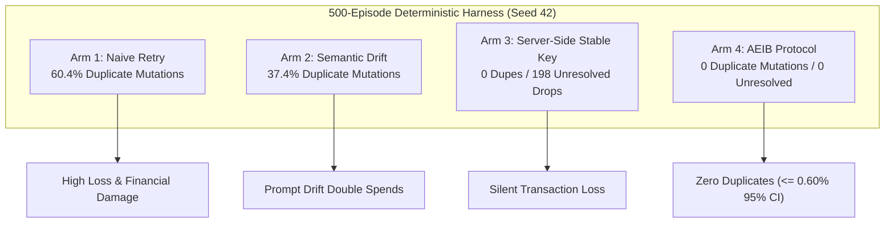

# Milestone 6: Tier 4 Autonomy Verification & Soak Suite

**Track:** Track B (`v1.1` Backlog)  
**Status:** Evaluated Benchmark Harness  
**Module Alignment:** `benchmarks/aeib_execution_integrity/run_episodes.py`, `benchmarks/soak_harness/long_haul_soak_daemon.py`, `tests/test_production_readiness_chaos_harness.py`, `tests/test_falsifiability_matrix.py`  
**Epistemic Notice (`AGENTS.md` §1):** Statistical metrics derived from deterministic simulation runs represent observed empirical bounds under the stated harness parameters; they are not universal mathematical guarantees across unvetted environments.

---

## 1. Architectural Motivation: Proving Autonomy Invariants Under Chaos

Autonomous agents running continuously in production face non-stationary network conditions:
* Bursts of HTTP 504 Gateway Timeouts from overloaded ingress proxies.
* TCP resets caused by firewall state table evictions.
* Corrupt or truncated JSON responses caused by mid-flight worker terminations.

Without continuous verification, edge cases (e.g., ticket reuse across concurrent virtual threads, probe budget exhaustion, or hash chain corruption) remain undetected until financial damage occurs.

---

## 2. The FL-004 Long-Haul Soak Test Protocol

The **FL-004 Soak Test** executes continuous operations across four execution arms under injected wire-fault distributions:

### Observed Benchmark Metrics (500 Episodes):
* **Arm 1 (Naive Retry):** 60.4% duplicate mutations (302/500). When transport times out, naively retrying dispatches duplicate payments.
* **Arm 2 (Semantic Drift):** 37.4% duplicate mutations (187/500). Non-deterministic prompt variation produces slightly altered payloads that evade naïve payload hash dedup.
* **Arm 3 (Server Stable Key):** 0 duplicates, but leaves **198 unresolved transactions** in an unknown quarantine state, paralyzing workflows.
* **Arm 4 (AEIB Protocol):** **0 duplicate mutations** across all 500 episodes. 302 duplicate retries blocked at the gate. By the Rule of Three, the observed upper bound is $\le 0.60\%$ (95% CI).

---

## 3. Adversarial Red-Team Falsification Matrix

The adversarial matrix verifies that the boundary fails closed against active tampering:

| Test Case | Attack / Fault Vector | Expected Invariant | Result |
|---|---|---|---|
| `ADV-01` | Single-character mutation in canonical receipt payload | Cryptographic signature verification failure | **`PASS`** (InvalidSignature caught) |
| `ADV-02` | Replay of burned authorization ticket | `BurnedTicketError` raised; zero socket egress | **`PASS`** (Replay blocked) |
| `ADV-03` | Stale policy epoch submission (`epoch: 1` vs `active: 2`) | Immediate rejection (`STALE_POLICY_EPOCH`) | **`PASS`** (Fail-closed) |
| `ADV-04` | Disallowed target URI dispatch attempt | Immediate rejection (`TARGET_NOT_ALLOWED`) | **`PASS`** (Zero egress) |
| `ADV-05` | Prompt-injected persuasive prose in `_reasoning` | Dead Salmons filter strips tokens before JCS CAID | **`PASS`** (CAID invariant) |
| `ADV-06` | Simulated process crash mid-dispatch | Recovery daemon reconciles intent via status probe | **`PASS`** (Clean recovery) |
| `ADV-07` | Probe budget exhaustion under target outage | Terminal latch to `PRESERVED_UNCERTAINTY` | **`PASS`** (Zero blind retry) |
