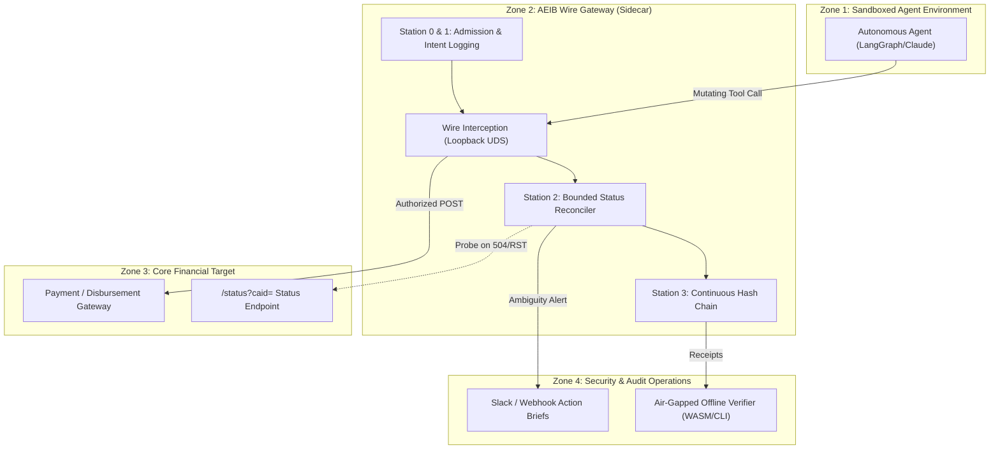

# Milestone 7: Production Deployment & EU Compliance Evidence Architecture

**Track:** Track B (`v1.1` Backlog)  
**Status:** Architecture Specification & Production Pilot Kit  
**Module Alignment:** `docs/compliance/EU_COMPLIANCE_EVIDENCE_PACK.md`, `docs/TPRM_BUYER_SECURITY_AND_COMPLIANCE_PACK.md`, `deploy/sandbox/docker-compose.sidecar.yml`  
**Epistemic Notice (`AGENTS.md` §1):** AEIB generates technical audit evidence; it does not by itself confer legal compliance. Compliance determinations remain the statutory responsibility of the deploying financial entity or AI provider.

---

## 1. Production Deployment Kit: The 30–60 Day Observe-Only Pilot

For enterprise financial institutions (Tier 1 banks, payment processors, treasury operations) evaluating autonomous agents, AEIB delivers a **30-to-60 Day Observe-Only Pilot Architecture**:

### Pilot Operational Phases:
1. **Days 1–14 (Shadow / Observe Mode):**
   * Boundary is deployed as an out-of-process sidecar proxy.
   * Intercepts all mutating agent calls, computes RFC 8785 CAIDs, records `EO-1` intent, and emits receipts without blocking traffic.
   * Establishes baseline latency, error distribution, and normal transaction volume.
2. **Days 15–30 (Enforced Invariant Gate):**
   * Enables strict spending ceilings, target allowlists, and single-use ticket burning.
   * Dead Salmons filter strips reasoning tokens before wire canonicalization.
   * Injects controlled fault testing (504 timeouts, connection resets) to verify `EFFECT_INDETERMINATE` latching.
3. **Days 31–60 (Audit Pack & Regulatory Synthesis):**
   * Generates full cryptographic audit pack: `claims.json`, `transport.jsonl`, in-toto SLSA L3 provenance, and DORA Article 17 incident dossier.
   * Internal risk committee reviews offline verification proofs using `smaos-verify.wasm`.

---

## 2. EU Regulatory Proof Alignment Matrix

Grounded in the 2025/2026 European standardization requests and RTS/ITS mandates:

| Regulatory Body / Standard | Mandatory Statutory Control | AEIB Technical Verification Evidence |
|---|---|---|
| **EU AI Act Art. 12** (Record-Keeping) | Automatic event logging across lifecycle; traceability of outputs. | Append-only RFC 8785 JCS + Ed25519 `ContinuityReceipt` hash chains verified offline across Java 21 and Python 3. |
| **EU AI Act Art. 14** (Human Oversight) | Stop/override automation; prevent runaway action loops. | RFC 9470 Step-Up challenges, dual-control single-use `HumanResolutionAuthority` tickets, and fail-closed hold states. |
| **EU AI Act Art. 15** (Cybersecurity / Robustness) | Technical robustness against wire faults, adversarial prompt injection. | Dead Salmons filter strips reasoning; `EFFECT_INDETERMINATE` latch blocks blind retry storms on 504 timeouts. |
| **CEN/CLC `prEN 18282`** (AI Cybersecurity) | Pre-execution parameter validation, tool surface constraints. | `Station0AdmissionGate` and `TypedOwaspPreDispatchGate` enforce parameter bounds, schema hashes, and URI allowlists. |
| **CEN/CLC `prEN 17926`** (Privacy / GDPR Art. 17) | Data minimization and PII scrubbing in audit trails. | `TraceScrubber` sanitizes IBAN/PAN/PII; salted commitment trees allow selective disclosure without leaking plaintext. |
| **DORA Art. 17 & RTS 2024/1772** (Major Incident Reporting) | Incident classification criteria and timeline reconstruction within 4h. | Automated incident timeline export detailing pre-dispatch intent, wire dropout, status probe, and final disposition. |
| **DORA Art. 28 & ITS 2024/2956** (Third-Party Registers) | Information register of third-party ICT service providers. | Generates candidate xBRL-CSV registers mapping to EBA DPM 4.0 data points (`RT.01.01`–`RT.01.03`). |
| **ISO/IEC 42006 (Clause 9)** (Audit Reconstructability) | Reconstructable evidence sufficient for independent re-execution. | Zero-egress offline verifier (`ReceiptVerifier` / `smaos-verify.wasm`) operates with zero network dependencies. |
